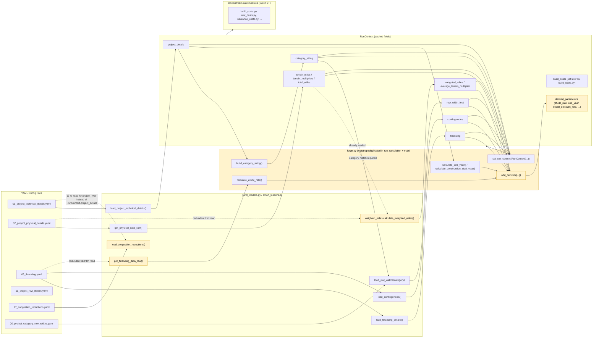
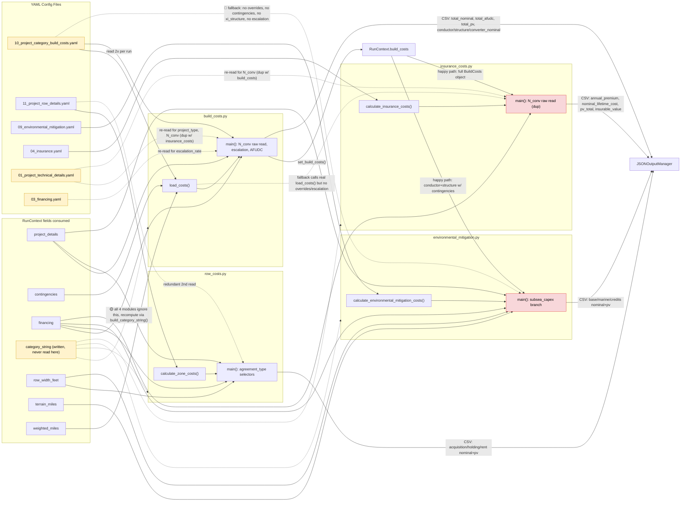
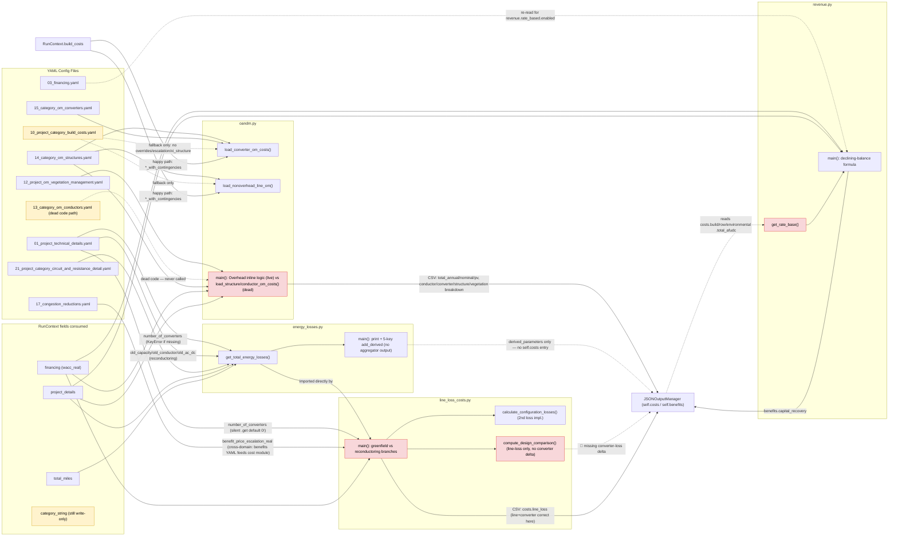
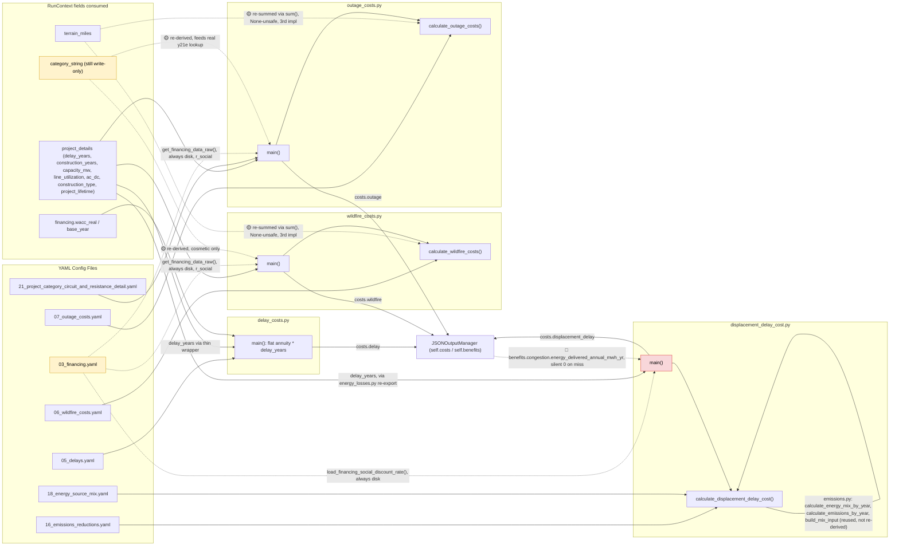
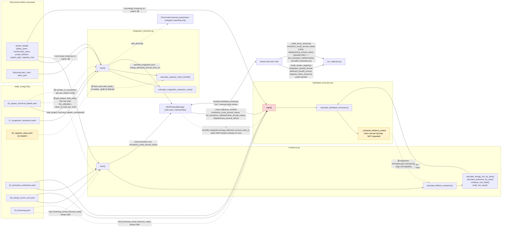
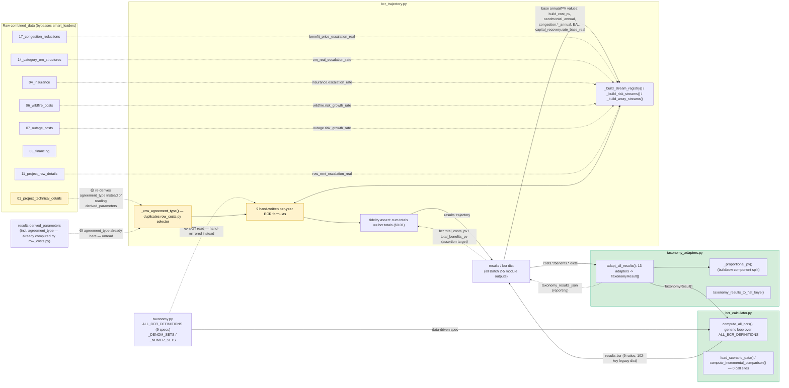

# FORGE Data-Flow Integrity Audit

**Date:** 2026-09-24
**Purpose:** Map every calc module's inputs/outputs, flag re-derivation violations, fragile couplings, and legitimate direct reads.

## Classification Key

- 🔴 **Active bug** — re-derivation produces a different (wrong) result today
- 🟡 **Fragile coupling** — results match today but will silently diverge if the upstream module changes
- 🟢 **Legitimate direct read** — module reads its own dedicated YAML inputs, not recomputing another module's output

---

## Batch 1: Foundation Layer

*(forge.py orchestrator, RunContext, yaml_loaders, smart_loaders, weighted_miles, financial_utils, calculation_utils)*

### forge.py

**YAML reads:** None directly — all YAML access is delegated to `yaml_loaders`/`smart_loaders` functions. `forge.py` writes YAML only in `run_calculation()` (dumps `combined_data` dict to a temp dir, then points `YAMLS_DIR` at it via `_set_yamls_dir`).

**RunContext interaction:** `forge.py` is the sole writer of `RunContext` (`set_run_context()` in both `run_calculation()` and `main()`) and the sole owner of its lifecycle (`clear_run_context()`). Bootstrap sequence (identical logic duplicated in both entry points):
1. `load_project_technical_details()` → `_project_details`
2. `load_financing_details()` → `_financing`
3. `load_contingencies()` → `_contingencies`
4. `get_physical_data_raw()` → `_physical_raw` → `_terrain_miles`, `_terrain_multipliers`, `_total_miles` (computed inline via `sum(...)`)
5. `build_category_string(project_details=_project_details)` → `_category_string`
6. `load_row_widths(_category_string)` → `_row_width_feet`
7. `calculate_weighted_miles()` → `_weighted_miles`, `_avg_terrain_mult`
8. `calculate_afudc_rate(get_financing_data_raw())` → `_afudc_rate`, `_afudc_source`
9. `calculate_cod_year(...)`, `calculate_construction_start_year(...)` → `_cod_year`, `_construction_start_year`
10. `set_run_context(RunContext(...))` with the 9 core fields
11. `get_financing_data_raw()` called **again** just to pull `financial.social_discount_rate`
12. `add_derived({...})` — copies category_string, row_width_feet, weighted_miles, average_terrain_multiplier, total_miles, terrain_miles, terrain_multipliers, wacc_real, wacc_nominal, inflation_rate, social_discount_rate, afudc_rate, afudc_source, cod_year, construction_start_year, contingencies into `RunContext.derived_parameters` (for JSON output only — not consumed by calc modules).

**Output contract:** Populates `RunContext` (consumed by every calc module in the pipeline) and `derived_parameters` (surfaced verbatim in the final JSON `results["derived_parameters"]`). Runs the ordered module list from `_build_scripts_list()`, each via `mod.main()`, writing into the shared `JSONOutputManager` (`get_output_manager()`). After the loop: hoists trajectory arrays (`_hoist_trajectory_arrays`), computes taxonomy adaptation + BCR (`adapt_all_results`, `compute_all_bcrs`), and assembles `csv_equivalent`/`summary_override`.

**Findings:**
- 🟡 **Two independent bootstrap implementations.** `run_calculation()` and `main()` each hand-roll the same ~30-line RunContext population block (steps 1–12 above) with separately-suffixed local variables (e.g. `_afudc_rate` vs `_afudc_rate_cli`). There is no shared `bootstrap_run_context()` helper. Any future change to the bootstrap sequence (e.g., adding a new derived parameter, fixing a load order bug) must be applied twice by hand or the two entry points silently diverge.
- 🟡 **Redundant re-reads of `03_financing.yaml` during bootstrap.** Within a single bootstrap call, financing YAML is opened from disk 4 separate times: `load_financing_details()`, `load_contingencies()`, `get_financing_data_raw()` (for AFUDC), and `get_financing_data_raw()` again (for `social_discount_rate`) — all before `RunContext` exists, so none of them can short-circuit via `get_run_context()`. Same file, same result today, but 4x the I/O for data that could be loaded once and passed around.
- 🟡 **Redundant re-reads of `02_project_physical_details.yaml`.** `get_physical_data_raw()` (step 4) and `calculate_weighted_miles()` (step 7) both open this file independently — `calculate_weighted_miles()` checks `get_run_context()` first but it's still `None` at that point in the bootstrap, so it falls through to its own `yaml.safe_load`.
- 🟡 **`forge.py` reimplements `load_physical_details()`'s total-miles logic.** `forge.py` computes `_total_miles = sum(v for v in _terrain_miles.values() if v is not None)` inline (step 4), which duplicates the exact "sum terrain miles, treat `None` as 0" logic already implemented in `yaml_loaders.load_physical_details()` (`sum(v if v is not None else 0 for v in terrain_miles.values())`). Two independent implementations of the same aggregation — currently equivalent, but a fix to the None-handling in one won't propagate to the other.
- 🔴 **CLI path (`main()`) never computes the BCR trajectory; API path (`run_calculation()`) does.** `run_calculation()` explicitly calls `scripts.calc.bcr_trajectory.compute_trajectory(results, combined_data)` and injects `results["trajectory"]` (lines ~429–430). `main()`'s output path goes through `write_final_json_output()`, which has no equivalent call — `bcr_trajectory` is never imported or invoked anywhere in `main()`. **Effect:** JSON output from the CLI (`forge_results_<scenario_id>.json`, used for saved scenario runs) is missing the `trajectory` key that API/in-process callers receive. This is a real behavioral divergence between the two orchestrator entry points, not just a style inconsistency.
- 🟡 **`derived_parameters` duplicates fields already in `RunContext`.** `category_string`, `row_width_feet`, `weighted_miles`, `average_terrain_multiplier`, `total_miles`, `terrain_miles`, `terrain_multipliers`, and `contingencies` are stored as first-class `RunContext` fields *and* copied byte-for-byte into `derived_parameters` via `add_derived()`. Two sources of truth for the same values in memory for the duration of a run — low risk since one is written from the other, but a future edit to a `RunContext` field without a matching `add_derived()` update (or vice versa) would silently desync the JSON-reported value from the internally-used value.
- 🟡 **`main()`'s `clear_run_context()`/`clear_output_manager()` calls are manually duplicated three times** (success-try, success-except, and the `successful_runs == 0` else-branch) rather than wrapped in `try/finally` as `run_calculation()` does. Functionally equivalent today (all three paths call both clear functions), but a future added branch could forget to clear, leaking `RunContext` into the next CLI invocation in the same process.

---

### run_context.py

**YAML reads:** None — this module has no I/O; it's a pure in-memory cache holder.

**RunContext interaction:** Defines the `RunContext` dataclass and its module-level singleton accessors. Fields cached: `project_details`, `terrain_miles`, `terrain_multipliers`, `total_miles`, `financing`, `contingencies`, `category_string`, `row_width_feet`, `weighted_miles`, `average_terrain_multiplier`, `build_costs` (optional, set later via `set_build_costs()`), `derived_parameters` (dict, mutated via `add_derived()`). Also owns the separate `_current_output_manager` singleton (`set_output_manager`/`get_output_manager`/`clear_output_manager`).

**Output contract:** `get_run_context()` → `Optional[RunContext]`, read by every `yaml_loaders`/`smart_loaders`/`weighted_miles` function that has a cache-check branch. `set_build_costs()` lets `build_costs.py` (batch 2) publish its result onto the shared context for downstream modules (e.g. `row_costs.py`) to consume without recomputation — a legitimate cross-module caching path, to be verified in Batch 2.

**Findings:**
- 🟡 **No cached field for `afudc_rate`, `afudc_source`, `cod_year`, `construction_start_year`, or `social_discount_rate`.** These are computed once in `forge.py`'s bootstrap and stored *only* in `derived_parameters` (an untyped dict, reporting-only by convention) — not as typed `RunContext` fields with a getter. Any calc module that needs `cod_year` or `afudc_rate` cannot read it off `RunContext`; it must recompute via `calculate_cod_year()`/`load_afudc_setup()` itself (see `financial_utils.py` findings below). Since the recomputation is a pure function of already-cached inputs (`project_details.delay_years`/`construction_years`, `financing` raw YAML), results match today, but this is the same shape of risk as the "derived_parameters duplicates RunContext" finding — it just goes the other direction (some derived values live *only* in the untyped reporting dict, not in the typed context).
- 🟢 `set_build_costs()`/`RunContext.build_costs` is the one intentional "modules write back to RunContext mid-pipeline" mechanism — legitimate design for expensive, order-dependent cross-module sharing (build costs computed once, consumed by several later modules). Full consumption pattern to be verified in Batch 2/3.

---

### yaml_loaders.py

**YAML reads:** Direct `open()` + `yaml.safe_load()` against `YAMLS_DIR` for: `01_project_technical_details.yaml` (×2 functions: `load_project_technical_details`, `load_congestion_reductions`), `02_project_physical_details.yaml` (×3: `load_physical_details`, `load_physical_details_detailed`, and indirectly via terrain access), `03_financing.yaml` (×4: `load_financing_details`, `load_contingencies`, `load_financing_social_discount_rate`, `load_afudc_config`), `04_insurance.yaml` (`load_insurance_details`), `05_delays.yaml` (`load_delay_costs`), `06_wildfire_costs.yaml` (`load_wildfire_costs`), `07_outage_costs.yaml` (`load_outage_costs`), `09_environmental_mitigation.yaml` (`load_environmental_mitigation`), `11_project_row_details.yaml` (`load_row_details`), `16_emissions_reductions.yaml` (`load_emissions_details`), `17_congestion_reductions.yaml` (`load_congestion_reductions`), `18_energy_source_mix.yaml` (`load_grid_mix`), `19_cost_timing_patterns.yaml` (`load_cost_timing_patterns`), `20_project_category_row_widths.yaml` (`load_row_widths`), `21_project_category_circuit_and_resistance_detail.yaml` (`load_circuit_and_resistance_details`), `22_corona_losses.yaml` (`load_corona_kw_per_mile`).

**RunContext interaction:** Only **3 of 17** loader functions check `get_run_context()` first: `load_financing_details()` (→ `ctx.financing`), `load_project_technical_details()` (→ `ctx.project_details`), `load_physical_details()` (→ `ctx.total_miles`), `load_row_widths(category)` (→ `ctx.row_width_feet`, but **only if** `category == ctx.category_string` — falls through to disk otherwise), and `load_contingencies()` (→ `ctx.contingencies`). The remaining 12 loaders (`load_physical_details_detailed`, `load_delay_costs`, `load_grid_mix`, `load_emissions_details`, `load_congestion_reductions`, `load_financing_social_discount_rate`, `load_environmental_mitigation`, `load_cost_timing_patterns`, `load_afudc_config`, `load_insurance_details`, `load_wildfire_costs`, `load_outage_costs`, `load_circuit_and_resistance_details`, `load_corona_kw_per_mile`) **always** hit disk regardless of `RunContext` state — none of this data is cached in `RunContext` at all, so this is by design, not an oversight (these are single-consumer, dedicated-YAML reads — see Findings).

**Output contract:** Typed dataclasses (`ProjectTechnicalDetails`, `FinancingDetails`, `CongestionParams`, `PhysicalDetailsDetailed`, `CircuitAndResistanceDetails`) or raw dicts, consumed by calc modules in later batches.

**Findings:**
- 🟢 The 12 loaders with no `RunContext` branch are each read by exactly one or two dedicated downstream calc modules (insurance → `insurance_costs.py`, wildfire → `wildfire_costs.py`, etc., to be confirmed in later batches) and are not part of the shared bootstrap set `forge.py` populates — legitimate direct reads, not violations.
- 🟡 **`load_row_widths()`'s cache check is category-scoped and silently falls through.** `if ctx is not None and category == ctx.category_string: return ctx.row_width_feet` — if a calc module calls `load_row_widths()` with a category string that doesn't exactly match `RunContext.category_string` (e.g. a differently-normalized string, or a category computed for a different scenario branch within the same run), it silently re-reads `20_project_category_row_widths.yaml` from disk instead of raising or logging. Currently safe because `category_string` is derived once per run from the same `project_details`, but any downstream code that reconstructs the category string independently (rather than reading `ctx.category_string`) risks a silent cache miss.
- 🟡 **`load_congestion_reductions()` re-reads `01_project_technical_details.yaml` from disk** to get `project_type` (for the greenfield-vs-incremental branch), even though `RunContext.project_details.project_type` already holds this value. No `get_run_context()` check at all in this function.
- 🟢 `load_afudc_config()` and `load_financing_social_discount_rate()` both re-read `03_financing.yaml` independently of `load_financing_details()`/`load_contingencies()`'s cache-aware reads — reasonable given they pull different sub-keys (`afudc` config, `social_discount_rate`) not represented in the `FinancingDetails` dataclass or `RunContext.financing`, but note that **`FinancingDetails` itself doesn't carry `contingencies`, `afudc`, or `social_discount_rate`** — those three sub-sections of `03_financing.yaml` are cached/exposed via entirely separate paths (`RunContext.contingencies`, `derived_parameters["afudc_rate"]`, `derived_parameters["social_discount_rate"]`) rather than being fields on `FinancingDetails`. This fragmentation is why `03_financing.yaml` gets opened 4+ times per run instead of once.

---

### smart_loaders.py

**YAML reads:** `01_project_technical_details.yaml` (`get_project_data_raw`), `03_financing.yaml` (`get_financing_data_raw`), `02_project_physical_details.yaml` (`get_physical_data_raw`). Also re-exports all of `yaml_loaders` via `from scripts.io.yaml_loaders import *`.

**RunContext interaction:** Despite the module name "smart_loaders" implying cache-aware wrappers, **only `load_terrain_miles()` checks `get_run_context()`** (→ `ctx.terrain_miles`). `get_project_data_raw()`, `get_financing_data_raw()`, and `get_physical_data_raw()` — the three "raw" accessors that `forge.py`'s bootstrap and `financial_utils.load_afudc_setup()` both depend on — have **zero** `RunContext` awareness and always hit disk.

**Output contract:** Raw untyped dicts (`{"project": ..., "timeline": ...}`, full financing dict, full physical-details dict), used by `forge.py`'s bootstrap and by `financial_utils.load_afudc_setup()` (which calls `get_financing_data_raw()` a *second* time, independent of `forge.py`'s own calls).

**Findings:**
- 🔴/🟡 **`get_financing_data_raw()` is called from at least two independent places per run — `forge.py`'s bootstrap (twice: AFUDC calc + social_discount_rate) and `financial_utils.load_afudc_setup()` (called by downstream calc modules, e.g. build_costs — to verify in Batch 2) — none of which check `RunContext`.** This means the financing YAML is parsed from disk on every single call site that needs raw financing data, even after `RunContext` is fully populated for the run. Today this is a 🟡 (same file, same result, just wasteful I/O), but it becomes a 🔴 risk vector: if `RunContext.financing` (a `FinancingDetails` dataclass) and a fresh `get_financing_data_raw()` disk read were ever to disagree — e.g. mid-run config hot-reload, or a future caller passing an already-mutated `financing_yaml` dict into `calculate_afudc_rate()` — nothing in the codebase would catch the divergence, because `get_financing_data_raw()` has no cache-check to short-circuit against.
- 🟡 **Misleading module name.** "smart_loaders" implies the caching/dedup layer, but the actual `RunContext`-aware caching lives in `yaml_loaders.py` (3 of 17 functions) and here only in `load_terrain_miles()`. The three `get_*_raw()` functions that most call sites actually use (`get_financing_data_raw`, `get_physical_data_raw`, `get_project_data_raw`) are the least "smart" functions in the file.
- 🟢 `get_project_data_raw()` appears unused within the Batch 1 file set (not called by `forge.py`, `yaml_loaders.py`, or `financial_utils.py`) — likely consumed by a calc or web-app module in a later batch; flagged here only as a name-to-verify.

---

### weighted_miles.py

**YAML reads:** `02_project_physical_details.yaml`, but only on cache miss (`get_run_context()` returns `None`).

**RunContext interaction:** Checks `get_run_context()` first; returns `(ctx.weighted_miles, ctx.average_terrain_multiplier)` if set. Falls back to its own independent `yaml.safe_load` + terrain-weighted-sum loop otherwise. This is the "first module in the pipeline" per `_PRELOAD_MODULES`/`_build_scripts_list()`, but by the time `main()`/`mod.main()` runs it inside the script loop, `RunContext` is already populated by `forge.py`'s bootstrap (which itself calls `calculate_weighted_miles()` directly, step 7) — so `weighted_miles.main()` running later in the loop is a guaranteed cache hit, just re-printing the already-computed values via `print()`.

**Output contract:** `(weighted_miles: float, average_terrain_multiplier: float)` tuple. `main()` only prints these — doesn't add them to the output aggregator, so `weighted_miles.py`'s presence in the script list is effectively a no-op once `RunContext` is populated (its only visible effect at that point is stdout, suppressed in `quiet` mode).

**Findings:**
- 🟢 The cache-check-then-fallback pattern here is correctly implemented and is the model the other loaders should follow more consistently.
- 🟡 **`weighted_miles.py`'s independent fallback logic duplicates the weighting math that lives nowhere else** — if `RunContext` isn't set (standalone/subprocess mode), this is the only place `weighted_miles = Σ(terrain_miles[t] × terrain_multipliers[t])` is computed. `forge.py`'s bootstrap calls this exact function (not a separate implementation), so there's no drift risk today — but it means the "first module in the pipeline" (`weighted_miles.main()`, invoked via the script loop) does zero work when run as part of the full pipeline; it's already stale by design once `forge.py`'s bootstrap runs. Worth confirming this is intentional (a documented "always warm" module) rather than a leftover from a pre-`RunContext` era.

---

### financial_utils.py

**YAML reads:** None directly — pulls raw YAML dicts via injected parameters (`financing_yaml: Dict`) or via `smart_loaders` imports inside `load_afudc_setup()` (`load_cost_timing_patterns()`, `load_afudc_config()`, `get_financing_data_raw()`).

**RunContext interaction:** None of the pure calculation functions (`calculate_real_wacc`, `calculate_present_value`, `calculate_growing_annuity_pv`, `calculate_afudc_rate`, `calculate_cod_year`, `calculate_construction_start_year`, `calculate_amortized_cost`, `calculate_afudc_capitalized_cost`) touch `RunContext` — they're pure functions taking already-loaded data as arguments, which is correct design. Only `load_afudc_setup()` (a convenience bundler, presumably called by calc modules in Batch 2+) does I/O, and it does so via `get_financing_data_raw()` with **no `RunContext` check**, per the `smart_loaders` finding above.

**Output contract:** `calculate_afudc_rate(financing_yaml) → (rate, source_str)`, `calculate_cod_year(delay_years, construction_years) → float`, `calculate_construction_start_year(delay_years) → float` — all pure, deterministic, and called both by `forge.py`'s bootstrap (to populate `derived_parameters`) and (presumably, via `load_afudc_setup()`) by capital-cost calc modules in Batch 2.

**Findings:**
- 🟡 **`forge.py`'s AFUDC/COD/construction-start computation and `financial_utils.load_afudc_setup()`'s equivalent computation are two independent call sites feeding the same pure functions with independently-fetched raw YAML.** `forge.py` calls `calculate_afudc_rate(get_financing_data_raw())` once during bootstrap purely to populate `derived_parameters["afudc_rate"]`/`["afudc_source"]` for JSON reporting. Any calc module needing the *actual* AFUDC rate for a real calculation (e.g. capitalizing build costs) must go through `load_afudc_setup()`, which does its own `get_financing_data_raw()` call and its own `calculate_afudc_rate()` call — completely disconnected from `forge.py`'s bootstrap computation of the same value. Both produce identical numbers today (same pure function, same underlying YAML), but there is no single source of truth: the `afudc_rate` used for actual cost capitalization in Batch 2 modules is *not* the same in-memory value as `derived_parameters["afudc_rate"]` reported in the final JSON — they merely happen to be computed from the same recipe twice. If `RunContext` ever gained a proper `afudc_rate: float` field (as recommended above), this duplication would collapse to one computation.
- 🟢 `calculate_afudc_capitalized_cost()` and `calculate_growing_annuity_pv()` correctly centralize non-trivial financial math (S-curve spending weights, delay/construction discounting) that would otherwise risk being reimplemented per calc module — good DRY design, no violation.
- 🟢 `load_afudc_setup()` bundling `timing_patterns` + `apply_afudc` + `delay_active` + `afudc_rate` + `spending_profiles` into one dataclass is a reasonable convenience API for calc modules — the *inputs* to it (`get_financing_data_raw()`, `load_cost_timing_patterns()`) are the violation surface, not the bundling itself.

---

### calculation_utils.py

**YAML reads:** None directly. One deferred/local import: `calculate_line_losses()` imports `load_corona_kw_per_mile` from `yaml_loaders` at call time (function-local import to avoid circular dependency), which does its own always-disk `22_corona_losses.yaml` read (no `RunContext` involvement, confirmed 🟢 dedicated single-purpose lookup).

**RunContext interaction:** None — this module is pure calculation helpers (`to_percent`, `from_percent`, `normalize_capacity_mw`, `calculate_phase_current`, `full_load_adjusted`, `calculate_line_losses`, `calculate_converter_losses`, `miles_to_acres`, `build_category_string`, `get_converter_type`, `normalize_construction_type_for_yaml`) — correctly stateless.

**Output contract:** `build_category_string(project_details=...)` is the canonical category-string builder, called by `forge.py`'s bootstrap (`_category_string`) and cached onto `RunContext.category_string`; downstream modules that need the category string should read `ctx.category_string` rather than re-calling `build_category_string()`, to be verified per-module in later batches.

**Findings:**
- 🟢 No violations found in this file's own logic — it's the single canonical implementation for category-string construction, capacity normalization, and line-loss/converter-loss physics, all pure functions.
- 🟡 **Watchpoint for later batches:** because `build_category_string()` is cheap and pure, nothing prevents a calc module from calling it again directly (with its own copy of `project_details` or raw project YAML) instead of reading `RunContext.category_string`. Confirmed-safe today since `RunContext.project_details` is itself immutable per-run, but this is exactly the shape of "re-derivation that matches today, diverges if inputs ever differ" — flagging for cross-check against Batch 2+ modules.

---

### constants.py

**YAML reads:** None. **RunContext interaction:** None. Pure constant definitions (unit conversions, financial validation bounds, converter loss defaults, AC power factor, construction-type string constants).

**Findings:** 🟢 No violations — this is the correct home for magic numbers, and `financial_utils.py`/`calculation_utils.py` both import from it rather than redefining. One observation: `CONSTRUCTION_TYPE_UNDERGROUND`, `CONSTRUCTION_TYPE_UNDERGROUND_DIRECT_BURIED`, `CONSTRUCTION_TYPE_UNDERGROUND_TUNNEL` are defined here but `yaml_loaders.normalize_construction_type()` hardcodes the equivalent strings in a local `normalization_map` dict rather than referencing these constants — a minor DRY gap (🟡), not a data-flow integrity violation.

---

### path_config.py

**YAML reads:** None. **RunContext interaction:** None — this is the path-resolution layer everything else depends on.

**Findings:**
- 🟢 `YAMLS_DIR` is read from `FORGE_YAMLS_DIR` env var at **import time** (module-level statement, not inside a function), which is exactly why `forge.py._set_yamls_dir()` has to reach into `sys.modules` and monkey-patch every module that cached `YAMLS_DIR` as a module attribute at import time (see `forge.py` lines ~56–64). This is a legitimate but fragile pattern: it works only because every consumer does `from scripts.utils.path_config import YAMLS_DIR` (binding a snapshot) rather than `from scripts.utils import path_config; path_config.YAMLS_DIR` (always live). Confirmed 🟡 fragile coupling — if any future module imports `YAMLS_DIR` some other way (e.g. `getattr` lazily, or caches it in a class attribute at class-definition time rather than module level), `_set_yamls_dir()`'s `sys.modules` sweep won't patch it, and that module would silently keep using the original (non-temp) YAML directory during an API (`run_calculation()`) call.
- 🟢 `YAMLS_DIR`/`OUTPUTS_DIR`/`PROJECT_ROOT`/`SCRIPTS_DIR` are correctly derived from `Path(__file__)` rather than `cwd`-relative — no violation there.

---

### YAML file → loader map

| YAML file | Loader(s) | Notes |
|---|---|---|
| `01_project_technical_details.yaml` | `load_project_technical_details` (ctx-aware), `load_congestion_reductions` (**not** ctx-aware), `get_project_data_raw` (not ctx-aware, unused in Batch 1) | |
| `02_project_physical_details.yaml` | `load_physical_details` (ctx-aware), `load_physical_details_detailed` (not ctx-aware), `calculate_weighted_miles` (ctx-aware), `get_physical_data_raw`/`load_terrain_miles` (get_ not ctx-aware; load_ is) | |
| `03_financing.yaml` | `load_financing_details` (ctx-aware), `load_contingencies` (ctx-aware), `load_financing_social_discount_rate` (not ctx-aware), `load_afudc_config` (not ctx-aware), `get_financing_data_raw` (not ctx-aware) | Read from disk 4× per bootstrap; see Findings |
| `04_insurance.yaml` | `load_insurance_details` | 🟢 dedicated, Batch 2/4 consumer |
| `05_delays.yaml` | `load_delay_costs` | 🟢 dedicated, Batch 4 consumer |
| `06_wildfire_costs.yaml` | `load_wildfire_costs` | 🟢 dedicated, Batch 4 consumer |
| `07_outage_costs.yaml` | `load_outage_costs` | 🟢 dedicated, Batch 4 consumer |
| `08_environmental_reporting(couldbeuseless).yaml` | **none found in Batch 1 scope** | Self-described as possibly dead; not read by any loader in this file set — verify in Batch 2 before treating as orphaned |
| `09_environmental_mitigation.yaml` | `load_environmental_mitigation` | 🟢 dedicated, Batch 2 consumer |
| `10_project_category_build_costs.yaml` | not read in Batch 1 files | Batch 2 (`build_costs.py`) |
| `11_project_row_details.yaml` | `load_row_details` | 🟢 dedicated, Batch 2 consumer |
| `12`–`15_category_om_*.yaml` | not read in Batch 1 files | Batch 3 (`oandm.py`) |
| `16_emissions_reductions.yaml` | `load_emissions_details` | 🟢 dedicated, Batch 5 consumer |
| `17_congestion_reductions.yaml` | `load_congestion_reductions` | Also re-reads `01_...` for `project_type` instead of using `RunContext.project_details` |
| `18_energy_source_mix.yaml` | `load_grid_mix` | 🟢 dedicated, Batch 5 consumer |
| `19_cost_timing_patterns.yaml` | `load_cost_timing_patterns` | 🟢 dedicated, feeds `financial_utils.load_afudc_setup` |
| `20_capacity_value.yaml` | not read in Batch 1 files | Batch 5 likely; **note duplicate `20_` prefix** with next row |
| `20_project_category_row_widths.yaml` | `load_row_widths` | ctx-aware but category-scoped fallthrough; **duplicate `20_` prefix** with previous row — file-naming fragility, not a data-flow bug |
| `21_project_category_circuit_and_resistance_detail.yaml` | `load_circuit_and_resistance_details` | 🟢 dedicated, Batch 3 consumer |
| `22_corona_losses.yaml` | `load_corona_kw_per_mile` | 🟢 dedicated, called from `calculation_utils.calculate_line_losses` |
| `project_category_template.yaml` | not read anywhere in Batch 1 | Template file, not a runtime input — verify unused in later batches |

---

### Batch 1 diagram



**Legend:** Yellow-highlighted nodes/subgraphs = 🟡 fragile coupling or redundant reads found in Batch 1 (financing YAML re-read 4×, physical-details YAML re-read 2×, `derived_parameters` duplicating `RunContext` fields, dual bootstrap implementations in `run_calculation()`/`main()`). The 🔴 finding (CLI path missing `bcr_trajectory.compute_trajectory()`) lives in the post-loop aggregation logic, outside this diagram's scope — it's in `forge.py`'s output-assembly path, not the RunContext bootstrap shown here.

---

## Batch 2: Capital Costs

*(build_costs, row_costs, environmental_mitigation, insurance_costs)*

**Pipeline order (confirmed from `forge.py` `_build_scripts_list()` / `_PRELOAD_MODULES`, both identical):** `weighted_miles` → **`build_costs`** → **`row_costs`** → **`environmental_mitigation`** → `revenue` → (conditionally) **`insurance_costs`**. `build_costs.main()` always runs before `environmental_mitigation.main()` and `insurance_costs.main()` in the full pipeline — this ordering is load-bearing for two fallback branches described below.

### build_costs.py

**YAML reads:**
- `10_project_category_build_costs.yaml` — **direct `yaml.safe_load()`, twice per run.** First in `load_costs()` (validates schema, pulls per-category cost coefficients + top-level `soft_cost_multiplier`). Second, independently, in `main()` (wrapped in a bare `try/except: pass`) purely to pull an optional top-level `overrides` dict and pass it into `load_costs(..., overrides=...)`. Same file opened from disk twice in one call to `main()`. 🟡
- No other direct YAML reads.

**RunContext consumption (via smart_loaders, all confirmed ctx-aware per Batch 1):** `load_project_technical_details()` → `ctx.project_details`; `load_physical_details()` → `ctx.total_miles` (print-only, not used in any calculation); `load_contingencies()` → `ctx.contingencies`; `load_financing_details()` → `ctx.financing` (used for `wacc_real`, `base_year`); `calculate_weighted_miles()` (called inside `load_costs()`) → `ctx.weighted_miles`/`ctx.average_terrain_multiplier` via the Batch-1-verified cache-check pattern. 🟢 for all of these — correct ctx-first consumption.

**Not ctx-aware (always disk, because RunContext has no cached field for them):**
- `get_project_data_raw()` → raw dict, read solely to extract `number_of_converters` (only for `ac_dc == "DC"`). No `RunContext` field exists for this value at all — it is not part of `ProjectTechnicalDetails` or any `RunContext` field, so this isn't a cache-bypass so much as a genuine gap: `number_of_converters` (the "N_conv" the task asked to track) has **no single source of truth** anywhere in the codebase; every consumer re-parses `01_project_technical_details.yaml` independently.
- `get_financing_data_raw()` → raw dict, read solely to extract `construction_cost_escalation_rate` for the delay-escalation step. `FinancingDetails` (Batch 1) does not carry this field, so this is a legitimate-but-fragmented direct read, same shape as Batch 1's `03_financing.yaml` fragmentation finding.
- Dead imports: `load_cost_timing_patterns`, `load_afudc_config` are imported at module top but never called directly in this file — AFUDC setup is actually loaded via `financial_utils.load_afudc_setup()` later in `main()`, which does its own independent imports of the same loaders. Harmless but indicates copy-paste import residue. 🟡 (code hygiene, not a data-flow bug)

**Category string:** `main()` calls `build_category_string(project_details=project_details)` to reconstruct `category` rather than reading `ctx.category_string`. Confirms the Batch 1 "watchpoint" — this is the first calc module in the pipeline order and it already re-derives rather than reads the cache. 🟡

**Output contract (CSV aggregator, `csv_manager.add_build_costs(results)`):** `total_nominal`, `total_afudc`, `total_pv`, `conductor_nominal`, `structure_nominal`, `converter_nominal`, `conductor_afudc` (hardcoded `0`), `structure_afudc` (hardcoded `0`), `converter_afudc` (hardcoded `0`). Component-level AFUDC is **not actually computed** — only the aggregate `total_afudc` (from `calculate_afudc_capitalized_cost()` on the whole `total_cost_with_contingencies`) is real; the three component AFUDC fields are placeholder zeros with a comment acknowledging this. Any Batch 6 synthesis relying on per-component AFUDC breakdown will silently get zeros for conductor/structure/converter AFUDC even though a real total exists. 🟡

**RunContext mutations:** `set_build_costs(costs)` — called **twice**: once immediately after `load_costs()` (pre-escalation `BuildCosts`), and again after the delay-escalation block *if* `project_details.delay_years > 0 and construction_cost_escalation_rate > 0` (post-escalation `BuildCosts`, replacing the first). `add_derived({...})` is likewise called twice with the same key set, the second call additionally including `construction_cost_escalation_factor`. Final state is correct (last write wins, escalated values persist to both `RunContext.build_costs` and `derived_parameters`) — but this is two sequential mutations of the same keys rather than a single conditional assembly, a minor style smell rather than a bug.

**Cross-module dependencies:** None imported from other `calc/` modules — `build_costs.py` is a leaf producer, the root of the capital-cost dependency tree. `insurance_costs.py` later imports `load_costs` directly from this module (see below).

**Findings:**
- 🟡 `10_project_category_build_costs.yaml` read twice per run (validated read in `load_costs()`, unvalidated read in `main()` for `overrides`).
- 🟡 `category_string` re-derived via `build_category_string()` instead of `ctx.category_string` (root of a pattern repeated in all four Batch 2 modules — see cross-cutting finding below).
- 🟡 **No `RunContext`/`ProjectTechnicalDetails` field for `number_of_converters`.** Duplicated raw-YAML extraction logic (identical ~10-line try/except block) appears verbatim in both `build_costs.py` and `insurance_costs.py`. Currently produces identical results (same YAML, same run), but it's copy-pasted logic with no shared helper — a future key rename/validation-error-message change made in one copy won't propagate to the other.
- 🟡 **Escalation asymmetry left for downstream to discover implicitly, not by contract.** After the delay-escalation step, `BuildCosts.total_cost` / `conductor_cost` / `structure_cost` / `converter_cost` (bare, no-contingency fields) remain **unescalated**, while all `*_with_contingencies` fields (including `total_cost_with_contingencies`) **are** escalated. This is intentional (escalation should compound with contingencies, not duplicate into the bare base), and downstream consumers in this batch (`insurance_costs.py`, `environmental_mitigation.py`'s subsea fallback) correctly only read the `_with_contingencies` fields — but nothing in the `BuildCosts` dataclass or docstring states this invariant explicitly. A future consumer that reads the bare `total_cost`/`conductor_cost` fields expecting "the real build cost" would silently get a pre-escalation number. Flagging as a watchpoint for Batch 3 (`revenue.py`, `oandm.py` — do they read the bare fields?).
- 🟢 `calculate_weighted_miles()` cache-check-then-fallback usage inside `load_costs()` is correct and matches the Batch 1 model.

---

### row_costs.py

**YAML reads:** None directly via `yaml.safe_load` — everything routed through `smart_loaders`. `load_row_details()` (`11_project_row_details.yaml`, 🟢 dedicated) is called **twice** per run: once inside `calculate_zone_costs()` (to compute holding/acquisition/rent/acres), once again independently inside `main()`'s `add_derived()` block (to rebuild `zone_acres` for reporting). Same file, same result, redundant I/O. 🟡

**RunContext consumption:** `load_project_technical_details()` → `ctx.project_details`; `load_physical_details()` → `ctx.total_miles` (print-only); `load_row_widths(category)` → `ctx.row_width_feet` (category-scoped cache check per Batch 1 finding); `load_financing_details()` → `ctx.financing`. Does **not** read `ctx.build_costs` — correctly independent, since ROW acquisition/holding/rent costs have no dependency on conductor/structure/converter costs. 🟢

**Category string:** Same pattern as `build_costs.py` — `build_category_string(project_details=project_details)` instead of `ctx.category_string`. 🟡 (see cross-cutting finding)

**Output contract (CSV aggregator, `csv_manager.add_row_costs(results)`):** `total_nominal`, `total_afudc`, `total_pv`, `row_capital_pv`, `row_capital_afudc`, `row_capital_nominal`, `row_holding_pv`, `row_rent_pv`, `row_rent_nominal`, `acquisition_nominal`, `holding_nominal`, `rent_nominal`, `row_rent_escalation_real`.

**RunContext mutations:** `add_derived({"zone_acres": ..., "total_row_acres": ..., "agreement_type": ...})`. Does **not** call `set_build_costs()` or set anything else consumed by other calc modules — `row_costs.py` is a terminal producer within Batch 2 (nothing downstream reads its outputs except the JSON aggregator/BCR synthesis in Batch 6).

**Cross-module dependencies:** None imported from other `calc/` modules.

**Findings:**
- 🟡 `load_row_details()` called twice in `main()` (once via `calculate_zone_costs()`, once directly) — redundant read, not a correctness issue.
- 🟡 `category_string` re-derivation (cross-cutting, see below).
- 🟢 No coupling to `ctx.build_costs` — correct, ROW costs are structurally independent of conductor/structure/converter costs; this module has the cleanest input surface of the four.
- 🟢 `agreement_type` selector logic (`xi_acquisition`/`xi_holding`/`xi_rent`) is self-contained and doesn't duplicate logic from `build_costs.py`'s selector pattern (`xi_structure`/`xi_dc`) even though both use the same "explicit binary selector" convention from the appendix — consistent convention, not code duplication.

---

### environmental_mitigation.py

**YAML reads:** `10_project_category_build_costs.yaml` — direct `yaml.safe_load()` inside the **subsea-CAPEX fallback branch only** (see below). Everything else routed through `smart_loaders`.

**RunContext consumption:** `load_project_technical_details()` → `ctx.project_details`; `load_row_widths(category)` → `ctx.row_width_feet`; `load_terrain_miles()` → `ctx.terrain_miles`; `load_financing_details()` → `ctx.financing`. `load_environmental_mitigation()` (`09_environmental_mitigation.yaml`) is 🟢 dedicated. Imports `load_physical_details`, `get_physical_data_raw`, `get_financing_data_raw`, `load_cost_timing_patterns`, `load_afudc_config` at module top but **none are called directly** in this file's body — same dead-import pattern as `build_costs.py`. 🟡

**Category string:** Same re-derivation pattern via `build_category_string()`. 🟡

**Subsea CAPEX — the key finding in this module.** For `construction_type == "Subsea"`, marine mitigation cost needs `subsea_capex` (conductor + structure cost with contingencies):
```python
ctx = get_run_context()
if ctx is not None and ctx.build_costs is not None:
    subsea_capex = ctx.build_costs.conductor_cost_with_contingencies + ctx.build_costs.structure_cost_with_contingencies
else:
    # re-derive from scratch, independently of build_costs.py
    ...
```
The primary path (`ctx.build_costs` set) is correct — it reads the **escalated, contingency-applied** values from the shared `BuildCosts` object, matching the invariant noted in the `build_costs.py` findings. **The `else` fallback branch is a real violation:**
- 🔴 **Active bug (order/isolation-dependent).** The fallback re-reads `10_project_category_build_costs.yaml` directly and recomputes `conductor_cost` / `structure_cost` from `variable_conductor_cost_per_mile * weighted_miles + fixed_conductor_cost` and `variable_structure_cost_per_mile * weighted_miles` — but it:
  1. **Ignores `build_cost_overrides`** (the optional `overrides` block in `10_project_category_build_costs.yaml` that `build_costs.main()` applies before computing costs).
  2. **Ignores contingencies entirely** — no `* (1 + contingencies["conductor_contingency"])` / structure equivalent is applied, so the fallback's `subsea_capex` is the *pre-contingency, pre-soft-cost* base cost, not `conductor_cost_with_contingencies + structure_cost_with_contingencies`.
  3. **Ignores the `xi_structure` selector** (`0.0` for `project_type == "reconductoring"`) — for a subsea reconductoring project, the fallback would include a nonzero structure cost that `build_costs.py` would have gated to zero.
  4. **Ignores the delay-escalation factor** applied in `build_costs.main()`.

  In the full pipeline this branch is unreachable (`build_costs.main()` always runs first and always calls `set_build_costs()`), so it is dormant today. But `TEST_PLAN.md` documents running each calc module standalone (`python3 -m scripts.calc.environmental_mitigation`) as part of the test process, and any such standalone invocation for a `Subsea` project would trigger this branch and produce a `marine_cost` (3% of `subsea_capex` by default) that is systematically **too low** whenever contingencies/overrides/escalation apply, or **too high** for a `Subsea` + `reconductoring` project (structure cost not gated to zero). Classified 🔴 because the divergence is a genuine wrong-number risk under a realistic, documented execution path (standalone module testing), not merely a hypothetical.

**Output contract (CSV aggregator, `csv_manager.add_environmental_mitigation(csv_results)`):** `total_nominal`, `total_afudc`, `total_pv`, `base_cost_nominal`, `marine_cost_nominal`, `credits_nominal`, `credits_pv`.

**RunContext mutations:** `add_derived({"terrain_acres": ..., "effective_acres_per_terrain": ..., "total_effective_acres": ..., "wetland_impacted_acres": ..., "habitat_impacted_acres": ...})`. Does not call `set_build_costs()`; only *reads* `ctx.build_costs`.

**Cross-module dependencies:** Reads `RunContext.build_costs` (populated by `build_costs.py`) directly via `get_run_context()` — this is the intended `set_build_costs()`/consume pattern flagged as 🟢 in Batch 1, correctly implemented on the happy path. No direct function import from `build_costs.py` (unlike `insurance_costs.py`, which imports `load_costs` — see below); instead it re-derives the formula inline in the fallback, which is the source of the 🔴 above. **If `environmental_mitigation.py` had imported `build_costs.load_costs()` for its fallback (the way `insurance_costs.py` does), the overrides/contingencies/selector-gating bug would not exist** — the fix is straightforward.

---

### insurance_costs.py

**YAML reads:** None directly — all routed through `smart_loaders`. Imports `YAMLS_DIR` but never uses it directly (dead import). Imports `calculate_weighted_miles` from `weighted_miles` but never calls it directly (dead import — weighted miles are only needed transitively inside `build_costs.load_costs()`, which this file calls in its fallback branch).

**RunContext consumption:** `load_project_technical_details()` → `ctx.project_details`; `load_financing_details()` → `ctx.financing`. `get_project_data_raw()` → raw dict for `number_of_converters` (same always-disk gap as `build_costs.py`, same duplicated ~10-line extraction block — see cross-cutting finding). `load_insurance_details()` (`04_insurance.yaml`) is 🟢 dedicated. `load_contingencies()` is called **only inside the fallback branch** (correctly scoped — not needed on the happy path since contingencies are already baked into `ctx.build_costs`).

**Category string:** Same re-derivation pattern via `build_category_string()`, used only for the print header and to pass into the fallback's `load_costs()` call. 🟡

**Build costs — the key finding in this module.**
```python
ctx = get_run_context()
if ctx is not None and ctx.build_costs is not None:
    costs = ctx.build_costs
else:
    contingencies = load_contingencies()
    costs = load_costs(category, number_of_converters, contingencies, project_details.project_type)
```
The primary path correctly reuses the shared `BuildCosts` object (imported at module top: `from scripts.calc.build_costs import load_costs`). The fallback **does** call the real `load_costs()` function (unlike `environmental_mitigation.py`'s hand-rolled fallback) — so contingencies and the `xi_structure`/`xi_dc` selectors are correctly applied. **However:**
- 🔴 **Fallback omits `overrides`.** `load_costs()` is called with no `overrides` argument (defaults to `None`), so any `overrides` block in `10_project_category_build_costs.yaml` that `build_costs.main()` would have applied is silently skipped.
- 🔴 **Fallback omits delay-escalation entirely.** `build_costs.main()`'s post-`load_costs()` escalation step (`* (1 + construction_cost_escalation_rate) ** delay_years`, applied to all `*_with_contingencies` fields) has no equivalent here — the fallback's `costs` object is always the pre-escalation `BuildCosts`.

  Same order-dependency caveat as `environmental_mitigation.py`: unreachable in the full pipeline (`insurance_costs.main()` always runs after `build_costs.main()` per `_build_scripts_list()`), but reachable via standalone invocation (`python3 -m scripts.calc.insurance_costs`, documented in `TEST_PLAN.md`) for any project with `delay_years > 0` and a nonzero `construction_cost_escalation_rate`, or with build-cost `overrides` configured. `insurable_value` and all downstream premium/PV figures would then be computed on unescalated, override-free costs — silently too low relative to a full-pipeline run of the same YAML inputs.

**Output contract (CSV aggregator, `csv_manager.add_insurance_costs(csv_results)`):** `annual_premium`, `nominal_lifetime_cost`, `pv_total`, `insurable_value`, `premium_rate`.

**RunContext mutations:** `add_derived({"insurable_value": ...})`. Does not call `set_build_costs()`; only reads `ctx.build_costs`.

**Cross-module dependencies:** `from scripts.calc.build_costs import load_costs` — direct function import (not just RunContext consumption). This is the only Batch 2 module that imports another Batch 2 calc module's function directly, and it's the *safer* half of the fallback pattern (reuses real logic) but still incomplete (missing overrides + escalation, both of which live only in `build_costs.main()`, not in `load_costs()` itself).

---

### Cross-cutting findings (all four modules)

- 🟡 **All four modules re-derive `category_string` via `build_category_string(project_details=project_details)` instead of reading `ctx.category_string`.** This is the Batch 1 "watchpoint" materializing across the entire capital-cost batch. Currently safe (pure function of `ctx.project_details`, which is immutable per run), but it means `RunContext.category_string` — a field that exists specifically to cache this value — is written once by `forge.py`'s bootstrap and then **never read by any Batch 2 module**. All four independently recompute it.
- 🟡 **`number_of_converters` has no `RunContext`/dataclass home.** Two modules (`build_costs.py`, `insurance_costs.py`) each carry an identical, independently-maintained ~10-line raw-YAML extraction-with-validation block for this single integer. A third field-level gap in the same shape as Batch 1's `FinancingDetails` fragmentation finding.
- 🔴 **Two of three `ctx.build_costs`-consuming fallback branches (`environmental_mitigation.py`, `insurance_costs.py`) do not reproduce what `build_costs.main()` actually produces** (missing overrides and/or escalation and/or contingency/selector gating). Both fallbacks are dormant in the full orchestrated pipeline (order guarantees `ctx.build_costs` is always set first) but are live, reachable code paths under the standalone module-execution pattern that `TEST_PLAN.md` documents as a supported workflow. This is the most concrete "silent divergence if build_costs.py changes" risk in this batch: adding a new contingency step, a new override key, or a new escalation factor to `build_costs.py` requires manually updating **two separate fallback implementations** elsewhere, with no test or lint currently enforcing that they stay in sync.
- 🟢 The `set_build_costs()` → `get_run_context().build_costs` hand-off itself (the *happy-path* consumption pattern) is implemented correctly and consistently across `row_costs.py` (doesn't use it, correctly independent), `environmental_mitigation.py`, and `insurance_costs.py`. The violations are entirely in the *fallback* branches, not the primary data path.

---

### Batch 2 diagram



**Legend:** Red-highlighted edges/nodes = 🔴 active bugs (the two incomplete `build_costs.py` re-derivation fallbacks in `environmental_mitigation.py` and `insurance_costs.py` — dormant in the full pipeline, live under standalone module execution). Yellow = 🟡 fragile coupling / redundant reads / re-derivation (category_string ignored by all four modules, `number_of_converters` duplicated in two modules, `10_project_category_build_costs.yaml` read twice in `build_costs.py`, `11_project_row_details.yaml` read twice in `row_costs.py`). The `RunContext.build_costs` → `environmental_mitigation.py`/`insurance_costs.py` happy-path hand-off itself is correctly implemented and not flagged.

---

## Batch 3: Operational + Revenue

*(oandm, revenue, energy_losses, line_loss_costs)*

**Pipeline order (confirmed from `forge.py` `_build_scripts_list()`):** `revenue` runs after `environmental_mitigation`, before `insurance_costs`; `oandm`, `energy_losses`, and `line_loss_costs` run later in the operational/loss block (`energy_losses.main()` is not part of the orchestrated script list at all — see finding below). `revenue.py`'s rate base depends on `build_costs`, `row_costs`, and `environmental_mitigation` having already run.

### oandm.py

**YAML reads:**
- `12_project_om_vegetation_management.yaml` — via `load_vegetation_management_om_costs()`, using **`YAMLS_DIR`** (scenario-aware temp dir when run in-process via `run_calculation()`).
- `13_category_om_conductors.yaml` — via `load_conductor_om_costs()`, using **`STATIC_YAMLS_DIR`** (`PROJECT_ROOT/yamls`, always the canonical repo copy). **Dead code — never called from `main()`.**
- `14_category_om_structures.yaml` — read **three separate ways**, all via `STATIC_YAMLS_DIR`: inside `load_nonoverhead_line_om()`, inside `load_structure_om_costs()` (dead code, see below), and inline inside `main()`'s Overhead branch (`base_om_per_mile_year`, `om_real_escalation_rate`) and again inline in the non-overhead branch (second open of the same file, just to re-fetch `om_real_escalation_rate`).
- `15_category_om_converters.yaml` — via `load_converter_om_costs()`, using `STATIC_YAMLS_DIR`.
- `10_project_category_build_costs.yaml` — direct `yaml.safe_load()` via `STATIC_YAMLS_DIR`, **only inside the `ctx.build_costs is None` fallback branches** of `load_converter_om_costs()` and `load_nonoverhead_line_om()`.

**RunContext consumption:** `load_project_technical_details()` → `ctx.project_details`; `load_physical_details_detailed()` (not confirmed ctx-aware — not in the Batch 1 ctx-aware list, likely always disk); `load_financing_details()` → `ctx.financing` (for `wacc_real`). `load_converter_om_costs()` and `load_nonoverhead_line_om()` both check `get_run_context()` for `ctx.build_costs` first, correctly reading `conductor_cost_with_contingencies` / `structure_cost_with_contingencies` / `converter_cost_with_contingencies` — the escalated, contingency-applied values — on the happy path. 🟢 for the happy path.

**Output contract (`csv_manager.add_oandm_costs(results)` → `self.costs["oandm"]`):** `total_annual`, `total_nominal`, `total_pv`, `conductor_annual/nominal/pv`, `converter_annual/nominal/pv`, `structure_annual/nominal/pv`, `vegetation_annual/nominal/pv`, `line_om_annual`, `line_om_pv`. `add_derived({"total_structures", "veg_mgmt_cost_per_year", "total_annual_oandm", "line_om_annual"})`. Does not call `set_build_costs()` or otherwise mutate anything consumed by downstream modules — `oandm.py` is a terminal consumer.

**Cross-module dependencies:** None imported directly from other `calc/` modules; consumes `RunContext.build_costs` (set by `build_costs.py`) via the standard happy-path/fallback pattern established in Batch 2.

**Findings:**
- 🔴 **`load_conductor_om_costs()` and `load_structure_om_costs()` are dead code that has silently diverged from the logic `main()` actually uses.** Both functions are fully implemented (conductor: category-based `variable_cost_per_mile_year` lookup from `13_category_om_conductors.yaml`; structure: per-terrain-type structures-count formula from `14_category_om_structures.yaml`, plus its own internal vegetation-management aggregation) but **neither is called anywhere in `main()`**. `main()` instead uses an entirely different, simpler formula for the Overhead case (`base_om_per_mile_year * total_miles`, a single flat per-mile rate read inline from `14_category_om_structures.yaml`'s `Overhead.base_om_per_mile_year` key — a *different key* than `load_structure_om_costs()` reads, which expects `structures_per_mile_*` and `cost_per_structure_per_year`). Conductor O&M is hardcoded to `0.0` in `main()` for both branches (`total_conductor_cost_per_year = 0.0`), with a comment "Legacy fields (zeroed — no longer decomposed into conductor/structure)" — meaning conductor O&M as a cost category has been **removed from the actual calculation** while `13_category_om_conductors.yaml` and its loader remain in the codebase, unreferenced. If anyone calls `load_conductor_om_costs()` or `load_structure_om_costs()` directly (tests, notebooks, a future refactor that "helpfully" wires them back in), they will produce a **different, non-zero result** than the real pipeline's `main()` — this is an active bug in waiting: two complete, independently-formulated cost models for the same physical quantity (structure/conductor O&M) coexist in one file, only one of which is live.
- 🔴 **Scenario-override asymmetry: `12_*.yaml` reads through the scenario-aware `YAMLS_DIR`, but `13_*.yaml`/`14_*.yaml`/`15_*.yaml` read through the always-canonical `STATIC_YAMLS_DIR`.** The module docstring justifies `STATIC_YAMLS_DIR` for "methodology reference data... that do not vary between scenarios," but vegetation management rates (`12_*.yaml`) are the same *kind* of reference-rate table as conductor/structure/converter O&M rates (`13`–`15`) and yet is the only one still routed through the per-scenario temp directory. In an API run (`forge.py run_calculation()`, which materializes `combined_data` — including any user-edited O&M sections — into a temp dir and repoints `YAMLS_DIR` there), a scenario that customizes `13`/`14`/`15` would have those edits **silently ignored** by `oandm.py`, while an edit to `12` would take effect. This is either an intentional split (in which case it needs to be documented) or a missed migration when `STATIC_YAMLS_DIR` was introduced for the other three files — worth resolving explicitly, not left implicit.
- 🟡 `14_category_om_structures.yaml` opened independently up to 3 times per run (`load_nonoverhead_line_om()`'s happy path doesn't open it — only its fallback does — but `main()`'s Overhead and non-overhead branches each open it once, and `load_nonoverhead_line_om()`'s own internal `om_rate` lookup opens it again) — redundant I/O, not a correctness issue, since it's read-only reference data.
- 🟡 `load_nonoverhead_line_om()`'s `ctx.build_costs is None` fallback branch re-derives `conductor_cost`/`structure_cost` from raw YAML **without applying the `xi_structure` selector, contingencies, overrides, or delay-escalation** that `build_costs.main()` applies — the identical shape of bug flagged for `environmental_mitigation.py`'s and `insurance_costs.py`'s fallbacks in Batch 2. Dormant in the full pipeline (order-guaranteed), live under standalone module execution.
- 🟡 `category_string` is re-derived via `build_category_string()` inside `load_conductor_om_costs()` (dead code) and inside both fallback branches — never reads `ctx.category_string`. Consistent with the cross-cutting Batch 2 finding.
- 🟡 `om_real_escalation_rate` (used to escalate O&M costs nominally and in the growing-annuity PV) is read from `14_category_om_structures.yaml`'s top-level key, independently of `build_costs.py`'s `construction_cost_escalation_rate` (from `03_financing.yaml`) — these are two *different, deliberately separate* escalation rates (O&M cost inflation vs. construction-cost escalation during delay), which is correct by design, but nothing in either module's docstring cross-references the other, so a reviewer skimming `oandm.py` alone could mistake `om_real_escalation_rate` for reusing `build_costs.py`'s escalation factor. Not a bug — a documentation gap.
- 🟡 `oandm_start_year` (`calculate_cod_year(...)`) is computed but never used — `calculate_growing_annuity_pv()` derives its own delay/construction discount internally from the `delay_years`/`construction_years` arguments passed separately. Dead variable, harmless.
- 🟢 The happy-path `ctx.build_costs.*_with_contingencies` consumption in `load_converter_om_costs()`/`load_nonoverhead_line_om()` is correct and matches the Batch 2 model.

---

### revenue.py

**YAML reads:** None directly via `yaml.safe_load()` — routed through `smart_loaders`. `get_financing_data_raw()` (not ctx-aware, per Batch 1) is used solely to pull `financial.revenue.rate_based.enabled` — a config sub-key that, like `contingencies`/`afudc`/`social_discount_rate` (Batch 1 finding), is **not represented in the `FinancingDetails` dataclass**, so `load_financing_details()` (ctx-aware) cannot serve it and a second raw read is required.

**RunContext consumption:** `load_financing_details()` → `ctx.financing` (for `wacc_real`, `base_year`); `load_project_technical_details_centralized()` → `ctx.project_details` (for `delay_years`/`construction_years`/`project_lifetime`). Does **not** read `ctx.build_costs` directly, even though `RunContext.build_costs.total_afudc` exists and is populated by the time `revenue.py` runs.

**Rate base — the key finding in this module.** `get_rate_base()` sources `build_afudc + row_afudc + env_afudc` through a **third, independent access pattern** not seen elsewhere in Batches 1–3:
1. **Primary path:** `get_output_manager()` (the shared in-process `JSONOutputManager`, imported from `run_context`) → `.costs["build"]["total_afudc"]`, `.costs["row"]["total_afudc"]`, `.costs["environmental"]["total_afudc"]` — i.e., it reads the **already-serialized output dicts** that `build_costs.py`/`row_costs.py`/`environmental_mitigation.py` wrote via `add_build_costs()`/`add_row_costs()`/`add_environmental_mitigation()`, not `RunContext.build_costs` (a typed dataclass) or any RunContext field for row/environmental costs (which don't exist as RunContext fields at all — only `build_costs` is cached there).
2. **Fallback path (standalone/subprocess mode):** reads three separate on-disk JSON files (`json_output_{scenario_id}_{build_costs,row_costs,environmental_mitigation}.json`) keyed by `FORGE_SCENARIO_ID`, parsing the same nested `costs.build.total_afudc` shape.

Both paths use `.get(..., 0) or 0` at every level, so a missing key, a renamed key, or an upstream module that hasn't run yet **all silently resolve to `rate_base = 0`** — the module prints a warning ("Rate base... is zero") but proceeds to write a full CSV row of zeros rather than failing. This is the first hard violation of the "fail loudly" standard (`52-python-standards.mdc`) found in Batch 3: a real config/ordering bug (e.g., `row_costs.py` renaming `total_afudc`, or `revenue.py` invoked before `row_costs.py` in a partial/subset pipeline run) degrades to a silent zero-revenue output rather than an error.
- 🔴 **Silent-zero rate base on any upstream key rename, missing cost category, or out-of-order execution.** Because every dict access in `get_rate_base()` uses `.get(key, {})`/`.get(key, 0)` chains with no validation that the *keys existed at all* (vs. legitimately being zero), there's no way to distinguish "build_costs really has zero AFUDC" from "build_costs hasn't run / its output shape changed." Given `total_afudc` is exactly the kind of aggregate value flagged in Batch 2 as having real component-level gaps (conductor/structure/converter AFUDC hardcoded to `0`), a future fix to that gap that also touches the top-level key name would silently zero out `revenue.py`'s rate base without any test catching it.
- 🟡 **Doesn't use the one RunContext field that does exist for this purpose.** `RunContext.build_costs.total_afudc` is directly available and ctx-aware (Batch 2's confirmed happy path), but `get_rate_base()` ignores it in favor of the aggregator-dict path — likely because `row_afudc`/`env_afudc` have no RunContext equivalent, forcing a uniform (if weaker) access pattern for all three. Today this produces the identical number, but it's a second source of truth for the build-cost AFUDC value specifically.
- 🟡 **Defensive `try/except ImportError` around `from scripts.utils.run_context import get_output_manager`** mirrors an identical defensive stub in `smart_output.py`, even though `run_context.py` unconditionally defines `get_output_manager()` in this codebase (confirmed Batch 1) — dead fallback code, harmless.

**Output contract:** `add_revenue(results)` → `self.benefits["capital_recovery"]` (note: stored under `benefits`, not `costs`, unlike every other Batch 2/3 module — `revenue.py` is a benefit/offset to ratepayers in the BCR framework, not a cost). `add_derived({"rate_base", "rate_base_real"})`.

**Cross-module dependencies:** Indirect, via the shared `JSONOutputManager`/on-disk JSON files written by `build_costs.py`, `row_costs.py`, and `environmental_mitigation.py` — no direct function imports.

**Findings summary:** 🔴 silent-zero rate base on key mismatch/ordering; 🟡 unused `RunContext.build_costs` happy path for the one AFUDC value that does have a typed home; 🟡 `revenue.rate_based.enabled` fragmentation (same shape as Batch 1's financing-YAML fragmentation finding). No `category_string` re-derivation issue — this module doesn't need it. 🟢 `financing.wacc_real` and `project_details` timeline fields are consumed correctly via the ctx-aware loaders.

---

### energy_losses.py

**YAML reads:** None directly — fully routed through `smart_loaders`/`calculation_utils`. `load_project_technical_details()` → ctx-aware. `load_physical_details()` → ctx-aware (returns `total_miles` only, as a single float — used here as `line_length`). `load_circuit_and_resistance_details(category)` → `21_project_category_circuit_and_resistance_detail.yaml`, 🟢 dedicated (Batch 1 confirmed). `get_project_data_raw()` (not ctx-aware) called **twice per invocation of `get_total_energy_losses()`**: once for `number_of_converters` (DC branch), once again for `old_capacity_mw`/`old_conductor_type`/`old_ac_dc` (reconductoring branch) — same raw dict, parsed from disk twice in one function call.

**RunContext consumption:** `ctx.project_details`, `ctx.total_miles` via the two ctx-aware loaders. Does **not** read `ctx.build_costs` — correctly independent; this module computes physical loss quantities (MWh), not costs. 🟢

**Category string:** `build_category_string(project_details=project_details)` — same re-derivation pattern as every module in Batches 2–3 rather than reading `ctx.category_string`. For reconductoring projects, a **second** category string (`old_category`) is also built from `old_*` fields pulled from the raw YAML dict — this one has no `RunContext` equivalent at all (RunContext only ever caches the *current* project's category), so it's a legitimate direct read, not a violation. 🟢 for `old_category`, 🟡 for the redundant re-derivation of `new_category`.

**`number_of_converters`:** Fourth independent copy (after `build_costs.py`, `insurance_costs.py` in Batch 2) of the same raw-YAML extraction-with-`KeyError` block — confirms the "no `RunContext`/dataclass home for N_conv" finding is not a two-module anomaly but a systemic gap spanning at least four modules now. This copy **raises `KeyError`** if the key is missing (fail-loud, consistent with `build_costs.py`/`insurance_costs.py`).

**Output contract:** `get_total_energy_losses()` returns a rich dict (`losses_mwh_per_year`, `lifetime_losses_mwh`, `total_line_loss_mw`, `total_converter_losses_mwh`, `total_losses_mwh_per_year`, `voltage_kv`, `phase_current`, etc.) — but `energy_losses.py`'s `main()` **never writes to the JSON cost aggregator at all.** There is no `SmartOutputManager`/`csv_manager` import anywhere in this file, and no `add_*` call. `main()` only prints results and calls `add_derived()` with a 5-key subset (`voltage_kv`, `phase_current`, `full_load_adj`, `losses_mwh_per_year`, `total_converter_losses_mwh`, `total_losses_mwh_per_year`) — `total_lifetime_losses_mwh`, `resistance_per_mile`, and the loss-percentage fields are computed but never surfaced to `derived_parameters` or any output dict.

**Cross-module dependencies:** None imported *from* other calc modules, but `get_total_energy_losses()` is imported *by* `line_loss_costs.py` (and, per the appendix's loss-benefit chain, presumably by `congestion_reduction.py`/`emissions.py` in Batch 5 — to verify). This confirms `energy_losses.py`'s actual role in the pipeline: it is a **physics library module consumed by function call**, not an independent cost/benefit-producing pipeline stage — its presence (or absence) in `_build_scripts_list()` only controls whether its own `main()` prints a standalone loss report; the real consumers get their loss numbers by importing `get_total_energy_losses()` directly.

**Findings:**
- 🟡 **`energy_losses.py` produces no aggregator output of its own** — every downstream cost figure derived from its physics (`line_loss_costs.py`'s "new configuration" totals) is computed by re-*calling* `get_total_energy_losses()` from within `line_loss_costs.main()`, not by reading anything `energy_losses.main()` wrote. This is architecturally fine (function-call composition is a legitimate pattern) but means `energy_losses.py`'s pipeline position is partly cosmetic — removing it from `_build_scripts_list()` would only silence its console printout and the 5 `derived_parameters` keys, not break `line_loss_costs.py`, which calls the underlying function directly regardless of pipeline order.
- 🟡 `get_project_data_raw()` called twice within one `get_total_energy_losses()` invocation (DC-converters check + reconductoring old-config check) — redundant I/O, no correctness issue.
- 🟢 Correct independence from `ctx.build_costs` — losses have no CAPEX dependency, and this module doesn't pretend otherwise.

---

### line_loss_costs.py

**YAML reads:** None directly via `yaml.safe_load()`. All routed through `smart_loaders` (`load_financing_details`, `get_project_data_raw`, `load_congestion_reductions`) plus symbols **re-imported from `energy_losses.py`** rather than from their true home modules: `load_physical_details`, `load_circuit_and_resistance_details`, `calculate_phase_current`, `full_load_adjusted`, `calculate_line_losses` are all imported via `from scripts.calc.energy_losses import (...)` — i.e., through `energy_losses.py`'s own import namespace, not directly from `smart_loaders`/`calculation_utils` where they're actually defined.
- 🟡 **Fragile transitive-import chain.** If `energy_losses.py` ever removes or renames one of these re-exported imports (e.g., during a refactor that inlines `load_physical_details` differently), `line_loss_costs.py`'s import breaks even though the real function is untouched in its home module. This is purely an import-hygiene issue, not a data-flow bug, but it's the kind of coupling that turns an unrelated one-file edit into a two-file break.

**RunContext consumption:** `load_financing_details()` → `ctx.financing` (`wacc_real`); `load_project_technical_details_centralized()` (via `load_project_details()`) → `ctx.project_details`. Does **not** consume `ctx.build_costs` — correctly independent (line-loss costs have no CAPEX dependency, same as `energy_losses.py`). 🟢

**`number_of_converters` — fifth copy, and the one that breaks the fail-loud contract.** `load_project_details()` extracts `number_of_converters` via `project.get("number_of_converters", 0)` — a **silent default to `0`**, unlike the `KeyError`-raising extraction used in `build_costs.py`, `insurance_costs.py`, and `energy_losses.py` for the identical field on the identical YAML file.
- 🔴 **Active inconsistency in fail-fast behavior across the codebase for the same required field.** For a DC project whose `01_project_technical_details.yaml` is missing `number_of_converters` (e.g., a malformed scenario, a partial YAML template), `build_costs.py`, `insurance_costs.py`, and `energy_losses.py` would all raise a `KeyError` and halt the run — but `line_loss_costs.py` would silently treat the project as having **zero converters**, producing a valid-looking (but wrong) run with converter losses/benefits zeroed out everywhere `line_loss_costs.py`'s own converter-loss calls are used (the reconductoring branch's `calculate_converter_losses(num_converters, ...)` calls). This directly violates the vault's "fail loudly... avoid silent fallbacks" standard, and it's inconsistent with the other three modules performing the identical extraction on the identical file.

**Category string:** `build_category_string()` called inside `calculate_configuration_losses()` — invoked up to 4 times per `main()` run (primary/new config, baseline/old config, counterfactual, and — for greenfield-with-comparison — the comparison config), each rebuilding its own category string from explicit parameters rather than caching. This is **structurally necessary** here (unlike the Batch 2 "always re-derive the *current* project's category" pattern): `calculate_configuration_losses()` is explicitly parameterized to compute losses for arbitrary hypothetical configurations (old capacity, comparison capacity, etc.) that have no single canonical `ctx.category_string` to fall back to. 🟢 for this reason — not flagged as a violation, unlike the cross-cutting Batch 2 pattern.

**Does it duplicate `energy_losses.py`'s resistance/impedance calculations?** Yes, but for a structural reason, not a copy-paste accident: `calculate_configuration_losses()` reimplements the same category→circuit→phase-current→`calculate_line_losses()` sequence that `energy_losses.get_total_energy_losses()` runs — because `get_total_energy_losses()` is hardwired to the *current* project's technical details (with reconductoring-specific old-voltage logic baked in) and cannot be called with an arbitrary hypothetical `(construction_type, ac_dc, capacity, conductor, converter)` tuple. `line_loss_costs.py` needs exactly that flexibility to compute baseline/counterfactual/comparison configurations, so a second, more general implementation exists alongside the first. 🟢 legitimate duplication driven by a genuine signature mismatch, not indifference — **but** it has one real gap:
- 🔴 **`calculate_configuration_losses()` returns line losses only — no converter losses — and `compute_design_comparison()`'s three benefit methods (direct/counterfactual/normalized) never add converter losses back in.** For a DC greenfield project with a configured `greenfield_comparison_capacity_mw` (the `has_comparison` branch in `main()`), the printed "3 methods" preview and, more importantly, the **persisted `self.costs["design_comparison"]` output** (`csv_manager.add_design_comparison(comparison_result)`) reflect **line-loss deltas only**. This is inconsistent with the reconductoring branch just below it in the same file, which explicitly computes and includes converter-loss deltas (`baseline_converter_losses_mwh` via `calculate_converter_losses()`, folded into `baseline_total_losses_mwh_per_year`) for Methods 1–3. The primary cost total written for greenfield projects (`results["total_pv"]` etc.) is *not* affected — it's computed separately via `get_total_energy_losses()` (line + converter combined) — but any downstream consumer (Batch 6 BCR/benefit synthesis) that reads `self.costs["design_comparison"]` specifically for a DC greenfield project would silently miss the converter-loss component of the benefit, with no error or warning anywhere in the chain.

**Escalation / discounting consistency:** `benefit_price_escalation_real` (used to grow line-loss costs nominally and in `calculate_growing_annuity_pv()`) is sourced from `load_congestion_reductions().benefit_price_escalation_real` — i.e., from **`17_congestion_reductions.yaml`**, a file whose "canonical owner" (per the Batch 1 YAML→loader map) is the *benefits* side of the pipeline (congestion/emissions, Batch 5), not the cost side. 🟡 **Cross-domain config coupling.** `line_loss_costs.py` (a cost module) borrows its escalation rate from a benefits-domain input file rather than having (or reusing) a dedicated cost-escalation rate the way `oandm.py` does (`om_real_escalation_rate`, read from its own `14_category_om_structures.yaml`). This is intentional per the appendix's welfare-consistency requirement (documented in the docstring: "for welfare consistency with the benefit-of-delivered-energy valuation") — not a bug — but it means a change to `17_congestion_reductions.yaml` made for Batch 5 purposes will silently also change how line-loss *costs* escalate, and nothing in `oandm.py`'s or `build_costs.py`'s escalation logic cross-references this file, so the three escalation rates in play across Batch 2/3 (`construction_cost_escalation_rate`, `om_real_escalation_rate`, `benefit_price_escalation_real`) are sourced from three different YAML files with no single "escalation rates" section tying them together.
- 🟢 `financing.wacc_real` is consumed via the ctx-aware `load_financing_details()` — would correctly pick up any WACC change; no staleness risk.
- 🟢 `calculate_growing_annuity_pv()`/`calculate_nominal_growing_series()` are the same centralized functions used by `oandm.py`, `build_costs.py`, and `revenue.py` — PV/escalation math itself is not duplicated, only its inputs are non-uniformly sourced (see above).

**Output contract:** `add_line_loss_costs(results)` → `self.costs["line_loss"]` (`annual_cost`, `total_nominal`, `total_afudc` — hardcoded `0`, `total_pv`, `line_loss_mwh_yr`, `converter_loss_mwh_yr`, `total_loss_mwh_yr`, `line_annual_cost`, `converter_annual_cost`, `line_cost_pv`, `converter_cost_pv`, `line_nominal_total`, `converter_nominal_total`); optionally `add_design_comparison(comparison_result)` → `self.costs["design_comparison"]` (greenfield-with-comparison case only). Does not call `add_derived()` — no `RunContext.derived_parameters` writes from this module. Does not call `set_build_costs()` or mutate anything read by other modules.

**Cross-module dependencies:** `from scripts.calc.energy_losses import (...)` (function/loader re-export, see fragility finding above). No dependency on `RunContext.build_costs`.

---

### Cross-cutting findings (Batch 3)

- 🔴 **`number_of_converters` extraction is now duplicated across five call sites (`build_costs.py`, `insurance_costs.py` — Batch 2; `energy_losses.py`, `line_loss_costs.py` — Batch 3) with inconsistent error handling: three raise `KeyError` on a missing key, one (`line_loss_costs.py`) silently defaults to `0`.** This is the most concrete correctness risk found in Batch 3 — a single missing YAML key produces a hard failure in most of the pipeline but a silently-wrong (zeroed) result in one module. Giving `number_of_converters` a single typed home (e.g., a `RunContext`/`ProjectTechnicalDetails` field, populated once with fail-loud validation) would collapse five independent implementations into one and eliminate this inconsistency outright.
- 🔴 **`revenue.py`'s rate-base lookup is a third distinct cross-module access pattern** (reading the shared `JSONOutputManager.costs` dict or its on-disk JSON mirror) layered on top of Batch 2's two established patterns (`ctx.build_costs` direct read; raw-YAML re-derivation fallback) — and it's the only one of the three that degrades to a silent zero rather than a hard failure or a stale-but-present value when its inputs are missing or misnamed.
- 🟡 **`category_string` re-derivation continues as the dominant pattern** in `oandm.py` (dead-code paths + fallbacks) and `energy_losses.py` (main current-project path), consistent with every Batch 2 module — `ctx.category_string` remains write-only across the entire capital-cost-through-operational chain audited so far. `line_loss_costs.py` is the first module where re-derivation is structurally justified rather than a missed-cache-read.
- 🟡 **Three unrelated escalation rates** (`construction_cost_escalation_rate` in `03_financing.yaml`, `om_real_escalation_rate` in `14_category_om_structures.yaml`, `benefit_price_escalation_real` in `17_congestion_reductions.yaml`) feed PV/nominal-series math in `build_costs.py`/`oandm.py`/`line_loss_costs.py` respectively, each read independently with no shared "escalation config" concept — not a bug (they are legitimately different rates for different phenomena), but worth a single reference note somewhere so a reader doesn't assume they're the same value reused three times.
- 🟢 `wacc_real` (via `ctx.financing`) and the centralized `calculate_growing_annuity_pv()`/`calculate_nominal_growing_series()` functions are consumed consistently and correctly across all four modules — no duplicated discounting math, no stale-WACC risk.
- 🟢 None of the four Batch 3 modules that don't need CAPEX (`revenue.py` is the one exception, and it goes through the aggregator, not `ctx.build_costs`) incorrectly couple to `ctx.build_costs` — the independence of `oandm.py`'s O&M-rate lookups, `energy_losses.py`'s physics, and `line_loss_costs.py`'s loss-benefit math from build-cost internals is correctly maintained (aside from `oandm.py`'s legitimate `ctx.build_costs.*_with_contingencies` consumption for converter/line O&M base, which is the intended happy path).

---

### Batch 3 diagram



**Legend:** Red-highlighted nodes/edges = 🔴 active bugs (dead-code divergence in `oandm.py`'s conductor/structure O&M functions; the 12-vs-13/14/15 scenario-override asymmetry; `revenue.py`'s silent-zero rate base on key mismatch; `line_loss_costs.py`'s silent `number_of_converters` default inconsistent with the other four call sites; the missing converter-loss delta in `compute_design_comparison()`'s persisted output). Yellow = 🟡 fragile coupling (fallback branches missing overrides/escalation, category-string re-derivation, cross-domain escalation-rate borrowing, transitive re-export imports). `energy_losses.py`'s lack of any `self.costs` output is flagged as an architectural note, not colored as a bug, since its real consumers reach it by direct function call rather than through the aggregator.

---

## Batch 4: Risk + Delay

*(delay_costs, displacement_delay_cost, wildfire_costs, outage_costs)*

**Pipeline order (confirmed from `forge.py` `_build_scripts_list()`):** `delay_costs` and `wildfire_costs`/`outage_costs` run in the risk block, independent of capital-cost/O&M ordering (none of the four modules read `ctx.build_costs`). `displacement_delay_cost` runs after `congestion_reduction` (Batch 5) — its primary input, `energy_delivered_annual_mwh_yr`, does not exist until `congestion_reduction.main()` has written it to the aggregator.

### delay_costs.py

**YAML reads:** `05_delays.yaml` — via `load_delay_costs()` (🟢 dedicated, confirmed Batch 1). The file contains exactly one field, `annual_base_delay_cost` (flat $/year, no growth/escalation field, no year fields) — a deliberate simplification per the file's own header comment ("This single field replaces the prior 8-category decomposition... Foregone congestion benefits during delay are modeled separately").

**RunContext consumption:** `load_project_technical_details_centralized()` (i.e., `smart_loaders.load_project_technical_details`, confirmed ctx-aware in Batch 1) → `ctx.project_details.delay_years`, via a **local same-named wrapper function** `load_project_technical_details()` defined in this file that extracts only `.delay_years` from the full dataclass. `load_financing_details()` → `ctx.financing.wacc_real`, `ctx.financing.base_year` (for the print header only). 🟢 — correctly ctx-aware end-to-end, because it delegates to the already-ctx-aware centralized loader rather than re-implementing the disk read.

**Output contract:** `add_delay_costs(results)` → `self.costs["delay"]` (`total_nominal`, `total_afudc` — hardcoded `0`, `total_pv`). `add_derived({"total_annual_delay_cost": ...})`. Does not mutate `RunContext` or `build_costs`.

**Cross-module dependencies:** None imported from other `calc/` modules. `calculate_present_value()` (from `financial_utils`) is the only shared function used.

**Findings:**
- 🟢 **Correctly sources `delay_years` from `RunContext`, not from `05_delays.yaml` or a re-derivation.** This is the cleanest ctx-consumption pattern found in Batches 1–4: the local `load_project_technical_details()` wrapper is a thin, single-field accessor over the *same* centralized, ctx-aware loader everything else uses — if `RunContext.project_details.delay_years`'s definition ever changed upstream, this module picks it up automatically with zero code changes. This directly answers the audit's "does delay_costs.py properly source delay_years from RunContext" question: yes.
- 🟡 **Naming collision risk.** The module defines its own `load_project_technical_details()` (module-level, no leading underscore) that shadows the identically-named function imported elsewhere as `load_project_technical_details_centralized`. A future `from scripts.calc.delay_costs import *` (or a copy-paste of this file's import block into another module) would silently rebind the name to this file's delay-years-only wrapper instead of the full centralized loader. No current call site does this, but it's the same "generic name for a specialized wrapper" smell flagged nowhere else in Batches 1–3 that thin.
- 🟢 **PV discounting choice is methodologically correct, not a bug.** `calculate_present_value(annual_cost, wacc_real, delay_year)` (implicit `start_year=1.0`) discounts a flat annuity over `delay_year` years at `financing.wacc_real` — the *private* financing discount rate, not the social discount rate wildfire/outage use. This is the right choice: delay costs (permitting/admin spend) are a private out-of-pocket cost during construction, not a societal risk externality, so WACC (not `r_social`) is the correct rate. Confirms the audit's "is discount rate / PV logic consistent" question resolves cleanly here — the *difference* from wildfire/outage's rate choice is intentional, not an inconsistency.
- 🟢 **`is this module too thin?` — no, by design.** At 85 lines, `delay_costs.py` is the smallest calc module audited so far, but that's because `05_delays.yaml` was deliberately collapsed to one field (per the file's header comment) and the timing/discounting logic is fully delegated to shared, already-verified functions (`calculate_present_value`, the centralized project-details loader). There's no missing complexity here — the module does exactly what its single input variable requires.
- 🟡 **No growth/escalation field exists for delay costs at all**, unlike wildfire/outage (`risk_growth_rate`) or oandm (`om_real_escalation_rate`) — `total_delay_cost = total_yearly_delay_cost * delay_year` is computed inline rather than via the shared `calculate_nominal_growing_series()` (which reduces to the same formula when `growth_rate=0`, but is used by every other Batch 4 cost module for the identical "flat-or-growing annual total" computation). Purely a style inconsistency (same numeric result, since `05_delays.yaml` has no growth field to pass), not a data-flow bug — flagging so a future re-introduction of delay-cost escalation doesn't have to hand-roll the geometric-series formula a second time.
- 🟢 No `category_string` re-derivation — this module never needs a category, since delay costs don't vary by construction category. Correctly absent, not a missed cache-read.
- 🟢 No `number_of_converters` dependency — correctly outside this module's scope.

---

### displacement_delay_cost.py

**YAML reads:** None directly via `yaml.safe_load()` — fully routed through `smart_loaders`: `load_emissions_details()` (`16_emissions_reductions.yaml`, 🟢 dedicated per Batch 1) for `emission_intensities`/`societal_costs`; `load_grid_mix()` (`18_energy_source_mix.yaml`, 🟢 dedicated) for `grid_mix["initial"/"rate_pre_cod"/"rate_post_cod"]`; `load_financing_social_discount_rate()` (`03_financing.yaml`, **not ctx-aware** per Batch 1 — always hits disk) for `social_discount_rate`.

**RunContext consumption:** `load_project_technical_details` (imported, confusingly, from `scripts.calc.energy_losses` rather than `smart_loaders` — see finding below) → `ctx.project_details.delay_years`. Does **not** read `ctx.financing.social_discount_rate` (no such typed field exists — `social_discount_rate` lives only in `derived_parameters`, per the Batch 1 `RunContext` gap finding) — instead calls `load_financing_social_discount_rate()` directly, which is the correct (only) path available today, but it means this module always re-parses `03_financing.yaml` from disk even when `RunContext` is fully populated. 🟡, same shape as the systemic financing-YAML-fragmentation finding from Batches 1–3.

**`load_project_technical_details` import source — a new, third re-export pattern.** This module imports the project-details loader as `from scripts.calc.energy_losses import load_project_technical_details` — i.e., through `energy_losses.py`'s own name (which is itself just `smart_loaders.load_project_technical_details` re-exported, per Batch 1's star-import of `yaml_loaders`/`smart_loaders`). This is the same transitive-import fragility flagged for `line_loss_costs.py` in Batch 3 (importing loaders through `energy_losses.py`'s namespace instead of their true home) — now confirmed to recur in a fourth calc module. 🟡

**Cross-module emissions-engine reuse — the key finding in this module.** `calculate_displacement_delay_cost()` imports `calculate_energy_mix_by_year`, `calculate_emissions_by_year`, and `build_mix_input` **directly from `emissions.py`** (not reimplemented) — this is the correct, DRY pattern the audit asked to check for ("does it re-derive emissions-related values that the emissions module should own?"). Answer: **no**, it does not re-derive; it calls the real functions. However, the *evolution semantics* differ subtly from `facilitated_emissions.py`'s `compute_cod_state()` handoff:
- `facilitated_emissions.py` evolves the without-line trajectory from year 0 to COD via `compute_cod_state()`, then the with-line trajectory picks up from that COD state for the *post-COD* (operational) period.
- `displacement_delay_cost.py` evolves **both** trajectories independently from year 0 for the *delay* period only (`noline_mix_by_year` at `rate_pre_cod`, `withline_mix_by_year` at `rate_post_cod`, both starting from `grid_mix["initial"]`) — it never calls `compute_cod_state()` at all, because the delay-period comparison is inherently pre-COD on both sides (the docstring's "both trajectories start from the same initial grid mix at year 0" is the single-trajectory design's explicit intent for this specific window, not a shortcut).
This is **not** a violation — it's the correct, distinct piece of the single-trajectory design doc's handoff logic — but it means `emissions.py`'s evolution engine now has (at least) two independent call sites with two different trajectory-window semantics (`facilitated_emissions.py`'s full-lifetime handoff vs. this module's delay-window-only comparison), and nothing in `emissions.py` itself documents that `compute_cod_state()` is deliberately *not* used by one of its two consumers. 🟡 documentation gap, not a bug.

**Congestion-benefit dependency — the second key finding.** `energy_delivered_annual_mwh_yr` is sourced via the exact **third cross-module access pattern** first flagged for `revenue.py` in Batch 3 and now confirmed in a second module (`facilitated_emissions.py`, per the grep above, shares the identical code block verbatim):
```python
output_manager = SmartOutputManager()
cc_results = getattr(output_manager, '_manager', output_manager).benefits.get("congestion", {})
energy_delivered_annual_mwh = cc_results.get("energy_delivered_annual_mwh_yr", 0.0)
```
with an on-disk JSON fallback (`json_output_{scenario_id}_congestion_reduction.json`) for subprocess/standalone execution — both paths reach into `JSONOutputManager.benefits["congestion"]` (the dict `congestion_reduction.add_congestion()` populates) rather than through any typed `RunContext` field (none exists for congestion outputs, same gap as row/environmental AFUDC in Batch 3).
- 🔴 **Same silent-zero risk as `revenue.py`'s rate base, now confirmed in a second (and by the grep, likely third — `facilitated_emissions.py`) module.** If `congestion_reduction.py` renames `energy_delivered_annual_mwh_yr`, is skipped in a partial pipeline run, or simply hasn't executed yet at the point `displacement_delay_cost.main()` runs, `.get(..., 0.0)` silently resolves to `0.0` and `calculate_displacement_delay_cost()`'s early-return guard (`energy_delivered_annual_mwh <= 0`) kicks in, producing a **valid-looking zero-cost result with only a printed warning** (`"⚠️ E_delivered_annual is 0 or missing — displacement delay cost is zero."`) rather than a hard failure. This is the identical shape of violation flagged for `revenue.py` in Batch 3, now shown to be a *pattern* reused verbatim across at least two Batch 5-adjacent modules (`displacement_delay_cost.py`, `facilitated_emissions.py`) rather than a one-off. Directly relevant to the audit's "does it read from the aggregator to get upstream results" question — yes, and the read is unguarded against upstream absence.
- 🟡 **Cross-domain coupling, by design but undocumented at the RunContext level.** This is a *cost* module (Batch 4) whose primary driver is a *benefit* module's output (`congestion_reduction.py`, Batch 5) — methodologically correct (foregone displacement during delay is a function of how much energy the line *would* have delivered), but it means Batch 4's pipeline position is not self-contained: running `displacement_delay_cost.py` standalone before `congestion_reduction.py` has run (in a different pipeline ordering, or a partial/subset run) silently zeroes this cost, with no explicit ordering dependency declared anywhere outside a comment.
- 🟢 **`compensation_percent` (first tuple element from `load_emissions_details()`) is deliberately unused (`_compensation_percent`)** — correctly discarded rather than silently misapplied; this module only needs `emission_intensities`/`societal_costs` from that loader.

**Output contract:** `add_displacement_delay_cost(output_results)` → `self.costs["displacement_delay"]` (`displacement_delay_cost_pv`, `displacement_delay_cost_nominal`, `co2_pv`, `sox_pv`, `nox_pv`, `energy_delivered_annual_mwh`). Does not call `add_derived()` — no `RunContext.derived_parameters` writes. Does not mutate `RunContext` or `build_costs`.

**Category string:** None used — correctly absent; emissions/grid-mix calculations are category-independent (driven by construction-type-independent grid-mix YAML), so there is nothing to re-derive here.

**Fragility check (per audit's specific questions):** If `project_details` gained a new delay-related field (e.g., a phased-delay schedule replacing the single scalar `delay_years`), this module would need `calculate_displacement_delay_cost()`'s `delay_years_int = int(delay_years)` truncation logic updated explicitly — there's no abstraction layer between "delay_years as a float on `ProjectTechnicalDetails`" and "delay_years as a loop bound" that would absorb a schema change silently. If the definition of "delay years" changed upstream (e.g., to exclude environmental-review time), this module would automatically pick up the new value (via the centralized loader) but the *year-by-year* SCC-growth compounding (`(1 + growth) ** t`) and discount-factor compounding (`(1 + social_discount_rate) ** (t + 1)`) would silently apply to a differently-scoped set of years — same shape of "correct plumbing, silently different meaning" risk noted for `oandm.py`'s escalation rates in Batch 3.

---

### wildfire_costs.py

**YAML reads:** `06_wildfire_costs.yaml` — via `load_wildfire_costs()` (🟢 dedicated per Batch 1) for `severity_per_event`, `risk_growth_rate`, `base_ignition_rate`, `ignition_rate_multiplier`. `03_financing.yaml` — via `get_financing_data_raw()` (**not ctx-aware**, per Batch 1) solely to pull `financial.social_discount_rate`, with an inline comment explicitly justifying the choice: *"Social discount rate only — risk externalities use r_social (appendix hard-codes this)."* 🟢 methodologically deliberate, but 🟡 mechanically the same disk-read-despite-RunContext gap as every other `social_discount_rate` consumer in Batches 1–4 (no typed `RunContext` field exists for it).

**RunContext consumption:** `load_project_technical_details()` → `ctx.project_details` (`.construction_type`, `.project_lifetime`, `.delay_years`, `.construction_years`, all correctly ctx-aware). `load_terrain_miles()` (imported *locally inside `main()`*, not at module top) → `ctx.terrain_miles`, confirmed ctx-aware in Batch 1.

**Dead imports.** `load_physical_details` and `get_physical_data_raw` are imported at module top (from `smart_loaders`) but **never called anywhere in the file** — `main()` uses the locally-imported `load_terrain_miles()` instead to get the same underlying terrain data. Harmless (no double-read occurs, since the unused imports are never invoked), but it's copy-paste import residue matching the pattern flagged for `build_costs.py`/`environmental_mitigation.py` in Batch 2. 🟡

**`total_miles` re-derivation — direct answer to the audit's "do wildfire/outage costs re-derive line_length... instead of using RunContext" question.** `calculate_wildfire_costs()` computes `total_miles = sum(terrain_miles.values())` internally from the passed-in `terrain_miles` dict, rather than accepting/using `ctx.total_miles` (which already holds this exact sum, computed once in `forge.py`'s bootstrap with `None`-safe handling — `sum(v if v is not None else 0 ...)`, per Batch 1). This function's `sum()` call has **no `None`-guard**, unlike `yaml_loaders.load_physical_details()`'s and `forge.py`'s bootstrap's versions of the identical aggregation.
- 🟡 **Fragile re-derivation, with a `None`-handling gap not present in the two other implementations of the same sum.** Today, `ctx.terrain_miles` values are always numeric (never `None`) by the time they reach this function on the happy path, so results match `ctx.total_miles` exactly — but this is now the **third** independent implementation of "sum terrain miles across all terrain types" (after `forge.py`'s bootstrap and `yaml_loaders.load_physical_details()`, both Batch 1 findings), and it's the only one of the three without `None`-safety. If any terrain-type key were ever legitimately `None` (e.g., an optional terrain category left unset in `02_project_physical_details.yaml`), this function would raise a `TypeError` on `sum()` where the other two implementations would silently treat it as 0 — a genuine behavioral divergence between three call sites computing "the same" number, not merely wasted I/O like the earlier `total_miles` findings.

**Category string:** `build_category_string(project_details=project_details)` — same re-derivation pattern as every module in Batches 2–3, confirmed to extend into Batch 4. Used only for the print header (`category` is never passed into `calculate_wildfire_costs()` or used in any calculation) — so this specific instance is even lower-risk than the Batch 2 pattern (cosmetic only), but it's still `ctx.category_string` going unread. 🟡

**Output contract:** `add_wildfire_costs(results)` → `self.costs["wildfire"]` (`lambda_total`, `EAL`, `severity`, `growth_rate`, `nominal_total`, `pv_cost`, `total_miles`, `base_ignition_rate`, `construction_multiplier`). `add_derived({"lambda_total_wildfire", "EAL_wildfire", "construction_type_multiplier_wildfire"})`. Does not mutate `RunContext.build_costs` or otherwise affect downstream modules — terminal producer within Batch 4.

**Cross-module dependencies:** None imported from other `calc/` modules. Uses the shared `calculate_growing_annuity_pv()`/`calculate_nominal_growing_series()` (same functions as `oandm.py`, `build_costs.py`, `outage_costs.py`) — 🟢 consistent PV/discounting math, no duplicated formula.

**`number_of_converters` check:** Not consumed — correctly absent; wildfire ignition risk is a function of line length and construction type, not converter count. No gap here.

**Findings:**
- 🟡 `category_string` re-derivation (cosmetic-only instance of the cross-cutting pattern).
- 🟡 `total_miles` re-derived via a third, `None`-unsafe `sum()` implementation instead of `ctx.total_miles`.
- 🟡 Dead imports (`load_physical_details`, `get_physical_data_raw`).
- 🟡 `social_discount_rate` sourced via always-disk `get_financing_data_raw()` — mechanically consistent with the systemic financing-YAML-fragmentation finding, methodologically justified by the appendix's `r_social`-for-externalities rule.
- 🟢 `delay_years`/`construction_years`/`project_lifetime`/`construction_type` all correctly sourced from `ctx.project_details` — no re-derivation of the timeline fields the audit specifically flagged as a risk.
- 🟢 Discount-rate choice (`r_social`, explicitly commented) is internally consistent with `outage_costs.py`'s identical choice, and correctly *different* from `delay_costs.py`'s WACC choice for the methodologically correct reason (risk externality vs. private cost).

---

### outage_costs.py

**YAML reads:** `07_outage_costs.yaml` — via `load_outage_costs()` (🟢 dedicated per Batch 1) for `risk_growth_rate`, `capacity_at_risk_factor`, `load_shed_fraction`, `redispatch_cost_per_mwh`, `value_of_lost_load.tiers`, `outage_duration`, `outage_duration_multiplier`, `outage_rate` (all with in-code fallback defaults if a key is absent — e.g. `outage_config.get("redispatch_cost_per_mwh", 24)`). `03_financing.yaml` — via `get_financing_data_raw()` (not ctx-aware), same `social_discount_rate`-only extraction and same inline "risk externalities use r_social" justification as `wildfire_costs.py`. 🟡/🟢, identical shape to the wildfire finding above.

**RunContext consumption:** `load_project_technical_details()` → `ctx.project_details` (`.construction_type`, `.capacity_mw`, `.project_lifetime`, `.delay_years`, `.construction_years`, `.line_utilization`, `.ac_dc` — the largest set of `ProjectTechnicalDetails` fields consumed by any Batch 4 module, all correctly ctx-aware). `load_terrain_miles()` (module-local import inside `main()`, same pattern as `wildfire_costs.py`) → `ctx.terrain_miles`. `load_circuit_and_resistance_details(category)` (`21_project_category_circuit_and_resistance_detail.yaml`, 🟢 dedicated per Batch 1) → `circuit_details.number_of_circuits_poles`, used to auto-derive `capacity_at_risk = 1/N_circuits_poles` when `capacity_at_risk_factor: auto`.

**Dead imports:** Same as `wildfire_costs.py` — `load_physical_details`, `get_physical_data_raw` imported at module top, never called (superseded by the local `load_terrain_miles()` import). 🟡

**`total_miles` re-derivation:** Identical finding to `wildfire_costs.py` — `total_miles = sum(terrain_miles.values())` inside `calculate_outage_costs()`, same `None`-unsafe third implementation of the sum `forge.py`/`yaml_loaders.py` already compute and cache on `ctx.total_miles`. 🟡

**Category string:** `build_category_string(project_details=project_details)` for the print header **and** to pass into `load_circuit_and_resistance_details(category)` — unlike `wildfire_costs.py`, this instance is **not purely cosmetic**: the re-derived category string is actually used to key a real YAML lookup (circuit/resistance details), so if `build_category_string()`'s output ever diverged from `ctx.category_string` (e.g., a future edit to one but not the other), `outage_costs.py`'s `number_of_circuits_poles` lookup — and therefore `capacity_at_risk` — would silently use the wrong category's data. Same underlying pattern as every other module, but with slightly higher blast radius than `wildfire_costs.py`'s cosmetic-only instance. 🟡

**`number_of_converters`:** Not consumed directly by name, but `number_of_circuits_poles` (from `load_circuit_and_resistance_details`) plays an analogous "auto-derive a risk-sharing factor" role for outage risk (`capacity_at_risk = 1/N_circuits_poles`) that `number_of_converters` plays for build/insurance/energy-loss costs. This field has its own dedicated, ctx-independent loader (`load_circuit_and_resistance_details`, 🟢 confirmed Batch 1) rather than a raw-YAML re-derivation — so unlike `number_of_converters`, `number_of_circuits_poles` does **not** exhibit the five-call-site duplication problem; it has a single, legitimate source. 🟢, worth noting as a contrast rather than a violation.

**Outage-rate model — no re-derivation, but a silent-default risk worth flagging.** `outage_rate_config.get(yaml_construction_type, 0.015)` and `duration_multiplier_dict.get(yaml_construction_type, 1.0)` both silently fall back to a hardcoded default if the normalized construction type isn't a key in the YAML dict, rather than raising. This mirrors the general "silent default vs. fail loud" tension flagged for `line_loss_costs.py`'s `number_of_converters` extraction in Batch 3, but here the defaults are legitimate fallback *rates* documented inline in the function signature (`outage_rate_config={"overhead": 0.015, "underground": 0.004, "subsea": 0.0007}` as the default parameter value itself) rather than a required identifier silently defaulting to zero — 🟢 acceptable design (a genuinely optional rate override with a sensible built-in default), not the same failure mode as the `line_loss_costs.py` finding.

**Output contract:** `add_outage_costs(results)` → `self.costs["outage"]` (`lambda_total`, `expected_annual_loss`, `capacity_at_risk`, `growth_rate`, `nominal_total`, `pv_cost`, `total_miles`, `outage_rate`, `lambda_terminal`, `lambda_per_mile`, `outage_duration`, `duration_multiplier`, `duration_effective`, `cost_per_event`, `cost_loadshed`, `cost_redispatch`, `rho`, `redispatch_cost_per_mwh`, `unserved_mwh_per_event`). `add_derived({"lambda_total_outage", "expected_annual_loss_outage", "mw_lost_per_event", "construction_type_multiplier_outage_duration"})`. Does not mutate `RunContext.build_costs` — terminal producer.

**Cross-module dependencies:** None imported from other `calc/` modules. Same shared PV/nominal-series functions as `wildfire_costs.py`/`oandm.py`/`build_costs.py` — 🟢 consistent.

**Findings:**
- 🟡 `category_string` re-derivation, with real (if currently dormant) blast radius via the `load_circuit_and_resistance_details(category)` lookup — higher-stakes instance of the cross-cutting pattern than `wildfire_costs.py`'s cosmetic one.
- 🟡 `total_miles` re-derived via the same third, `None`-unsafe `sum()` implementation as `wildfire_costs.py`.
- 🟡 Dead imports (`load_physical_details`, `get_physical_data_raw`).
- 🟡 `social_discount_rate` sourced via always-disk `get_financing_data_raw()` (methodologically correct choice, mechanically fragmented — same as `wildfire_costs.py`).
- 🟢 `number_of_circuits_poles` correctly sourced via a single dedicated loader, not duplicated across call sites — a positive contrast to the systemic `number_of_converters` gap.
- 🟢 Outage-rate/duration-multiplier `.get(..., default)` fallbacks are legitimate optional-override design, not a fail-loud violation.
- 🟢 All timeline fields (`delay_years`, `construction_years`, `project_lifetime`) and the newer `line_utilization`/`ac_dc` fields correctly sourced from `ctx.project_details` — no re-derivation.

---

### Cross-cutting findings (Batch 4)

- 🟡 **`total_miles` now has a *third* independent implementation** (`wildfire_costs.py` and `outage_costs.py` share the identical inline `sum(terrain_miles.values())`, distinct from `forge.py`'s bootstrap and `yaml_loaders.load_physical_details()`'s `None`-safe versions flagged in Batch 1) — and it's the only one of the three without `None`-guarding. `ctx.total_miles` exists specifically to avoid this, and neither risk module reads it.
- 🔴 **The `JSONOutputManager.benefits["congestion"]` direct-read pattern first flagged for `revenue.py` (Batch 3) is now confirmed reused verbatim (identical code, not just identical shape) in `displacement_delay_cost.py` and `facilitated_emissions.py`.** This is the most concrete cross-batch risk surfaced in Batch 4: a third module now silently degrades to a zero result if `congestion_reduction.py` hasn't run yet or renames its output key, with no shared helper function to fix the pattern once — three independent copy-pasted `getattr(output_manager, '_manager', output_manager).benefits.get(...)` blocks.
- 🟡 **`category_string` re-derivation continues in `wildfire_costs.py`/`outage_costs.py`**, extending the cross-cutting Batch 2/3 pattern into Batch 4 — but with a notable severity split: `wildfire_costs.py`'s re-derivation is cosmetic (print-only), while `outage_costs.py`'s feeds a real downstream YAML lookup (`load_circuit_and_resistance_details`). `delay_costs.py` and `displacement_delay_cost.py` correctly have **no** category-string need at all — the first two Batch 4 modules audited that are structurally exempt from this pattern rather than merely avoiding it by luck.
- 🟡 **`social_discount_rate` remains typed-`RunContext`-less** (per Batch 1's original finding) and is re-fetched from disk independently by `wildfire_costs.py`, `outage_costs.py`, and `displacement_delay_cost.py` (the latter via `load_financing_social_discount_rate()` rather than `get_financing_data_raw()` — a fourth distinct accessor for the same underlying YAML key, after `forge.py`'s bootstrap and `financial_utils`'s hidden dependency) — all three correctly use the *same value* today, but there is still no single cached source.
- 🟢 **Discount-rate discipline across the batch is internally consistent and methodologically sound**: `wildfire_costs.py`/`outage_costs.py` explicitly use `r_social` (risk externalities, commented with the appendix citation); `delay_costs.py` explicitly uses `wacc_real` (private out-of-pocket cost); `displacement_delay_cost.py` uses `r_social` (societal emissions cost). This directly answers the audit's "is discount rate / PV logic consistent with other modules" question: yes — the *variation* in rate choice across the four modules is intentional and correctly applied in each case, not an inconsistency to fix.
- 🟢 **No `number_of_converters` duplication in this batch** — none of the four modules need it, correctly. `outage_costs.py`'s analogous field (`number_of_circuits_poles`) has a single legitimate source, unlike `number_of_converters`'s five-call-site duplication (Batches 2–3), providing a useful positive counter-example for how the `number_of_converters` gap should eventually be fixed.
- 🟢 **None of the four modules read or need `ctx.build_costs`** — correctly independent; risk/delay costs have no CAPEX coupling, and none of the four incorrectly assumes one.

---

### Batch 4 diagram



**Legend:** Red-highlighted node = 🔴 active bug (`displacement_delay_cost.py`'s unguarded read of `JSONOutputManager.benefits["congestion"]`, silently zeroing the cost on any upstream key rename/miss/ordering issue — the same pattern independently confirmed in `revenue.py` (Batch 3) and `facilitated_emissions.py`). Yellow = 🟡 fragile coupling (`total_miles` third `None`-unsafe re-derivation in both risk modules; `category_string` re-derivation in `wildfire_costs.py`/`outage_costs.py`; dead imports; `social_discount_rate` fragmentation via a fourth distinct accessor). `delay_costs.py` is the cleanest module audited across all four batches so far — the only calc module with zero 🔴/🟡 findings on its primary data path, flagged only for a cosmetic naming-collision risk and a stylistic (not numeric) escalation-formula inconsistency.

---

## Batch 5: Benefits + Emissions

*(congestion_reduction, emissions, facilitated_emissions)*

**Pipeline order:** `congestion_reduction` runs before `emissions`/`facilitated_emissions` and before Batch 4's `displacement_delay_cost` (confirmed in Batch 4: the latter depends on `congestion_reduction`'s `energy_delivered_annual_mwh_yr` output). `emissions.py` and `facilitated_emissions.py` are independent of each other in execution order (neither reads the other's aggregator output), but both import calculation *engine* functions directly from `emissions.py`.

### congestion_reduction.py

**YAML reads:** `01_project_technical_details.yaml` — via three separate paths: (1) `load_project_technical_details_centralized()` (= `smart_loaders.load_project_technical_details`, ctx-aware, confirmed Batch 1) for the bulk of `ProjectTechnicalDetails`; (2) `get_project_data_raw()` (**not** ctx-aware, always disk) called directly in `_get_old_capacity_mw()` and again in `main()` to pull `line_utilization` and `value_of_load_per_mwh` — two fields that are either already on `ctx.project_details` (`line_utilization`) or genuinely benefit-specific (`value_of_load_per_mwh`, not part of `ProjectTechnicalDetails` at all). `17_congestion_reductions.yaml` — via `load_congestion_reductions()` (not ctx-aware per Batch 1, also re-reads `01_...` internally for `project_type`). `20_capacity_value.yaml` — via a **raw inline `yaml.safe_load()` with no dedicated loader function at all** (see Findings).

**RunContext consumption:** `ctx.project_details` (`.delay_years`, `.construction_years`, `.project_lifetime`, `.project_type`, `.capacity_mw`) via the centralized loader — 🟢 correctly ctx-aware for these fields. `ctx.financing.wacc_real`, `ctx.financing.base_year` via `load_financing_details()` — 🟢 ctx-aware. Does **not** consume `ctx.project_details.line_utilization` even though that field exists on the cached dataclass — re-reads it from raw YAML instead (see Findings).

**Output contract:** `add_congestion(results)` → `self.benefits["congestion"]`: `congestion_benefit_annual`, `congestion_benefit_nominal`, `congestion_benefit_pv`, `delivered_benefit_annual`, `delivered_benefit_nominal`, `delivered_benefit_pv`, `energy_delivered_annual_mwh_yr`, `congestion_delay_cost_nominal`, `congestion_delay_cost_pv`, `effective_capacity_relief_mw`, `constrained_hours`, `relief_mw`, `capacity_value_annual`, `capacity_value_nominal`, `capacity_value_pv`. `add_derived({"effective_capacity_relief", "energy_delivered_annual_mwh_yr"})` → `RunContext.derived_parameters` (untyped, reporting-only). **Note:** `energy_delivered_annual_mwh_yr` therefore exists in *two* places after this module runs — `derived_parameters` (untyped dict) and `benefits["congestion"]` (the aggregator dict) — and every downstream consumer (`displacement_delay_cost.py` Batch 4, `facilitated_emissions.py` below) reads the aggregator copy via the silent-zero pattern, never the `derived_parameters` copy. No typed `RunContext` field exists for congestion outputs at all.

**Annual value arrays:** None — unlike `emissions.py`/`facilitated_emissions.py`, this module produces only **scalar** annual values (`congestion_benefit_annual`, `delivered_benefit_annual`, `capacity_value_annual`) plus a flat real growth rate (`benefit_price_escalation_real`). `bcr_trajectory.py`'s `_build_stream_registry()` (confirmed by direct read) consumes these as `StreamSpec(name, annual_value, growth_rate, wacc_real, category)` — i.e. it reconstructs the year-by-year trajectory algebraically from the scalar + growth rate, rather than needing a pre-computed array. This is the correct, simpler pattern for streams that grow at a constant real rate; `emissions.py`/`facilitated_emissions.py` need actual arrays because their year-by-year values follow a non-constant-rate energy-mix evolution that can't be captured by a single scalar + growth rate.

**Cross-module dependencies:** None imported from other `calc/` modules. Uses `financial_utils` (`calculate_present_value`, `calculate_cod_year`, `calculate_growing_annuity_pv`, `calculate_nominal_growing_series`) — same shared functions as every other batch, 🟢 consistent.

**Aggregator reads:** None — this is a pure producer within Batch 5; it does not read any other module's output from the aggregator.

**Findings:**
- 🟡 **`line_utilization` re-derived from raw YAML instead of `ctx.project_details.line_utilization`.** `CongestionProjectDetails` (this module's own dataclass, built from the centralized loader) deliberately omits `line_utilization`, forcing `main()` to call `get_project_data_raw()` a second time just to extract `project["line_utilization"]` — even though `ctx.project_details.line_utilization` already holds this exact value (confirmed used directly by `energy_losses.py`, Batch 3). Same shape as the systemic "own dataclass doesn't carry a field that RunContext already has, so re-derive from raw YAML" pattern flagged for `old_capacity_mw` in prior batches, now shown for `line_utilization` specifically. Results match today (same YAML, same run); would silently diverge only if `RunContext.project_details` were ever built from a different source than `get_project_data_raw()` mid-run.
- 🟡 **`20_capacity_value.yaml` has no dedicated loader function — the only Batch 1–5 YAML file read via a bare inline `yaml.safe_load()` in a calc module's `main()`.** Every other YAML file in the pipeline goes through a named `load_*()`/`get_*_raw()` function in `yaml_loaders.py`/`smart_loaders.py` (confirmed exhaustively in Batch 1's loader map); `20_capacity_value.yaml` is opened directly with `open(cap_yaml_path) as _f: cap_params = yaml.safe_load(_f) or {}` inside `main()`, then every key is pulled with a silent `.get(key, 0)`/`.get(key, False)` default. This is a **stylistic reversal** within the same file: `require_value_of_load_per_mwh()` (used 40 lines earlier) raises loudly on a missing required key, while the capacity-value block — for what could be an equally load-bearing input if `applicability_gate: true` — silently zeroes the entire capacity-value benefit stream on any missing/misspelled key. Currently low-severity in practice (the gate is documented as an intentional opt-in, so "all zero" is the correct default when the feature is off), but it means a *typo* in `capacity_credit`/`capacity_price`/`applicability_gate` inside `20_capacity_value.yaml` would silently produce `$0` capacity-value benefit with no error, no warning, and no loader-level validation — the only YAML input in Batches 1–5 with zero schema enforcement.
- 🟢 **`old_capacity_mw` has its own dedicated, fail-loud extractor (`_get_old_capacity_mw()`)** — distinct from (and better-designed than) the copy-pasted `number_of_converters` blocks duplicated across five other modules (Batches 2–3): it raises `KeyError` specifically when `project_type` requires the field and it's `None`, and documents the greenfield null-default explicitly in its docstring. A positive contrast, not a violation — but it is still a second, module-local re-implementation of "pull `old_capacity_mw` from raw project YAML," alongside `energy_losses.py`'s and `line_loss_costs.py`'s own independent extractions of the same field (three sites total now, none sharing a helper).
- 🟢 **No `category_string` re-derivation** — congestion/capacity-value benefits are category-independent (driven by grid-flow physics and market prices, not construction-category-specific circuit/resistance data); correctly absent, matching the pattern established for category-independent Batch 3/4 modules.
- 🟢 **No `number_of_converters` dependency** — congestion relief is a function of capacity (MW) and price, not converter count; correctly outside scope. This batch's DC-specific field is `ac_dc`/converter data, and this module needs neither.
- 🟢 **Discount-rate discipline is correct and consistent with the rest of the pipeline**: all three congestion-adjacent benefit streams (congestion, delivered energy, capacity value) use `financing.wacc_real` — the private discount rate — because these are market-value benefits accruing to the project owner/ratepayers, not societal externalities. Directly answers the audit's "is discount rate logic consistent" question for this module: yes, and correctly *different* from `emissions.py`/`facilitated_emissions.py`'s `r_social` choice below, for the methodologically correct reason.
- 🟢 **"Congestion delay cost = congestion benefit annual" is a documented identity (Appendix §10), not a bug.** `cong_delay_annual = annual_congestion_benefit` is a deliberate methodological choice (foregone congestion benefit during delay equals the delay opportunity cost), not an accidental copy — flagged here only so it isn't mistaken for a re-derivation error in a future pass.

---

### emissions.py

**YAML reads:** `16_emissions_reductions.yaml` — via `load_emissions_details()` (🟢 dedicated, not ctx-aware, confirmed Batch 1/4) for `alpha_compensation`, `emission_intensities_details`, `societal_costs_details`. `18_energy_source_mix.yaml` — via `load_grid_mix()` (🟢 dedicated, not ctx-aware) for `grid_mix["initial"/"rate_pre_cod"/"rate_post_cod"]`. `03_financing.yaml` — via `load_financing_social_discount_rate()` (not ctx-aware, always disk — same fragmented-financing-YAML finding as Batches 1–4). `01_project_technical_details.yaml` — via `get_project_data_raw()` (not ctx-aware) for `number_of_converters` when `ac_dc == "DC"` (see Findings).

**RunContext consumption:** `ctx.project_details` via `load_project_technical_details`, but imported **not** from `smart_loaders` directly — from `scripts.calc.energy_losses import load_project_technical_details` (a transitive re-export of the same underlying `smart_loaders` function). This is the same "fourth distinct accessor for a re-exported name" fragility flagged for `displacement_delay_cost.py` in Batch 4, now confirmed in a **second** module. Functionally correct today (still resolves to the ctx-aware loader), but it means a future refactor of `energy_losses.py`'s import block could silently break `emissions.py`'s access to project details with no direct import path to `smart_loaders` to fall back on.

**Output contract:** `add_emissions_comp_costs(results)` → `self.costs["emissions"]`: `total_nominal`, `total_pv`, `annual_cost`, `co2_emissions_kg`, `co2_cost_nominal`, `co2_cost_pv`, `sox_emissions_kg`, `sox_cost_nominal`, `sox_cost_pv`, `nox_emissions_kg`, `nox_cost_nominal`, `nox_cost_pv`, `emissions_comp_annual_values`. `add_derived({"total_energy_compensated_mwh"})` → `RunContext.derived_parameters` only (no typed field).

**Annual value arrays:** `emissions_comp_annual_values` (length = `project_lifetime`, nominal — undiscounted — cost per year, `LifetimeEmissionsResults.annual_values`). Confirmed hoisted to the **top level** of the final `results` dict by `forge.py`'s `_hoist_trajectory_arrays()` via a hardcoded lookup table:
```python
_TRAJECTORY_ARRAY_KEYS = {
    ("costs", "emissions"): ["emissions_comp_annual_values"],
    ("benefits", "facilitated_emissions"): [
        "fac_emissions_withline_annual_values",
        "fac_emissions_noline_annual_values",
        "displacement_annual_values",
    ],
}
```
`bcr_trajectory.py`'s `_build_array_streams()` then reads `results.get("emissions_comp_annual_values")` (top-level, post-hoist) directly — confirming the audit's "emissions.py produces annual arrays hoisted by forge.py" premise exactly, with the precise key list. **This hardcoded whitelist is itself a fragility point**: if `emissions.py` ever renamed `emissions_comp_annual_values` or added a second array key, `forge.py`'s `_TRAJECTORY_ARRAY_KEYS` dict would need a manual, synchronized edit — there is no introspection or convention-based discovery of "which output keys are year-by-year arrays."

**Cross-module dependencies:** Imports `get_total_energy_losses`, `load_project_technical_details` from `energy_losses.py` (see RunContext finding above). No imports *from* `facilitated_emissions.py` or `displacement_delay_cost.py` — those two modules import *from* `emissions.py`, making `emissions.py` the shared "engine" module for the physical emissions-quantity calculation (see facilitated_emissions.py findings for exactly which functions are shared vs. duplicated).

**Aggregator reads:** None — `emissions.py` is a pure producer; it does not read `facilitated_emissions.py`'s or `congestion_reduction.py`'s aggregator output.

**Findings:**
- 🟡 **`number_of_converters` — sixth confirmed independent extraction site.** The exact copy-pasted `KeyError`-checking block (`if "project" not in ...`, `if "number_of_converters" not in ...`, raise/extract) recurs verbatim here, extending the count from five (Batches 2–3: `build_costs.py`, `insurance_costs.py`, `line_loss_costs.py`, `energy_losses.py`, plus `line_loss_costs.py`'s second internal use) to **six**. `emissions.py` doesn't even *use* the resulting `number_of_converters` value for anything visible in this file's own emissions math (it's computed, then the variable goes unused in the rest of `main()` — the actual TEC/loss input comes entirely from `get_total_energy_losses()`, which does its own independent `number_of_converters` extraction internally, per Batch 3/`energy_losses.py`'s findings above). This looks like **dead/vestigial code**: the `if project_details.ac_dc == "DC": ... number_of_converters = ...` block in `emissions.py`'s `main()` computes a value that is never referenced again in the function. 🟡 (dead-code duplication, not a live bug — but it's the most clear-cut "unnecessary re-derivation" instance found in the whole `number_of_converters` saga, since even a correct answer here has no effect on this module's output).
- 🟡 **`load_project_technical_details` imported through `energy_losses.py`'s namespace** rather than directly from `smart_loaders` — same transitive-re-export fragility as `displacement_delay_cost.py` (Batch 4), now a second confirmed instance, extending to a third when `facilitated_emissions.py` (below) is counted.
- 🟢 **No `category_string` re-derivation** — correctly absent; loss-compensation emissions are driven by grid-mix and loss-quantity inputs, not construction category. Consistent with `displacement_delay_cost.py`'s identical exemption (Batch 4).
- 🟢 **Single-trajectory grid-mix handoff (`compute_cod_state()`) is used correctly and matches the design doc**: the "with-line" mix fed to `calculate_lifetime_emissions()` evolves from the COD-state at `rate_post_cod`, exactly mirroring `facilitated_emissions.py`'s "withline" instance construction (see below) — the two modules agree on how the with-line trajectory is built, even though the surrounding code isn't shared.
- 🟡 **Internal double-computation of `pollutant_cost` within `calculate_lifetime_emissions()`.** The per-pollutant `cost_per_kg`/`pollutant_cost` formula is computed twice per year in the same loop — once to accumulate `year_cost`/`total_costs_by_pollutant`, and a second, textually-identical time a few lines later to accumulate `total_costs_by_pollutant_pv`. Not a cross-module or data-flow violation (same function, no risk of divergence in the values it produces), but worth flagging as the internal-duplication root of the *cross-module* duplication flagged below in `facilitated_emissions.py`: whoever ported this formula into `facilitated_emissions.py`'s `_compute_instance_costs()` inherited the "compute it twice" shape too, since there was no single-pass reference implementation to copy cleanly.
- 🟢 **Discount rate (`social_discount_rate`) and COD-year discounting are correctly and consistently applied**: `year_discount_year = start_year + year - 1` where `start_year = calculate_cod_year(delay_years, construction_years)` — the same COD-year formula `congestion_reduction.py` uses for its own PV calcs (via `calculate_cod_year`), confirming the two modules agree on when "year 1" of operations begins, even though one discounts at `wacc_real` and the other at `r_social`.

---

### facilitated_emissions.py

**YAML reads:** None directly — fully routed through `smart_loaders`: `load_emissions_details()` (`16_emissions_reductions.yaml`) for `emission_intensities`/`societal_costs` (deliberately discards `compensation_percent` as `_compensation_percent`, 🟢 correctly unused — facilitated emissions scope is `E_delivered_annual`, not loss-compensation energy, so `alpha_compensation` doesn't apply here). `load_grid_mix()` (`18_energy_source_mix.yaml`). `load_financing_social_discount_rate()` (`03_financing.yaml`, not ctx-aware).

**RunContext consumption:** `load_project_technical_details` imported **from `scripts.calc.energy_losses`** — the same transitive re-export pattern as `emissions.py` (above) and `displacement_delay_cost.py` (Batch 4), now a **third** confirmed instance of this specific import shape. → `ctx.project_details.project_lifetime`, `.delay_years`, `.construction_years`.

**Output contract:** `add_facilitated_emissions_costs(output_results)` → `self.benefits["facilitated_emissions"]`: `fac_emissions_project_pv`, `fac_emissions_project_nominal`, `fac_emissions_noline_pv`, `fac_emissions_noline_nominal`, `displacement_avoided_benefit_pv`, `displacement_avoided_benefit_nominal`, `project_co2_pv`, `project_sox_pv`, `project_nox_pv`, `noline_co2_pv`, `noline_sox_pv`, `noline_nox_pv`, `energy_delivered_annual_mwh`, `fac_emissions_withline_annual_values`, `fac_emissions_noline_annual_values`, `displacement_annual_values`. No `add_derived()` call — no `RunContext.derived_parameters` writes from this module.

**Annual value arrays:** `fac_emissions_withline_annual_values`, `fac_emissions_noline_annual_values`, `displacement_annual_values` (each length = `project_lifetime`) — all three hoisted to top-level `results` via the same `_TRAJECTORY_ARRAY_KEYS` table shown above. **Only `displacement_annual_values` is actually consumed by `bcr_trajectory.py`** (`_build_array_streams()`, category `B_avoided_emissions`, discounted at `social_discount_rate`) — confirmed by a direct read of `bcr_trajectory.py`, which contains an explicit code comment: *"fac_emissions_{withline,noline}_annual_values are NOT included here... to avoid double counting, only the loss-compensation cost (emissions_comp) and the net displacement benefit... are counted."* This means `fac_emissions_withline_annual_values`/`fac_emissions_noline_annual_values` are **reporting-only** intermediates that exist in the JSON output and get hoisted to top-level, but have zero effect on the BCR — 🟢 correct by design (confirmed in code, not inferred), but worth documenting explicitly since nothing in `facilitated_emissions.py` itself states this; a future reader of this module alone would reasonably assume all three arrays feed the BCR symmetrically.

**Cross-module dependencies — the key finding for this module.** `calculate_facilitated_emissions()` imports `calculate_energy_mix_by_year`, `calculate_emissions_by_year`, `compute_cod_state`, `build_mix_input` **directly from `emissions.py`** — confirming the audit's question "does facilitated_emissions.py re-derive emissions calculations that emissions.py already does?" has a **split answer**:
  - **Physical emissions-quantity math: correctly shared, not re-derived.** The grid-mix evolution engine (`calculate_energy_mix_by_year`), the per-year emissions-mass calculation (`calculate_emissions_by_year`), the COD-state handoff (`compute_cod_state`), and the mix-input builder (`build_mix_input`) are imported and called as-is. If `emissions.py` changed how emissions mass is computed from energy mix (e.g. added a new pollutant, changed the intensity lookup), `facilitated_emissions.py` would pick up the change automatically with zero code changes here.
  - 🟡 **Cost-monetization math: independently re-implemented, NOT shared.** `_compute_instance_costs()` (this module's private helper) contains its own inline per-year, per-pollutant cost loop — `cost_per_kg = base_cost * (1 + growth) ** year_idx; pollutant_cost = emissions_kg * cost_per_kg` — that is **textually near-identical to, but not imported from,** the equivalent loop inside `emissions.py`'s `calculate_lifetime_emissions()` (`cost_per_kg = base_cost * (1 + growth) ** (year - 1)`, with `year - 1 == year_idx` by construction). **This directly answers the audit's fragility question: "if emissions.py changed its carbon price methodology, would facilitated_emissions.py pick up the change or use its own?" — it would use its own.** Today the two formulas are numerically identical (confirmed by inspection: same base-cost/growth-rate lookup keys, same exponent, same discounting-year formula `start_year + year_number - 1`), so results match — but there is no shared `monetize_emissions(emissions_kg_dict, societal_costs, year_idx) -> float` function either module calls; there are two independent implementations of the identical monetization formula, one inside a `calc/emissions.py` loop that also does the physical-mass calculation, and one inside `calc/facilitated_emissions.py`'s `_compute_instance_costs()`. This is a genuine 🟡 fragile coupling — a future change to *either* file's cost-escalation formula (e.g. a carbon-price-cap, a different discount convention, a new "social cost of carbon" schedule) would silently apply to only one of the two modules unless the author remembered to update both call sites by hand.
  - 🟢 **The `compute_cod_state()`+`build_mix_input()` two-line combo for constructing "with-line, post-COD" and "without-line, post-COD" mix inputs is duplicated verbatim between `emissions.py`'s `main()` and `facilitated_emissions.py`'s `calculate_facilitated_emissions()`** — low-risk (both are pure orchestration calls to already-shared functions, not re-implementations of the functions themselves), but flagged for completeness: a shared `get_operational_mix_inputs(grid_mix, delay_years, construction_years) -> (withline_input, noline_input)` helper would eliminate even this small duplication.

**Aggregator reads — the pattern flagged in Batch 4, confirmed and detailed exactly.** `main()` reads `energy_delivered_annual_mwh` via the identical copy-pasted block first seen in `revenue.py` (Batch 3) and `displacement_delay_cost.py` (Batch 4):
```python
output_manager = SmartOutputManager()
cc_results = getattr(output_manager, '_manager', output_manager).benefits.get("congestion", {})
energy_delivered_annual_mwh = cc_results.get("energy_delivered_annual_mwh_yr", 0.0)

if energy_delivered_annual_mwh <= 0 and not getattr(output_manager, '_using_shared', False):
    # subprocess fallback: glob for json_output_{scenario_id}_congestion_reduction.json on disk
    ...
if energy_delivered_annual_mwh <= 0:
    print("⚠️  E_delivered_annual is 0 or missing — skipping facilitated emissions.")
    return
```
- 🔴 **Confirmed: third module sharing the exact silent-zero aggregator-read block, and the only one of the three that early-`return`s from `main()` entirely (rather than merely zeroing one cost term).** `revenue.py` and `displacement_delay_cost.py` (Batch 3/4) degrade to a zero *value* on a miss; `facilitated_emissions.py` degrades to **skipping the entire module** — `add_facilitated_emissions_costs()` is never called, so `benefits["facilitated_emissions"]` doesn't exist in the output at all for that run, and the three trajectory arrays (`fac_emissions_*_annual_values`, `displacement_annual_values`) are silently absent from the hoisted top-level `results` too. If `bcr_trajectory.py`'s `_build_array_streams()` runs against a `results` dict missing `displacement_annual_values`, it degrades gracefully (`results.get("displacement_annual_values") or []` → empty array → zero contribution), so the failure mode is "silently drop a real benefit category from the BCR," not a crash — the least visible failure mode of the three modules sharing this pattern.
- 🟡 **Disk-fallback glob pattern is `congestion_reduction`-filename-specific and duplicated verbatim across the two consumer modules.** The `glob.glob(os.path.join("outputs", f"json_output_{scenario_id}_congestion_reduction.json"))` fallback (for subprocess/standalone execution outside the shared in-process aggregator) is copy-pasted between `displacement_delay_cost.py` and `facilitated_emissions.py` with identical logic — if `congestion_reduction.py`'s output filename convention or `benefits.congestion` key ever changed, both fallback blocks would need identical hand-edits.

**Findings:**
- 🔴 Same silent-zero / silent-skip aggregator-read pattern as `revenue.py`/`displacement_delay_cost.py`, now with a third confirmed variant (module-level skip rather than value-level zero).
- 🟡 Cost-monetization formula duplicated (not shared) between `emissions.py` and `facilitated_emissions.py` — numerically identical today, no shared function to keep them that way.
- 🟡 `load_project_technical_details` imported transitively through `energy_losses.py` (third confirmed instance of this pattern).
- 🟡 `compute_cod_state`+`build_mix_input` orchestration duplicated (not the underlying functions, just the two-line call sequence).
- 🟢 Physical emissions-quantity engine (`calculate_energy_mix_by_year`, `calculate_emissions_by_year`) correctly shared via direct import, not re-derived.
- 🟢 `displacement_annual_values` vs. `fac_emissions_*_annual_values` BCR-inclusion split is correct by design and confirmed in `bcr_trajectory.py`'s own code comment — not a bug, but undocumented in `facilitated_emissions.py` itself.
- 🟢 No `category_string`/`number_of_converters`/`total_miles` dependency — correctly category-independent and terrain-independent, matching `emissions.py`'s exemption.
- 🟢 Discount rate (`social_discount_rate`) and COD-year discounting formula (`start_year + year_number - 1`) match `emissions.py`'s exactly — no cross-module drift in the *discounting* mechanics, only in the *cost-per-kg* mechanics flagged above.

---

### Cross-cutting findings (Batch 5)

- 🔴 **The `JSONOutputManager.benefits["congestion"]` silent-zero/silent-skip aggregator-read pattern is now confirmed in three independent modules across two batches** (`revenue.py` Batch 3, `displacement_delay_cost.py` Batch 4, `facilitated_emissions.py` Batch 5) — all three are copy-pasted variants of the same unguarded `getattr(output_manager, '_manager', output_manager).benefits.get("congestion", {})` block, and `facilitated_emissions.py`'s variant is the most severe failure mode (drops an entire benefit category and its three trajectory arrays silently, rather than zeroing a single value).
- 🟡 **`number_of_converters` re-derivation extends to a sixth site (`emissions.py`)**, and in this instance it's confirmed **dead code** — the extracted value is never used in `emissions.py`'s own calculation path, since `get_total_energy_losses()` (called separately) does its own independent extraction of the same field for the value that actually matters.
- 🟡 **`load_project_technical_details` transitive re-export via `energy_losses.py` now spans three modules** (`displacement_delay_cost.py` Batch 4, `emissions.py` and `facilitated_emissions.py` Batch 5) — none import the ctx-aware loader directly from `smart_loaders`, all go through `energy_losses.py`'s namespace instead.
- 🟡 **Cost-monetization logic (`cost_per_kg = base × (1+growth)^t`) is independently reimplemented in two files** (`emissions.py`'s internal loop, `facilitated_emissions.py`'s `_compute_instance_costs()`) — the single highest-value new finding of this batch, since it directly demonstrates the audit's hypothetical "would a methodology change in emissions.py propagate to facilitated_emissions.py?" is **no**, for the monetization step specifically (the physical emissions-quantity step would propagate correctly, since those functions are shared by import).
- 🟢 **`congestion_reduction.py` is the first Batch 1–5 module to read a YAML file (`20_capacity_value.yaml`) with zero dedicated loader function and zero schema validation** — a new failure mode not seen in Batches 1–4 (which always had at least a `load_*()`/`get_*_raw()` wrapper, even when that wrapper wasn't ctx-aware).
- 🟢 **Discount-rate discipline remains internally consistent across the batch and with prior batches**: `congestion_reduction.py` uses `wacc_real` (market-value benefits); `emissions.py`/`facilitated_emissions.py` use `social_discount_rate` (societal externalities) — the same `wacc_real`-vs-`r_social` split established in Batch 4, now confirmed to hold for the benefit side of the ledger too.
- 🟢 **The `_TRAJECTORY_ARRAY_KEYS` hoisting mechanism in `forge.py` is a deliberate, working, if manually-maintained, bridge between the nested `costs`/`benefits` aggregator structure and `bcr_trajectory.py`'s flat top-level-key expectation** — confirmed exactly which keys are hoisted and consumed, closing out the audit's "make sure these array keys are documented" ask for this batch.

---

### Batch 5 diagram



**Legend:** Red-highlighted node = 🔴 active bug (`facilitated_emissions.py`'s unguarded aggregator read, which — uniquely among the three modules sharing this pattern — skips the entire module and silently drops three trajectory arrays from the BCR on any upstream miss). Yellow = 🟡 fragile coupling (`20_capacity_value.yaml`'s loader-less, unvalidated read; the independently-reimplemented cost-monetization formula in `facilitated_emissions.py`; the sixth `number_of_converters` site, confirmed dead code this time; the third instance of the `energy_losses.py` transitive-import pattern). Green (not separately colored above, see module sections) = the physical emissions-quantity engine correctly shared by direct import between `emissions.py` and `facilitated_emissions.py`, and correct, consistent `wacc_real`-vs-`r_social` discount-rate discipline across all three modules.

---

## Batch 6: BCR + Synthesis

*(bcr_calculator, bcr_trajectory, master data-flow map, violation summary)*

**Pipeline order (confirmed by direct read of `forge.py`):** `taxonomy_adapters`/`bcr_calculator` are preloaded (`_PRELOAD_MODULES`) but only invoked **after** the full script loop finishes, in both `run_calculation()` (lines ~384–403) and `main()` (lines ~723–748): `adapt_all_results(json_results) → compute_all_bcrs(taxonomy_results) → build_csv_equivalent(...) → aggregator.add_bcr_metrics(bcr_results)`. `bcr_trajectory.compute_trajectory(results, combined_data)` runs last of all, gated on `if results.get("bcr")`, and — confirming Batch 1's 🔴 finding with exact line numbers — this gate is only reached in `run_calculation()` (line 428–430); `main()` never imports or calls `bcr_trajectory` at all, so CLI-produced `forge_results_<scenario_id>.json` files never contain a `trajectory` key.

### bcr_calculator.py

**YAML reads:** None — this module is a pure aggregation/computation layer over `TaxonomyResult` objects. `load_scenario_data()` reads `outputs/batch_summary.csv` directly, but this is legacy CSV-era code (see Findings).

**RunContext / aggregator consumption:** None directly — `compute_all_bcrs(results: list[TaxonomyResult])` takes its sole input as a parameter, produced upstream by `taxonomy_adapters.adapt_all_results(json_results)`. This is the correct shape: `bcr_calculator.py` does not reach into `RunContext` or the `JSONOutputManager` itself; `forge.py` is the one orchestrating the `adapt_all_results → compute_all_bcrs` call chain.

**Does `compute_all_bcrs` re-derive cost/benefit totals instead of consuming aggregated results? — No, with one caveat.** `_sum_pv`/`_sum_nom` sum directly over the `TaxonomyResult` list keyed by `taxonomy_id`, filtered by taxonomy-defined ID sets (`_ALL_COST_IDS`, `_HARD_IDS`, `_RISK_IDS`, etc., all derived once at import time from `TAXONOMY`). This is genuine aggregation of already-computed per-item PV/nominal values — not a re-derivation of any individual module's cost formula. **The caveat:** the individual item PVs it aggregates (`build_conductor`, `build_structure`, `build_converter`, `row_acquisition`, `row_holding`) are not the calc modules' own component-level PVs — they don't exist as separate fields in `build_costs.py`'s/`row_costs.py`'s output (both modules only compute a single blended `total_pv` per cost category, not per-component PVs). `taxonomy_adapters.adapt_build()`/`adapt_row()` **manufacture** these component PVs via `_proportional_pv(total_pv, component_nominal, total_nominal)` — a proportional split by nominal share. This is mathematically exact only if every component within a category shares an identical PV/nominal ratio (i.e., identical discounting + escalation profile) — true today (conductor/structure/converter all discount at the same `wacc_real` with the same delay/construction timing), but it means `bcr_calculator.py`'s per-item output keys (`build_conductor` is not itself a legacy `_BCR_OUTPUT_KEYS` member so this doesn't leak into the 102-key legacy dict, but the taxonomy-side per-item breakdown used elsewhere, e.g. `taxonomy_results_json` in the final output, is a **derived approximation**, not a genuine independent calculation) would silently become wrong if `build_costs.py` ever escalated one component differently from another (e.g., a future per-material contingency schedule). 🟡

**BCR ratio computation:** `for bcr_def in ALL_BCR_DEFINITIONS.values(): numerator = _sum_pv(_NUMER_SETS[bcr_def.numerator_rule] - excluded_ids); denominator = _sum_pv(_DENOM_SETS[bcr_def.denominator_rule] - excluded_ids)` — this is a clean, **data-driven** implementation: all 9 BCR perspectives (`bcr_societal`, `bcr_utility`, `bcr_ratepayer`, and the 6 exclusion variants confirmed in `taxonomy.py`'s `ALL_BCR_DEFINITIONS` assert block: `bcr_excl_avoided_emissions`, `bcr_excl_emissions_costs`, `bcr_excl_all_emissions`, `bcr_excl_outage`, `bcr_excl_wildfire`, `bcr_excl_outage_wildfire`) are generated from the single `taxonomy.py` specification, with no hand-coded per-ratio formula. 🟢 This is the **single best-designed aggregation point in the entire audited codebase** — one specification (`ALL_BCR_DEFINITIONS`), one execution loop, 9 outputs, zero duplication. It directly answers the audit's "are the 9 BCR perspectives correctly sourced" question: yes, unambiguously, for `bcr_calculator.py` itself. (`bcr_trajectory.py`, below, does **not** share this discipline — see its Findings.)

**Findings:**
- 🟡 **`load_scenario_data()` and `compute_incremental_comparison()` are confirmed dead code — zero call sites anywhere in the codebase** (verified via repo-wide grep). `load_scenario_data()` reads `outputs/batch_summary.csv` with a three-tier fallback-matching scheme (exact → partial substring → prefix → last-row-as-fallback) that predates the taxonomy-driven rewrite (per the module's own header: "Taxonomy-driven aggregation (Phase 2.3 rewrite)"). `compute_incremental_comparison()` implements the Appendix §Reporting L2025-2027 ΔC/ΔB/ΔNB project-vs-baseline comparison — a real, documented methodology feature — but nothing in `forge.py`, the web app server, or any calc module calls it. Either this is planned-but-unwired functionality (a genuine gap: incremental P-vs-B comparison is documented in the appendix but not exposed anywhere) or it's superseded legacy code that should be removed. Flagging for an explicit decision rather than leaving it as silent dead weight.
- 🟡 **`print_bcr_summary()`'s hardcoded field list can silently drop new BCR categories.** The function's `_g(key)` helper defaults every missing key to `0`, and the printed sections (Benefits/Costs/Risk/Delay/Ratios) enumerate a fixed set of `_BCR_OUTPUT_KEYS`-adjacent field names. If a future taxonomy addition introduces a new cost/benefit category (e.g., a new `TaxonomyItem` under a new `category`), `compute_all_bcrs()`'s category-subtotal `out.update({...})` block (lines ~216–240) would need a matching manual addition — there's no introspection over `TAXONOMY`'s `category` values to auto-generate subtotal keys, so a new category added to `taxonomy.py` produces correct `total_costs_pv`/`total_benefits_pv` (those sum over the fully dynamic `_ALL_COST_IDS`/`_ALL_BENEFIT_IDS`) but a **silently missing** category-level subtotal (e.g., no `new_category_costs_pv` key at all) until someone remembers to add it by hand.
- 🟢 **`_DENOM_SETS`/`_NUMER_SETS` are frozensets built once at import time from `TAXONOMY`'s `side`/`category`/`subgroup` fields** — genuinely data-driven, not hardcoded taxonomy-ID lists maintained by hand (aside from three small named baskets: `atrr_delay`, `revenue_requirement_loss`, `revenue_requirement`, `capital_recovery`, which are legitimately hand-curated subsets per the appendix's ATRR/revenue-requirement definitions, not derivable from `category`/`subgroup` alone).
- 🟢 **`safe_divide()` correctly returns 0 rather than raising or returning `inf`/`nan`** for a zero-denominator BCR — appropriate defensive behavior for a ratio that is genuinely undefined when a project has zero cost in a given exclusion variant, not a silent-failure violation in the sense flagged elsewhere in this audit (there is no "missing data" ambiguity here — a `bcr_def` with a computed `denominator == 0` is a real, reportable edge case, and `0.0` combined with `format_bcr_viability()`'s `< 1.0 → not viable` framing is the correct display choice).

---

### bcr_trajectory.py

**YAML reads:** Extensive **direct** reads of the combined `inputs` dict (`combined_data`, the merged YAML structure `forge.py` passes in) — `01_project_technical_details`, `17_congestion_reductions`, `14_category_om_structures`, `04_insurance` (via `_dig`), `11_project_row_details`, `03_financing`, `06_wildfire_costs`, `07_outage_costs`. Unlike every calc module audited in Batches 2–5, `bcr_trajectory.py` bypasses `smart_loaders`/`yaml_loaders` entirely and indexes the raw merged dict by its numeric-prefixed top-level keys (`inputs["01_project_technical_details"]`) — a **fourth distinct YAML-access pattern** in the codebase, after (1) `yaml_loaders`' typed dataclass loaders, (2) `smart_loaders`' raw-dict `get_*_raw()` functions, and (3) the bare inline `yaml.safe_load()` seen once in `congestion_reduction.py` (`20_capacity_value.yaml`, Batch 5). This is architecturally necessary here — `bcr_trajectory.py` runs post-pipeline, receives `combined_data` as a plain parameter (not via `RunContext`, which has already been cleared by the time some callers might invoke this in isolation), and needs growth/escalation *rates* that the calc modules consumed internally but never surfaced as output fields.

**Why the raw reads are necessary, and where they become a genuine re-derivation risk:** `compute_trajectory()`'s whole design is to reconstruct a **year-by-year path** from calc modules' **already-computed aggregate PV/annual values** (`results["costs"]["oandm"]["total_annual"]`, `bcr["build_cost_pv"]`, etc. — all read directly off `results`/`bcr`, not re-derived) — but the geometric-growth decomposition (`StreamSpec.growth_rate`) requires the *escalation rate*, which none of `oandm.py`/`insurance_costs.py`/`congestion_reduction.py`/`wildfire_costs.py`/`outage_costs.py` write back to their output dicts. So `bcr_trajectory.py` re-reads the same YAML sub-keys those modules read (`om_real_escalation_rate`, `insurance.escalation_rate`, `benefit_price_escalation_real`, `wildfire.risk_growth_rate`, `outage.risk_growth_rate`) independently. **This is legitimate for the *annual base value* (always read from `results`, never re-derived) but is a re-derivation for the *growth rate*** — the identical shape of risk flagged for `oandm.py`'s/`wildfire_costs.py`'s escalation-rate sourcing in Batches 3–4, now recurring at the very end of the pipeline. 🟡

**`_row_agreement_type()` — the clearest re-derivation finding in this module.** `bcr_trajectory.py` defines its own copy of `row_costs.py`'s agreement-type selector:
```python
explicit = project.get("row_agreement_type")
if explicit: return explicit
return ("lease_license_existing" if (project.get("project_type", "greenfield") in ("reconductoring", "rebuild") or project.get("uses_existing_row")) else "permanent_easement_new")
```
This is a **verbatim, line-for-line duplicate** of `row_costs.calculate_zone_costs()`'s selector logic (confirmed by direct comparison — same three conditions: explicit override, `reconductoring`/`rebuild`, `uses_existing_row`; same two fallback values). Crucially, **`row_costs.py` already computes this exact value and writes it to `RunContext.derived_parameters["agreement_type"]`** (via `add_derived({"agreement_type": agreement_type, ...})`, confirmed Batch 2) — a value that also survives into the final JSON as `results["derived_parameters"]["agreement_type"]` (per `write_final_json_output()`'s unconditional `results["derived_parameters"] = _ctx.derived_parameters` merge). `bcr_trajectory.py` has both `results` and `inputs` in scope and could read `results.get("derived_parameters", {}).get("agreement_type")` directly — instead it re-derives from raw YAML with a second, independently-maintained copy of the selector. 🟡 **Results match today (same inputs, same pure function); this is a textbook instance of the "generic re-derivation" pattern this audit has traced through `category_string` (Batches 2–4), and it directly answers the audit's "does bcr_trajectory re-derive values the calc modules already computed" question in the affirmative** for this specific field.

**The most consequential Batch 6 finding: `bcr_trajectory.py`'s per-year BCR formulas are a *second, independent, hand-coded implementation* of the same 9 BCR perspectives `bcr_calculator.py` computes from `taxonomy.py`'s data-driven `ALL_BCR_DEFINITIONS`.** Contrast the two modules directly:
- `bcr_calculator.py`: `for bcr_def in ALL_BCR_DEFINITIONS.values(): numerator = _sum_pv(_NUMER_SETS[bcr_def.numerator_rule] - excluded_ids); denominator = _sum_pv(_DENOM_SETS[bcr_def.denominator_rule] - excluded_ids)` — one loop, one specification, 9 outputs.
- `bcr_trajectory.py`: nine separately hand-written expressions inside the per-year loop — `bcr_societal = cum_B_total / cum_C_total`; `bcr_excl_wf_out = cum_B_total / (cum_C_total - cum_C_risk)`; `bcr_excl_outage = cum_B_total / (cum_C_total - cum_C_risk_out)`; `bcr_ratepayer = (cum_B_remedial + cum_B_enabling) / (cum_revenue + cum_C_soft_op)`; `bcr_excl_emissions_costs = cum_B_total / (cum_C_total - cum_C_emissions)`; `bcr_excl_all_emissions = (cum_B_total - cum_B_avoided_emissions) / (cum_C_total - cum_C_emissions)`; `bcr_utility = cum_revenue / (cum_revenue + cum_base_delay)`; `bcr_excl_avoided_emissions = (cum_B_total - cum_B_avoided_emissions) / cum_C_total`; `bcr_excl_wildfire = cum_B_total / (cum_C_total - cum_C_risk_wf)` — each built from a bespoke combination of the module's own cumulative-category accumulators (`cum_C_hard`, `cum_C_soft`, `cum_C_risk`, `cum_C_risk_wf`, `cum_C_risk_out`, `cum_C_emissions`, `cum_C_soft_op`, `cum_revenue`, `cum_base_delay`, `cum_B_remedial`, `cum_B_enabling`, `cum_B_avoided_emissions`), maintained entirely independently of `taxonomy.py`'s `_DENOM_SETS`/`_NUMER_SETS`/`EXCLUDABLE_GROUPS`.
  - 🟡 **No shared source of truth between the two BCR implementations.** If `taxonomy.py`'s `BCR_DEFINITIONS`/`BCR_EXCLUSION_VARIANTS` ever changed — a new exclusion group, a redefined `numerator_rule`/`denominator_rule` basket, a new BCR perspective added to the 9 — `bcr_calculator.py` would pick it up automatically (it iterates `ALL_BCR_DEFINITIONS.values()`), but `bcr_trajectory.py` would **not**: someone would have to notice the change and hand-add a matching `cum_*` accumulator and a matching per-year formula line. There is a comment acknowledging this explicitly (`# BCR perspectives (mirrors bcr_calculator.py's numerator/denominator rules — see taxonomy.py BCR_DEFINITIONS for bcr_ratepayer)`), confirming the author was aware of the duplication but chose not to eliminate it — almost certainly because a per-year trajectory needs *cumulative running sums by category*, which the taxonomy-driven flat-item-list approach isn't naturally suited to producing without its own refactor.
  - **Mitigation that exists today, and its limits:** the module's `FIDELITY_TOLERANCE` assertion (`assert abs(final["cum_C_total"] - target_total_costs_pv) < 0.01`, same for benefits) catches any divergence in the **two aggregate totals** (`total_costs_pv`, `total_benefits_pv`) — so if a stream is missing or a formula is wrong in a way that shifts the grand total, the assertion fails loudly at the end of every run. **But it does not, and cannot, validate the other 7 of the 9 per-year BCR ratios' *category-level* correctness** (e.g., `cum_C_risk_wf` vs. `cum_C_risk_out` could be swapped, or `cum_revenue`'s ratepayer-denominator composition could drift from `taxonomy.py`'s `revenue_requirement_loss` basket, without tripping the two-aggregate assertion) — this is the audit's single clearest example of "verification exists, but it doesn't cover the full surface it needs to."

**Fidelity assertion — a genuinely strong, positive design pattern.** The `assert` block at the end of `compute_trajectory()` (comparing `trajectory[-1]`'s cumulative totals against `bcr.total_costs_pv`/`bcr.total_benefits_pv` to within $0.01) is the **only automated cross-module consistency check found anywhere in Batches 1–6** — every other finding in this audit describes a *potential* silent divergence with no test or assertion to catch it; this one has a real, load-bearing `assert` that would fail a run (not just log a warning) if the year-by-year reconstruction and the aggregate BCR totals ever disagreed by more than a rounding error. 🟢 Worth calling out explicitly as the model other cross-module boundaries in this codebase should follow — see Prioritized Fix Recommendations.

**Findings:**
- 🟡 Growth/escalation rates (`om_real_escalation_rate`, `insurance.escalation_rate`, `benefit_price_escalation_real`, wildfire/outage `risk_growth_rate`, `row_rent_escalation_real`) are re-read from raw `inputs` rather than being surfaced as output fields by the modules that actually apply them — necessary today given the calc modules' output contracts, but it means 6+ growth-rate values have two live readers (the originating calc module, and `bcr_trajectory.py`) with no shared accessor.
- 🟡 `_row_agreement_type()` duplicates `row_costs.py`'s selector logic verbatim instead of reading `results["derived_parameters"]["agreement_type"]`, which already holds the identical, already-computed value.
- 🟡 **The 9-BCR-perspective logic is maintained in two independent places** (`taxonomy.py`'s data-driven `ALL_BCR_DEFINITIONS` + `bcr_calculator.py`'s generic loop, vs. `bcr_trajectory.py`'s 9 hand-written per-year formulas) with no shared specification — the single highest-value systemic finding of Batch 6.
- 🟢 All annual/PV **base values** (`build_cost_pv`, `oandm.total_annual`, `congestion.congestion_benefit_annual`, `EAL`, `expected_annual_loss`, `capital_recovery.rate_base_real`, `emissions_comp_annual_values`, `displacement_annual_values`) are read directly from `results`/`bcr` — genuinely consumed, not re-derived. This directly and cleanly answers the audit's "does bcr_trajectory read the module-computed values or recompute them" question for the *value* side of every stream (only the *rate* side and the *agreement-type selector* are re-derived).
- 🟢 The `assert`-based fidelity check is a real, working safety net — flagged as a positive pattern, not a violation.
- 🟢 `_growing_term()`'s docstring explicitly states it reproduces `calculate_growing_annuity_pv()`'s k-th term exactly, and the code is faithful to that claim (same exponent structure, same discount compounding) — no silent formula drift between the closed-form PV function used by the calc modules and the term-by-term reconstruction used here.

---

### taxonomy_adapters.py

**Role confirmed:** the sole bridge between the nested `costs`/`benefits` aggregator dicts (`json_results`) and the flat `TaxonomyResult` list `bcr_calculator.compute_all_bcrs()` consumes. `adapt_all_results(json_results)` calls 13 per-module adapter functions, each reading one calc module's output-dict slice and emitting one or more `TaxonomyResult` objects tagged with a `taxonomy_id`.

**Does taxonomy_adapters correctly map all module output keys, or are some hardcoded/mismatched? — Correctly mapped, with one structural approximation flagged above.** Cross-checked every adapter function's `_safe(dict, "key")` calls against the actual output-dict keys confirmed in Batches 2–5 (`build_costs.py`'s `total_pv`/`conductor_nominal`/etc., `row_costs.py`'s `row_capital_pv`/`acquisition_nominal`/`row_rent_pv`, `oandm.py`'s `total_pv`/`total_annual`, `insurance_costs.py`'s `pv_total`/`nominal_lifetime_cost`/`annual_premium`, `wildfire_costs.py`'s `pv_cost`/`nominal_total`/`EAL`, `outage_costs.py`'s `pv_cost`/`nominal_total`/`expected_annual_loss`, `emissions.py`'s `total_pv`/`total_nominal`/`annual_cost`, `facilitated_emissions.py`'s `fac_emissions_project_pv`/`displacement_avoided_benefit_pv`, `congestion_reduction.py`'s `congestion_benefit_pv`/`delivered_benefit_pv`/`capacity_value_pv`, `revenue.py`'s `capital_recovery_pv`/`annual_revenue`) — **every key referenced exists in the producing module's confirmed output contract; no mismatched or stale key names found.** All 17 taxonomy `cost`-side items, all 4 `benefit`-side items, the 1 `transfer` item (`capital_recovery`), and the 1 `reporting_only` item (`emissions_fac`) are covered by exactly one adapter each — a full accounting against `taxonomy.py`'s `assert len(TAXONOMY) == 34` (17 cost + 4 benefit + 1 transfer + 1 reporting + 11 `utility`-side project/route/financial metadata items, which `adapt_all_results()` correctly does not attempt to populate — those are display-only project metadata, not BCR inputs). 🟢
- `adapt_all_results()`'s own closing loop (`assert r.taxonomy_id in TAXONOMY for r in results`) is a real, load-bearing fail-loud check — a typo'd `taxonomy_id` string anywhere in the 13 adapter functions would raise immediately rather than silently producing an orphaned `TaxonomyResult` that `compute_all_bcrs()`'s `by_id` dict lookup would then just never find. 🟢

**Where hardcoding does exist — legitimate, but worth naming explicitly:**
- 🟡 `_proportional_pv()` — used by `adapt_build()` (conductor/structure/converter) and `adapt_row()` (acquisition/holding) — is a genuine **computed approximation**, not a direct read: it manufactures per-component PVs from a single blended `total_pv`/`total_nominal` pair by assuming a uniform PV/nominal ratio across components. This is the taxonomy layer's own re-derivation, not the calc modules' — see the `bcr_calculator.py` finding above for the downstream risk (silently wrong per-component breakdown if a future change escalates one component differently from its siblings within the same category).
- 🟢 `taxonomy_results_to_flat_keys()` — the "backward-compat shim" — reconstructs some of the pre-taxonomy legacy flat keys (`build_cost_pv`, `row_cost_pv`, `energy_losses_pv`) by **re-summing** taxonomy items (`build_conductor + build_structure + build_converter`) rather than reading the calc module's own already-blended totals a second time. This is intentional and stated in the docstring ("canonical bridge between the taxonomy system and the BCR calculator") — and since `_pv()`/`_nom()` pull from the *same* `TaxonomyResult` objects `compute_all_bcrs()` itself sums over via `_sum_pv(_ALL_COST_IDS)` etc., there is exactly one source of truth (the `TaxonomyResult` list) feeding two different consumption shapes (flat individual-item keys, and category-set sums) — not two independently-computed numbers. No violation.
- 🟢 **`adapt_outage()`'s two `DetailRow` entries for `load_shed_per_event`/`redispatch_per_event` hardcode `value_pv=0.0`** — deliberate, not an oversight: these are *per-event* annual rate breakdowns (diagnostic detail, not PV-bearing quantities in their own right — the aggregate `outage_eac` item carries the real PV), so a `0.0` placeholder for a field that structurally doesn't apply to a per-event rate is correct, not a silent-zero bug of the kind flagged for aggregator reads elsewhere in this audit.

**Findings:**
- 🟢 No hardcoded/mismatched output-key mapping found — this module is the cleanest, most exhaustively-verified adapter layer in the audited codebase; its own fail-loud `assert` at the end of `adapt_all_results()` is exactly the kind of guard this audit recommends adding to the *other* cross-module read patterns (see Prioritized Fix Recommendations).
- 🟡 `_proportional_pv()`'s uniform-ratio assumption in `adapt_build()`/`adapt_row()` is the one place this module performs a computed approximation rather than a direct pass-through — flagged for completeness, not urgency (the assumption holds today because `build_costs.py`/`row_costs.py` apply uniform discounting/escalation within each category).
- 🟢 The 11 `utility`-side taxonomy items (project/route/financial metadata) are correctly left unpopulated by `taxonomy_adapters.py` — they are display/reporting metadata for the taxonomy explorer UI, not BCR inputs, and `compute_all_bcrs()` never needs them.

---

### Cross-cutting findings (Batch 6)

- 🔴 **Confirmed with exact line numbers: `main()` never computes `results["trajectory"]`; `run_calculation()` always does (when `results.get("bcr")` is truthy).** This is not a hypothetical divergence — it is the single clearest, most easily-triggered behavioral difference between FORGE's two entry points found in the entire audit, and it means every CLI-invoked run (`forge_results_<scenario_id>.json`) is missing the year-by-year data the web app's payback-period charts and paper figures depend on.
- 🟡 **The 9-BCR-perspective specification lives in three places that must stay manually synchronized: `taxonomy.py` (`ALL_BCR_DEFINITIONS`, the canonical spec), `bcr_calculator.py` (a genuinely generic consumer of that spec — the good half), and `bcr_trajectory.py` (nine hand-written per-year formulas — the fragile half).** This is the Batch 6-specific instance of the exact "one specification, two-plus independent implementations" theme that recurs as the audit's dominant finding across every batch (category_string, number_of_converters, cost-monetization formulas, agreement_type, and now BCR-ratio definitions themselves).
- 🟡 **`bcr_trajectory.py`'s `_row_agreement_type()` is the sixth confirmed instance of a value being re-derived from raw inputs when an already-computed copy exists in `RunContext.derived_parameters`/`results["derived_parameters"]`** (after `category_string` [Batches 2–4], `total_miles` [Batches 1, 4], `afudc_rate`/`cod_year`/`social_discount_rate` [Batch 1], and `line_utilization` [Batch 5]) — confirming this is a pipeline-wide architectural gap (no typed, guaranteed-populated home for "values every module needs but only one module computes"), not a one-off oversight in any single file.
- 🟢 **`taxonomy_adapters.py` and `bcr_calculator.py`'s core aggregation loop are, together, the best-designed pair of modules in the audited codebase** — a single data-driven specification (`taxonomy.py`), one fail-loud validation assertion, and zero hand-maintained per-category duplication in the *aggregation* step (the only real "computed approximation" is the proportional-PV split, which is explicit and documented). If the rest of the pipeline's cross-module reads followed this module's discipline — read from a typed, validated structure; assert on unknown/missing keys; avoid parallel hand-written specifications — most of Batches 1–5's 🟡/🔴 findings would not exist.

---

### Batch 6 diagram



**Legend:** Green subgraphs (`taxonomy_adapters.py`, `bcr_calculator.py`) = the two best-disciplined modules in the audit: data-driven, fail-loud, no hand-maintained duplication of the taxonomy spec. Yellow nodes/edges (`bcr_trajectory.py`'s `_row_agreement_type()`, its 9 hand-written per-year BCR formulas, and its raw growth-rate re-reads) = 🟡 fragile coupling — correct today, silently divergent if `row_costs.py`'s selector or `taxonomy.py`'s `ALL_BCR_DEFINITIONS` ever change without a matching manual edit here. No 🔴 active bugs found *within* these three files' own logic; the one 🔴 confirmed in Batch 6 (`main()` missing `results["trajectory"]`) lives in `forge.py`'s orchestration, already flagged in Batch 1 and re-confirmed here with exact line numbers.

---

## Master Violation Summary

Every violation (🔴 + 🟡) found across all six batches, exhaustively. Legitimate direct reads (🟢) are covered in each batch's module sections and in the Systemic Anti-Patterns notes below, not repeated here.

### 🔴 Active bugs

| # | Module | Violation | Classification | Severity | Description |
|---|---|---|---|---|---|
| 1 | `forge.py` | CLI path missing trajectory | 🔴 | High | `main()` never calls `bcr_trajectory.compute_trajectory()`; `run_calculation()` does. CLI-produced `forge_results_<scenario_id>.json` files are permanently missing `trajectory`. |
| 2 | `environmental_mitigation.py` | Subsea CAPEX fallback re-derivation | 🔴 | Medium (dormant in full pipeline; live under standalone execution) | `else` branch of the `ctx.build_costs` check hand-rolls conductor+structure cost from raw YAML, ignoring `overrides`, contingencies, `xi_structure` selector, and delay-escalation — all applied by `build_costs.main()` but not reproduced here. |
| 3 | `insurance_costs.py` | Build-cost fallback omits overrides | 🔴 | Medium (dormant/standalone-only) | Fallback calls the real `load_costs()` but with no `overrides` argument — any `10_project_category_build_costs.yaml` overrides block is silently skipped. |
| 4 | `insurance_costs.py` | Build-cost fallback omits escalation | 🔴 | Medium (dormant/standalone-only) | Same fallback never applies `build_costs.main()`'s post-`load_costs()` delay-escalation step. |
| 5 | `oandm.py` | Dead-code cost model divergence | 🔴 | Medium | `load_conductor_om_costs()`/`load_structure_om_costs()` are fully implemented but never called by `main()`, which uses a different, simpler formula (and hardcodes conductor O&M to 0). Calling the dead functions directly produces a different, non-zero result. |
| 6 | `oandm.py` | Scenario-override asymmetry (12 vs 13/14/15) | 🔴 | Medium | `12_project_om_vegetation_management.yaml` reads through the scenario-aware `YAMLS_DIR`; `13`/`14`/`15_category_om_*.yaml` read through the always-canonical `STATIC_YAMLS_DIR` — a scenario editing 13/14/15 has those edits silently ignored. |
| 7 | `revenue.py` | Silent-zero rate base | 🔴 | High | `get_rate_base()`'s `.get(key, {})`/`.get(key, 0)` chains against the aggregator/on-disk JSON degrade to `rate_base = 0` (with only a printed warning) on any upstream key rename, missing category, or out-of-order execution. |
| 8 | `line_loss_costs.py` | Silent `number_of_converters` default | 🔴 | Medium | Silently defaults to `0` via `.get(..., 0)`, unlike the `KeyError`-raising extraction used for the identical field in `build_costs.py`/`insurance_costs.py`/`energy_losses.py`. |
| 9 | `line_loss_costs.py` | Missing converter-loss delta in design comparison | 🔴 | Medium | `compute_design_comparison()`'s persisted `self.costs["design_comparison"]` output omits converter-loss deltas for DC greenfield projects with a comparison capacity configured, while the reconductoring branch correctly includes them. |
| 10 | `build_costs.py`, `insurance_costs.py`, `energy_losses.py`, `line_loss_costs.py`, `emissions.py` | `number_of_converters` — 5-6 independent extraction sites, inconsistent fail-fast | 🔴 | High (systemic) | Same field, same YAML file, five-plus independent extraction blocks; three raise `KeyError` on a missing key, one (`line_loss_costs.py`) silently defaults to `0`, one (`emissions.py`) extracts it but never uses the result (dead code). A single missing key produces a hard failure in most of the pipeline but a silently-wrong result in one module. |
| 11 | `revenue.py`, `displacement_delay_cost.py`, `facilitated_emissions.py` | `JSONOutputManager.benefits["congestion"]` silent-zero/silent-skip pattern | 🔴 | High (systemic) | Three independent copy-pasted blocks read `energy_delivered_annual_mwh_yr` off the shared aggregator with `.get(..., 0.0)` and no validation that the key existed; `facilitated_emissions.py`'s variant is worst — it skips the entire module (and its three trajectory arrays) on any miss, with only a printed warning. |

### 🟡 Fragile coupling

| # | Module | Violation | Classification | Severity | Description |
|---|---|---|---|---|---|
| 12 | `forge.py` | Dual bootstrap implementations | 🟡 | Medium | `run_calculation()` and `main()` each hand-roll the same ~30-line RunContext population block independently. |
| 13 | `forge.py` | `03_financing.yaml` read 4x per bootstrap | 🟡 | Low | `load_financing_details()`, `load_contingencies()`, `get_financing_data_raw()` ×2, none short-circuit via RunContext (not yet populated). |
| 14 | `forge.py` | `02_project_physical_details.yaml` read 2x per bootstrap | 🟡 | Low | `get_physical_data_raw()` and `calculate_weighted_miles()` both open the file independently before RunContext exists. |
| 15 | `forge.py` | Reimplements `load_physical_details()`'s total-miles sum | 🟡 | Low | Inline `sum(v for v in _terrain_miles.values() if v is not None)` duplicates `yaml_loaders.load_physical_details()`'s identical aggregation. |
| 16 | `forge.py` | `derived_parameters` duplicates typed `RunContext` fields | 🟡 | Low | `category_string`, `row_width_feet`, `weighted_miles`, etc. exist as both typed fields and untyped dict copies. |
| 17 | `forge.py` (`main()`) | `clear_run_context()`/`clear_output_manager()` triplicated | 🟡 | Low | Manually duplicated in three branches instead of a single `try/finally`. |
| 18 | `run_context.py` | No typed field for `afudc_rate`/`cod_year`/`social_discount_rate`/`construction_start_year` | 🟡 | High (systemic root cause) | These live only in the untyped `derived_parameters` dict; every downstream consumer must recompute or dig into an untyped dict. |
| 19 | `yaml_loaders.py` | `load_row_widths()` category-scoped cache silently falls through | 🟡 | Low | Falls back to disk on any category-string mismatch, without logging. |
| 20 | `yaml_loaders.py` | `load_congestion_reductions()` re-reads `01_...` for `project_type` | 🟡 | Low | `ctx.project_details.project_type` already holds this value; no RunContext check at all. |
| 21 | `yaml_loaders.py` | `FinancingDetails` doesn't carry `contingencies`/`afudc`/`social_discount_rate` | 🟡 | High (systemic root cause) | Root cause of `03_financing.yaml` being opened 4+ times per run. |
| 22 | `smart_loaders.py` | `get_financing_data_raw()` never checks RunContext | 🟡→🔴 risk | Medium | Called from ≥2 independent sites per run (`forge.py` bootstrap ×2, `financial_utils.load_afudc_setup()`); today always matches, but nothing would catch a future divergence. |
| 23 | `smart_loaders.py` | Misleading module name | 🟡 | Low | Only 1 of the module's own functions is actually RunContext-aware. |
| 24 | `weighted_miles.py` | Independent fallback duplicates weighting math | 🟡 | Low | Only live path if `RunContext` unset; the "first module in the pipeline" does zero real work once RunContext is populated. |
| 25 | `financial_utils.py` | AFUDC/COD computed twice from independently-fetched YAML | 🟡 | Medium | `forge.py`'s bootstrap and `load_afudc_setup()` each call `calculate_afudc_rate()` on their own `get_financing_data_raw()` read — no single source of truth. |
| 26 | `calculation_utils.py` | `build_category_string()` re-callable instead of reading `ctx.category_string` | 🟡 | High (root of systemic pattern) | Cheap and pure, so nothing prevents — and everything encourages — re-derivation instead of cache reads. |
| 27 | `constants.py` / `yaml_loaders.py` | Construction-type strings hardcoded in a local map instead of referencing `constants.py` | 🟡 | Low | Minor DRY gap. |
| 28 | `path_config.py` | `YAMLS_DIR` monkey-patch relies on every consumer importing it the same way | 🟡 | Medium | `_set_yamls_dir()`'s `sys.modules` sweep only patches modules that did `from ... import YAMLS_DIR`; a different import style would silently bypass the API-mode temp-dir redirect. |
| 29 | `build_costs.py` | `10_project_category_build_costs.yaml` read 2x per run | 🟡 | Low | Validated read in `load_costs()`, unvalidated read in `main()` for `overrides`. |
| 30 | `build_costs.py`, `row_costs.py`, `environmental_mitigation.py`, `insurance_costs.py` | `category_string` re-derived via `build_category_string()` in all 4 Batch 2 modules | 🟡 | High (systemic) | `ctx.category_string` is written once, never read by any Batch 2 module. |
| 31 | `build_costs.py`, `insurance_costs.py` | `number_of_converters` duplicated raw-YAML extraction (2 of the 5-6 sites) | 🟡 | High (systemic, see 🔴 #10) | Identical ~10-line block copy-pasted between the two files. |
| 32 | `build_costs.py` | Escalation asymmetry undocumented in `BuildCosts` dataclass | 🟡 | Medium | Bare `total_cost`/`conductor_cost` fields stay unescalated while `*_with_contingencies` fields are escalated; no docstring states this invariant. |
| 33 | `row_costs.py` | `load_row_details()` called 2x in `main()` | 🟡 | Low | Once inside `calculate_zone_costs()`, once again for `zone_acres` reporting. |
| 34 | `environmental_mitigation.py`, `insurance_costs.py` | Dead imports (`load_cost_timing_patterns`, `load_afudc_config`, etc.) | 🟡 | Low | Copy-paste import residue, harmless but confusing. |
| 35 | `oandm.py` | `14_category_om_structures.yaml` opened up to 3x per run | 🟡 | Low | Redundant I/O on read-only reference data. |
| 36 | `oandm.py` | `load_nonoverhead_line_om()` fallback missing selector/contingency/escalation | 🟡 | Medium | Same shape as `environmental_mitigation.py`'s/`insurance_costs.py`'s fallback bugs, dormant in the full pipeline. |
| 37 | `oandm.py` | `category_string` re-derived in dead-code paths and fallbacks | 🟡 | Low | Extends the cross-cutting Batch 2 pattern into Batch 3. |
| 38 | `oandm.py` | `om_real_escalation_rate` sourcing undocumented relative to `build_costs.py`'s escalation rate | 🟡 | Low | Two deliberately-separate rates, no cross-reference comment. |
| 39 | `revenue.py` | Ignores `ctx.build_costs.total_afudc` in favor of aggregator-dict read | 🟡 | Low | Second source of truth for the one AFUDC value that does have a typed home. |
| 40 | `revenue.py` | `financial.revenue.rate_based.enabled` fragmentation | 🟡 | Low | Not represented in `FinancingDetails`; forces a second raw read. |
| 41 | `energy_losses.py` | Produces no aggregator output of its own | 🟡 | Low | Real consumers call `get_total_energy_losses()` directly; pipeline position is partly cosmetic. |
| 42 | `energy_losses.py` | `get_project_data_raw()` called 2x per invocation | 🟡 | Low | Once for `number_of_converters`, once for reconductoring old-config fields. |
| 43 | `line_loss_costs.py` | Transitive re-export imports through `energy_losses.py` | 🟡 | Medium | If `energy_losses.py` renames a re-exported symbol, this file's import breaks despite the real function being untouched. |
| 44 | `line_loss_costs.py` | Cross-domain escalation-rate coupling | 🟡 | Low | Sources `benefit_price_escalation_real` from a benefits-domain YAML file (`17_congestion_reductions.yaml`) rather than a dedicated cost-escalation rate; intentional (welfare consistency) but undocumented cross-reference. |
| 45 | `wildfire_costs.py`, `outage_costs.py` | `total_miles` re-derived, `None`-unsafe, 3rd implementation | 🟡 | Medium | `sum(terrain_miles.values())` with no `None`-guard, unlike `forge.py`'s and `yaml_loaders.py`'s versions of the same sum. |
| 46 | `wildfire_costs.py`, `outage_costs.py` | Dead imports (`load_physical_details`, `get_physical_data_raw`) | 🟡 | Low | Superseded by locally-imported `load_terrain_miles()`. |
| 47 | `outage_costs.py` | `category_string` re-derivation feeds a real YAML lookup | 🟡 | Medium | Higher blast radius than `wildfire_costs.py`'s cosmetic-only instance — feeds `load_circuit_and_resistance_details(category)`. |
| 48 | `wildfire_costs.py`, `outage_costs.py`, `displacement_delay_cost.py`, `emissions.py` | `social_discount_rate` re-fetched from disk independently, 4 distinct accessors | 🟡 | Medium | No single cached source anywhere in the pipeline (root cause: finding #18). |
| 49 | `delay_costs.py` | Naming collision risk (`load_project_technical_details` local wrapper) | 🟡 | Low | Shadows the centralized loader's name; no current call site trips it. |
| 50 | `delay_costs.py` | No escalation field, formula hand-rolled instead of `calculate_nominal_growing_series()` | 🟡 | Low | Same numeric result since `growth_rate=0`; stylistic inconsistency only. |
| 51 | `displacement_delay_cost.py`, `emissions.py`, `facilitated_emissions.py` | `load_project_technical_details` imported transitively through `energy_losses.py` | 🟡 | Medium | 3 confirmed modules import the ctx-aware loader through a re-export rather than directly from `smart_loaders`. |
| 52 | `displacement_delay_cost.py` | Cross-domain pipeline-position coupling to `congestion_reduction.py` | 🟡 | Low | Undocumented ordering dependency outside a comment. |
| 53 | `emissions.py`, `facilitated_emissions.py` | Cost-monetization formula independently reimplemented, not shared | 🟡 | High | `cost_per_kg = base × (1+growth)^t` loop duplicated verbatim between two files; a methodology change in one would not propagate to the other. |
| 54 | `emissions.py` | `number_of_converters` extracted then never used | 🟡 | Low | Confirmed dead code — 6th site in the systemic pattern (see 🔴 #10), and the only one whose result has zero effect on output. |
| 55 | `emissions.py`, `facilitated_emissions.py` | `compute_cod_state()`+`build_mix_input()` orchestration duplicated (call sequence, not the functions) | 🟡 | Low | Low-risk, both are pure calls to already-shared functions. |
| 56 | `congestion_reduction.py` | `line_utilization` re-derived from raw YAML instead of `ctx.project_details.line_utilization` | 🟡 | Low | `CongestionProjectDetails` dataclass omits the field even though it's already cached. |
| 57 | `congestion_reduction.py` | `20_capacity_value.yaml` has no dedicated loader, zero schema validation | 🟡 | Medium | The only YAML file in Batches 1–5 read via a bare inline `yaml.safe_load()` with silent `.get(key, 0)` defaults throughout. |
| 58 | `bcr_calculator.py` | `load_scenario_data()` / `compute_incremental_comparison()` dead code | 🟡 | Low | Zero call sites anywhere in the codebase; a documented methodology feature (ΔC/ΔB/ΔNB) is unwired. |
| 59 | `bcr_calculator.py` | Category-subtotal keys hand-added, not auto-derived from `TAXONOMY` categories | 🟡 | Low | A new taxonomy category would compute correctly into `total_costs_pv` but silently lack its own subtotal key. |
| 60 | `taxonomy_adapters.py` | `_proportional_pv()` assumes uniform PV/nominal ratio within a category | 🟡 | Low | Holds today (uniform discounting/escalation); would silently misallocate if a future change escalated one component differently. |
| 61 | `bcr_trajectory.py` | Growth/escalation rates re-read from raw `combined_data` rather than surfaced by calc modules | 🟡 | Medium | 6+ rates read a second time from YAML because no calc module exports the rate it applied. |
| 62 | `bcr_trajectory.py` | `_row_agreement_type()` duplicates `row_costs.py`'s selector instead of reading `derived_parameters["agreement_type"]` | 🟡 | Medium | Verbatim re-implementation of already-computed logic. |
| 63 | `bcr_trajectory.py` | 9 BCR perspectives hand-coded independently of `taxonomy.py`'s `ALL_BCR_DEFINITIONS` | 🟡 | High | The audit's single highest-value Batch 6 finding — no shared specification between the two BCR implementations; only the two grand totals are cross-checked by the fidelity assertion. |

---

## Systemic Anti-Patterns

Six recurring shapes of the same underlying problem, spanning most of the audit's 63 catalogued findings.

### 1. The `category_string` re-derivation pattern
**What it is:** `RunContext.category_string` is computed once by `forge.py`'s bootstrap and cached, but nearly every downstream calc module (`build_costs.py`, `row_costs.py`, `environmental_mitigation.py`, `insurance_costs.py`, `oandm.py`, `energy_losses.py`, `wildfire_costs.py`, `outage_costs.py`, `line_loss_costs.py`) calls `build_category_string(project_details=...)` a second (or third) time instead of reading `ctx.category_string`.
**Modules affected:** 9 confirmed (findings #26, #30, #37, #47 and their module-level instances).
**Blast radius varies:** cosmetic-only in `wildfire_costs.py` (print header only) up to a real YAML-keying dependency in `outage_costs.py`/`build_costs.py`.
**Fix class:** *Enforce the cache, don't just offer it.* Nothing currently prevents re-derivation because `build_category_string()` is a cheap, importable, pure function — the cache is optional by construction. Fix: make `RunContext.category_string` the only sanctioned access path for calc modules (keep `build_category_string()` for `forge.py`'s bootstrap and for the legitimate hypothetical-category use case in `line_loss_costs.py`'s `calculate_configuration_losses()`), and add a lint rule or code-review checklist item flagging any calc-module call to `build_category_string()` outside those two call sites.

### 2. The `number_of_converters` (and friends) homeless-parameter pattern
**What it is:** A single scalar field on `01_project_technical_details.yaml` (`number_of_converters`) has no typed home on `RunContext` or `ProjectTechnicalDetails` — five to six independent modules each re-implement the identical raw-YAML extraction, with **inconsistent fail-fast behavior** (three `KeyError`, one silent `0`, one dead-code extraction). The same shape recurs for `line_utilization` (re-derived in `congestion_reduction.py`), `agreement_type` (re-derived in `bcr_trajectory.py`), `old_capacity_mw` (three independent extractors), and the untyped-`derived_parameters`-only fields (`afudc_rate`, `cod_year`, `social_discount_rate`, `construction_start_year`).
**Modules affected:** `build_costs.py`, `insurance_costs.py`, `energy_losses.py`, `line_loss_costs.py`, `emissions.py` (for `number_of_converters` specifically); `bcr_trajectory.py` (`agreement_type`); `congestion_reduction.py` (`line_utilization`); every `social_discount_rate` consumer (`wildfire_costs.py`, `outage_costs.py`, `displacement_delay_cost.py`, `emissions.py`, `facilitated_emissions.py`, `bcr_trajectory.py`).
**Fix class:** *Add typed RunContext fields, populated once with fail-loud validation.* Extend `ProjectTechnicalDetails` (or `RunContext` directly) with `number_of_converters: int`, `social_discount_rate: float`, `afudc_rate: float`, `cod_year: float`, `construction_start_year: float`, each populated exactly once in `forge.py`'s bootstrap with a single validation rule (raise `KeyError`/`ValueError` on a missing/invalid value — never silently default). Collapses 10+ independent extraction sites into 1, and eliminates the `line_loss_costs.py` inconsistent-fail-fast bug entirely.

### 3. The silent-zero aggregator-read pattern
**What it is:** `revenue.py`, `displacement_delay_cost.py`, and `facilitated_emissions.py` each read another module's output off the shared `JSONOutputManager` (`.costs`/`.benefits` dicts, or their on-disk JSON mirror) using unguarded `.get(key, {})`/`.get(key, 0)` chains — indistinguishable from "the value is legitimately zero" vs. "the upstream module hasn't run, was skipped, or renamed its output key."
**Modules affected:** `revenue.py` (rate base), `displacement_delay_cost.py` (energy delivered), `facilitated_emissions.py` (energy delivered, most severe — skips the whole module).
**Fix class:** *Centralize the read behind a validating accessor.* Add a single `get_required_aggregator_value(manager, category, module_key, field, *, context: str) -> float` helper in `json_output_manager.py` that raises a descriptive error (not a silent `0.0`) when the module hasn't run yet, distinguishing "ran and produced 0" (a dict with the key present, value `0`) from "hasn't run" (key or dict absent entirely). Replace all three copy-pasted blocks with calls to this helper. This is the highest-leverage single fix in the audit — one new function, three call-site replacements, eliminates the most severe class of 🔴 findings.

### 4. The standalone-fallback-produces-wrong-results pattern
**What it is:** Three modules (`environmental_mitigation.py`, `insurance_costs.py`, `oandm.py`'s `load_nonoverhead_line_om()`) have an `if ctx.build_costs is not None: ... else: <fallback>` branch for standalone/subprocess execution. All three fallbacks are dormant in the full orchestrated pipeline (order guarantees `ctx.build_costs` is always set first) but are live, reachable, and **wrong** under the standalone module-execution pattern `TEST_PLAN.md` documents as supported — missing `overrides`, contingencies, the `xi_structure` selector, and/or delay-escalation, in varying combinations.
**Modules affected:** `environmental_mitigation.py` (worst — hand-rolled re-derivation, misses all four), `insurance_costs.py` (calls the real `load_costs()` but misses overrides + escalation), `oandm.py` (misses selector/contingency/escalation).
**Fix class:** *Make the fallback call the same function the primary path's producer used, with the same arguments.* All three fallbacks should call `build_costs.load_costs(category, number_of_converters, contingencies, project_type, overrides=<loaded overrides>)` **and then apply the identical delay-escalation step `build_costs.main()` applies** — ideally by extracting `build_costs.main()`'s escalation logic into a reusable `apply_delay_escalation(build_costs: BuildCosts, ...) -> BuildCosts` function that both `build_costs.main()` and the three fallbacks call.

### 5. The smart-loaders-aren't-smart pattern
**What it is:** `smart_loaders.py`'s name implies a caching/dedup layer, but only 1 of its own functions (`load_terrain_miles`) actually checks `RunContext`; the three `get_*_raw()` functions most call sites actually use (`get_financing_data_raw`, `get_physical_data_raw`, `get_project_data_raw`) are RunContext-blind and always hit disk. The real `RunContext`-aware caching lives in `yaml_loaders.py` (3 of 17 functions) — a naming/location mismatch that makes it easy to assume a function is cached when it isn't.
**Modules affected:** `smart_loaders.py` itself, plus every calc module that calls `get_financing_data_raw()`/`get_project_data_raw()`/`get_physical_data_raw()` expecting (incorrectly) that repeated calls are cheap.
**Fix class:** *Either make the `get_*_raw()` functions actually RunContext-aware, or rename them to make their always-disk behavior obvious* (e.g. `read_financing_yaml_uncached()`). The former is more valuable: add a `RunContext.financing_raw`/`project_raw`/`physical_raw` field (the untyped dict, cached once) and short-circuit all three `get_*_raw()` functions against it — this alone would eliminate the 4x-per-run `03_financing.yaml` re-read documented in Batch 1.

### 6. The parallel-specification pattern (new in Batch 6)
**What it is:** A single specification exists in one place (`taxonomy.py`'s `ALL_BCR_DEFINITIONS`, `row_costs.py`'s agreement-type selector, `emissions.py`'s cost-monetization formula) and a second module re-implements the *rule*, not just the *value* — hand-coding an equivalent set of formulas/conditionals rather than calling the canonical implementation or reading its output.
**Modules affected:** `bcr_trajectory.py` (BCR-ratio rules vs. `taxonomy.py`; agreement-type selector vs. `row_costs.py`), `facilitated_emissions.py` (cost-monetization formula vs. `emissions.py`).
**Distinction from Pattern #1/#2:** those patterns re-derive a *value* from raw inputs; this pattern re-derives a *rule* (a formula or decision tree) that could instead be called or read. It's harder to fix mechanically (there's no single "cache field" to add) and requires either extracting the rule into a shared function both call sites invoke, or accepting the duplication and adding an automated cross-check (as `bcr_trajectory.py`'s fidelity assertion already does for the two BCR aggregate totals — the model to extend, not the exception).
**Fix class:** *Extract shared rule functions; where extraction is impractical (e.g., a cumulative per-year reconstruction with a fundamentally different data shape than a flat item-list), add a fidelity assertion covering the specific quantity at risk* (e.g., assert `bcr_trajectory.py`'s final-year `bcr_ratepayer`/`bcr_utility`/each exclusion variant matches `bcr_calculator.py`'s corresponding `bcr.*` key, not just the two grand totals).

---

## Master Data-Flow Map

```mermaid
flowchart TB
  classDef yaml fill:#e8f0fe,stroke:#4a86e8,color:#000
  classDef foundation fill:#d9d2e9,stroke:#8e63ce,color:#000
  classDef calc fill:#eaf4ea,stroke:#38761d,color:#000
  classDef bcr fill:#fce8e6,stroke:#c00,color:#000
  classDef violation stroke:#d4a017,stroke-width:2px,stroke-dasharray: 4 2
  classDef bug stroke:#c00,stroke-width:3px

  subgraph YAMLS["24 YAML config files"]
    direction TB
    y01["01_project_technical_details"]:::yaml
    y02["02_project_physical_details"]:::yaml
    y03["03_financing"]:::yaml
    y04["04_insurance"]:::yaml
    y05["05_delays"]:::yaml
    y06["06_wildfire_costs"]:::yaml
    y07["07_outage_costs"]:::yaml
    y08["08_environmental_reporting (possibly dead)"]:::yaml
    y09["09_environmental_mitigation"]:::yaml
    y10["10_project_category_build_costs"]:::yaml
    y11["11_project_row_details"]:::yaml
    y1215["12-15_category_om_* (veg/conductor/structure/converter)"]:::yaml
    y16["16_emissions_reductions"]:::yaml
    y17["17_congestion_reductions"]:::yaml
    y18["18_energy_source_mix"]:::yaml
    y19["19_cost_timing_patterns"]:::yaml
    y20cap["20_capacity_value (no loader!)"]:::yaml
    y20row["20_project_category_row_widths"]:::yaml
    y21["21_circuit_and_resistance_detail"]:::yaml
    y22["22_corona_losses"]:::yaml
  end

  subgraph Foundation["Foundation layer"]
    direction TB
    forgePy["forge.py\n(orchestrator: bootstrap, script loop, BCR+trajectory assembly)"]:::foundation
    runCtx["RunContext\n(project_details, financing, contingencies,\ncategory_string, row_width_feet, weighted_miles,\nbuild_costs, derived_parameters)"]:::foundation
    loaders["yaml_loaders.py / smart_loaders.py\n(3-of-17 + 1-of-4 RunContext-aware)"]:::foundation
    finUtils["financial_utils.py / calculation_utils.py\n(pure functions: PV, AFUDC, category_string, line losses)"]:::foundation
  end

  YAMLS --> loaders --> forgePy
  forgePy -->|"set_run_context()"| runCtx
  runCtx -.->|"category_string, total_miles, afudc_rate, social_discount_rate:\nwrite-once, re-derived by consumers instead of read"| Violation1{{"🟡 Systemic:\ncategory_string / homeless-parameter\nre-derivation (Patterns 1-2)"}}:::violation

  subgraph Capital["Batch 2: Capital Costs"]
    direction TB
    bcCalc["build_costs.py"]:::calc
    rcCalc["row_costs.py"]:::calc
    emCalc["environmental_mitigation.py"]:::calc
    icCalc["insurance_costs.py"]:::calc
  end

  y10 --> bcCalc
  y11 --> rcCalc
  y09 --> emCalc
  y04 --> icCalc
  runCtx --> bcCalc & rcCalc & emCalc & icCalc
  bcCalc -->|"set_build_costs()"| runCtx
  runCtx -->|"ctx.build_costs (happy path)"| emCalc
  runCtx -->|"ctx.build_costs (happy path)"| icCalc
  y10 -.->|"🔴 fallback: no overrides/contingencies/selector/escalation"| emCalc
  bcCalc -.->|"🔴 fallback: load_costs() but no overrides/escalation"| icCalc

  class emCalc,icCalc bug

  subgraph Operational["Batch 3: Operational + Revenue"]
    direction TB
    oandmCalc["oandm.py"]:::calc
    revCalc["revenue.py"]:::calc
    elCalc["energy_losses.py"]:::calc
    llcCalc["line_loss_costs.py"]:::calc
  end

  y1215 --> oandmCalc
  y21 --> elCalc
  runCtx --> oandmCalc & revCalc & elCalc & llcCalc
  runCtx -->|"ctx.build_costs (happy path)"| oandmCalc
  y10 -.->|"🔴 fallback, same shape as Batch 2"| oandmCalc
  elCalc -->|"get_total_energy_losses() direct call"| llcCalc
  Aggregator["JSONOutputManager\n(self.costs / self.benefits, in-process + on-disk JSON mirror)"]
  bcCalc & rcCalc & emCalc & icCalc & oandmCalc & revCalc & llcCalc --> Aggregator
  Aggregator -.->|"🔴 .get(key,{}) chains -> silent rate_base=0\non key rename / missing category / bad ordering"| revCalc
  class revCalc,oandmCalc bug

  subgraph Risk["Batch 4: Risk + Delay"]
    direction TB
    dcCalc["delay_costs.py"]:::calc
    ddCalc["displacement_delay_cost.py"]:::calc
    wfCalc["wildfire_costs.py"]:::calc
    ocCalc["outage_costs.py"]:::calc
  end

  y05 --> dcCalc
  y06 --> wfCalc
  y07 --> ocCalc
  runCtx --> dcCalc & wfCalc & ocCalc
  runCtx -.->|"🟡 total_miles re-summed, None-unsafe, 3rd impl"| wfCalc
  runCtx -.->|"🟡 total_miles re-summed, None-unsafe, 3rd impl"| ocCalc
  dcCalc & wfCalc & ocCalc --> Aggregator
  Aggregator -.->|"🔴 benefits.congestion.energy_delivered_annual_mwh_yr\nsilent 0 on miss"| ddCalc
  ddCalc --> Aggregator
  class ddCalc bug

  subgraph Benefits["Batch 5: Benefits + Emissions"]
    direction TB
    crCalc["congestion_reduction.py"]:::calc
    emsCalc["emissions.py"]:::calc
    faCalc["facilitated_emissions.py"]:::calc
  end

  y17 --> crCalc
  y20cap -.->|"🟡 bare yaml.safe_load(), no loader, no validation"| crCalc
  y16 --> emsCalc & faCalc
  y18 --> emsCalc & faCalc
  runCtx --> crCalc & emsCalc & faCalc
  crCalc -->|"benefits.congestion incl. energy_delivered_annual_mwh_yr"| Aggregator
  emsCalc -->|"costs.emissions incl. emissions_comp_annual_values"| Aggregator
  emsCalc -.->|"🟢 shared: calculate_energy_mix_by_year, calculate_emissions_by_year, compute_cod_state"| faCalc
  faCalc -.->|"🟡 cost-per-kg loop reimplemented, NOT shared"| emsCalc
  Aggregator -.->|"🔴 benefits.congestion.energy_delivered_annual_mwh_yr\nsilent SKIP of whole module on miss"| faCalc
  faCalc -->|"benefits.facilitated_emissions incl. 3 trajectory arrays"| Aggregator
  class faCalc bug

  Aggregator -->|"_hoist_trajectory_arrays()"| TopLevel["results (flat top-level)\nemissions_comp_annual_values,\nfac_emissions_withline/noline_annual_values,\ndisplacement_annual_values"]

  subgraph BCRLayer["Batch 6: BCR + Trajectory"]
    direction TB
    taxAdapt["taxonomy_adapters.py\nadapt_all_results() — 13 adapters, fail-loud assert"]:::bcr
    bcrCalc["bcr_calculator.py\ncompute_all_bcrs() — data-driven, 9 ratios from ALL_BCR_DEFINITIONS"]:::bcr
    bcrTraj["bcr_trajectory.py\ncompute_trajectory() — per-year reconstruction + 9 hand-written BCR formulas"]:::bcr
  end

  Aggregator -->|"json_results (costs/benefits dicts)"| taxAdapt
  taxAdapt -->|"TaxonomyResult[]"| bcrCalc
  taxonomySpec["taxonomy.py\nTAXONOMY (34 items) / ALL_BCR_DEFINITIONS (9 specs)"]:::foundation
  taxonomySpec -->|"data-driven spec"| bcrCalc
  bcrCalc -->|"results.bcr"| forgePy
  TopLevel --> bcrTraj
  forgePy -->|"combined_data (raw YAML)"| bcrTraj
  runCtx -.->|"🟡 derived_parameters.agreement_type\nalready computed, unread"| bcrTraj
  taxonomySpec -.->|"🟡 NOT read — 9 BCR rules hand-mirrored instead"| bcrTraj
  bcrTraj -->|"results.trajectory"| forgePy
  forgePy -.->|"🔴 main() never calls compute_trajectory() —\nonly run_calculation() does"| bcrTraj

  class bcrTraj violation
  class forgePy bug
```



**Reading the map:** solid arrows = confirmed, correct data flow (🟢). Dashed arrows = every flagged violation, labeled inline with its classification. Bold-outlined nodes = modules containing at least one 🔴 active bug on their own primary/fallback logic (`environmental_mitigation.py`, `insurance_costs.py`, `oandm.py`, `revenue.py`, `displacement_delay_cost.py`, `facilitated_emissions.py`, `forge.py`). Dashed-outlined nodes = modules whose findings are exclusively 🟡 fragile coupling (`bcr_trajectory.py`). The two solid-green `BCRLayer` nodes (`taxonomy_adapters.py`, `bcr_calculator.py`) have no bug/violation outline on their own logic — every arrow touching them that *is* dashed represents an upstream module's problem flowing through, not a defect in the aggregation layer itself.

---

## Prioritized Fix Recommendations

Ranked by (risk eliminated) × (how many findings the fix collapses), not by file size or effort alone.

### 1. Centralize the aggregator-read pattern behind a validating accessor
- **Fixes:** 🔴 #7 (`revenue.py`), #11 (`displacement_delay_cost.py`, `facilitated_emissions.py`) — the single most severe class of bug in the audit (silent-zero/silent-skip on any upstream rename, ordering change, or partial-pipeline run).
- **Files to change:** `scripts/io/json_output_manager.py` (add `get_required_value(category, module_key, field, *, allow_zero=True) -> float`, raising if the module hasn't run at all vs. returning a real zero); `scripts/calc/revenue.py`, `scripts/calc/displacement_delay_cost.py`, `scripts/calc/facilitated_emissions.py` (replace the 3 copy-pasted `.get()` chains with calls to the new helper).
- **Effort:** Small (one new ~20-line function, three call-site replacements).
- **Risk reduction:** Eliminates the worst-behaved failure mode in the codebase (silent, valid-looking wrong output) and converts it to a loud, debuggable error.

### 2. Give `number_of_converters` (and the other homeless parameters) a typed `RunContext` home
- **Fixes:** 🔴 #10 (5-6 duplicated extraction sites, inconsistent fail-fast) plus the related 🟡 findings for `social_discount_rate` (#48), `afudc_rate`/`cod_year`/`construction_start_year` (#18), and `line_utilization` (#56).
- **Files to change:** `scripts/utils/run_context.py` (add fields), `scripts/io/yaml_loaders.py`/`smart_loaders.py` (populate once, fail loudly), `forge.py`'s bootstrap (single population point), then remove the duplicated extraction blocks from `build_costs.py`, `insurance_costs.py`, `energy_losses.py`, `line_loss_costs.py`, `emissions.py`.
- **Effort:** Medium (touches 6+ files, but each edit is a deletion of duplicated code plus a one-line read from `RunContext`).
- **Risk reduction:** Collapses the single largest count of duplicated-logic findings in the audit (10+ across Patterns #1/#2) into one validated source of truth; specifically fixes `line_loss_costs.py`'s silent-zero-converters inconsistency.

### 3. Fix `forge.py`'s CLI-path missing trajectory
- **Fixes:** 🔴 #1 — the clearest, easiest-to-verify behavioral divergence between `run_calculation()` and `main()`.
- **Files to change:** `forge.py` — add the identical `if results.get("bcr"): from scripts.calc.bcr_trajectory import compute_trajectory; results["trajectory"] = compute_trajectory(results, combined_data)` block to `main()`'s output-assembly path (mirroring lines ~428–430 of `run_calculation()`).
- **Effort:** Small (one code block, needs `combined_data` — or the equivalent merged-YAML dict — threaded into `main()`'s scope if not already available).
- **Risk reduction:** Eliminates a real user-facing data gap (CLI-produced JSON missing payback-period/chart data) with a minimal, low-risk change.

### 4. Make the three standalone-execution fallbacks call the real `build_costs.load_costs()` with full arguments
- **Fixes:** 🔴 #2, #3, #4 (`environmental_mitigation.py`, `insurance_costs.py` fallbacks) and 🟡 #36 (`oandm.py`'s `load_nonoverhead_line_om()` fallback).
- **Files to change:** `scripts/calc/build_costs.py` (extract the delay-escalation step into a standalone `apply_delay_escalation(build_costs, financing, project_details) -> BuildCosts` function, callable independently of `main()`); `scripts/calc/environmental_mitigation.py`, `scripts/calc/insurance_costs.py`, `scripts/calc/oandm.py` (rewrite each fallback to call `load_costs(..., overrides=<loaded>)` then `apply_delay_escalation(...)`, matching the primary path exactly).
- **Effort:** Medium (one extraction in `build_costs.py`, three fallback rewrites).
- **Risk reduction:** Closes the "correct results only if `TEST_PLAN.md`'s documented standalone-execution workflow is never used for a Subsea/DC/reconductoring project with overrides or escalation" gap — currently dormant but real.

### 5. Add a shared `apply_category_string()` accessor and lint/review discipline against `build_category_string()` re-calls
- **Fixes:** 🟡 #26, #30, #37, #47 (9+ modules re-deriving `category_string` instead of reading `ctx.category_string`).
- **Files to change:** No new function needed — `RunContext.category_string` already exists. Remove the `build_category_string(project_details=...)` call from `build_costs.py`, `row_costs.py`, `environmental_mitigation.py`, `insurance_costs.py`, `oandm.py`, `energy_losses.py`, `wildfire_costs.py`, `outage_costs.py`, replacing each with `get_run_context().category_string`. Keep `build_category_string()` itself for `forge.py`'s bootstrap and `line_loss_costs.py`'s legitimate hypothetical-category use.
- **Effort:** Small-medium (mechanical find-replace across 8 files, but each site needs verification that `RunContext` is guaranteed populated at that call point).
- **Risk reduction:** Eliminates the single most repeated pattern in the entire audit; makes `ctx.category_string`'s existence load-bearing rather than decorative.

### 6. Extract a shared `monetize_emissions()` function
- **Fixes:** 🟡 #53 — the cost-monetization formula independently reimplemented in `emissions.py` and `facilitated_emissions.py`.
- **Files to change:** `scripts/calc/emissions.py` (extract the per-year, per-pollutant `cost_per_kg = base × (1+growth)^t` loop, used twice internally for `year_cost`/`total_costs_by_pollutant_pv`, into a single-pass helper — this also fixes the internal double-computation flagged in the `emissions.py` Batch 5 findings); `scripts/calc/facilitated_emissions.py` (replace `_compute_instance_costs()`'s inline loop with a call to the shared helper).
- **Effort:** Medium (requires care to preserve exact numeric behavior — both PV and nominal outputs — across the refactor; recommend TDD with the existing output values as golden-master fixtures before changing either file).
- **Risk reduction:** Ensures a future carbon-price-schedule change propagates to both the loss-compensation and facilitated/displacement emissions cost calculations automatically.

### 7. Add a cross-module `bcr_trajectory.py` ↔ `bcr_calculator.py` per-ratio fidelity check
- **Fixes:** 🟡 #63 (the two independent BCR-ratio implementations) — without requiring a full unification of the two calculation shapes.
- **Files to change:** `scripts/calc/bcr_trajectory.py` — extend the existing `FIDELITY_TOLERANCE` assertion block to also compare each of the 7 non-societal/non-benefit-total BCR ratios' final-year value (`bcr_ratepayer`, `bcr_utility`, and the 5 remaining exclusion variants used here) against the corresponding `results["bcr"][...]` key computed by `bcr_calculator.py`, raising on any mismatch beyond the same tolerance.
- **Effort:** Small (extends an existing, already-proven assertion pattern; no new calculation logic).
- **Risk reduction:** Converts a currently-invisible risk (would only manifest as a wrong-shaped trajectory chart, never caught by any test) into a loud, immediate failure — directly analogous to what the existing assertion already does for the two grand totals, extended to cover the full 9-ratio surface.

### 8. Consolidate `03_financing.yaml` sub-sections onto `FinancingDetails`
- **Fixes:** 🟡 #13, #21, #22, #39, #40, #48 — the systemic financing-YAML-fragmentation finding spanning Batches 1–6.
- **Files to change:** `scripts/io/yaml_loaders.py` (`FinancingDetails` dataclass — add `contingencies`, `afudc` config, `social_discount_rate`, `revenue.rate_based.enabled` as typed fields, populated by `load_financing_details()`'s single read); remove the now-redundant `load_contingencies()`, `load_afudc_config()`, `load_financing_social_discount_rate()`, and the ad-hoc `get_financing_data_raw()` calls scattered across `revenue.py`/`wildfire_costs.py`/`outage_costs.py`/`displacement_delay_cost.py`/`emissions.py`/`facilitated_emissions.py`/`bcr_trajectory.py`.
- **Effort:** Large (touches the most files of any fix on this list — 10+ call sites across all six batches — but each individual change is a mechanical "replace raw-dict access with typed-field access").
- **Risk reduction:** Reduces `03_financing.yaml`'s current 4-8+ independent disk-read call sites per run to 1, and removes the largest remaining "same value, no single source of truth" gap in the codebase.

### 9. Resolve or remove `bcr_calculator.py`'s dead code
- **Fixes:** 🟡 #58 (`load_scenario_data()`, `compute_incremental_comparison()`).
- **Files to change:** `scripts/calc/bcr_calculator.py` — either wire `compute_incremental_comparison()` into the web app/CLI as a real P-vs-B comparison feature (it implements a documented appendix methodology with no current UI/CLI entry point) or delete both functions and `load_scenario_data()`'s CSV-fallback matching logic.
- **Effort:** Small (deletion) or Medium (wiring up a new feature, if the ΔC/ΔB/ΔNB comparison is wanted).
- **Risk reduction:** Low direct risk (dead code doesn't execute), but removes maintenance confusion and a stale CSV-era code path that no longer matches the taxonomy-driven architecture.

### 10. Decide and document the `12_*.yaml` vs `13-15_*.yaml` scenario-override policy
- **Fixes:** 🔴 #6 — `oandm.py`'s `STATIC_YAMLS_DIR`/`YAMLS_DIR` asymmetry.
- **Files to change:** `scripts/calc/oandm.py` (route `13`/`14`/`15_category_om_*.yaml` through the same `YAMLS_DIR` mechanism as `12_*.yaml`, if scenario overrides should apply to conductor/structure/converter O&M rates — the more likely intended behavior given they're the same "kind" of reference-rate table) or explicitly document in the module docstring why vegetation management is the one O&M category that supports scenario-level overrides.
- **Effort:** Small (one `STATIC_YAMLS_DIR` → `YAMLS_DIR` swap per file, or a documentation-only fix if the asymmetry is intentional).
- **Risk reduction:** Closes a real, currently-silent scenario-customization gap for API-mode runs that edit O&M rate tables.

---

## Related

- [[Projects/FORGE/FORGE MOC]]
- [[Projects/FORGE/PROJECT_MEMORY]]
